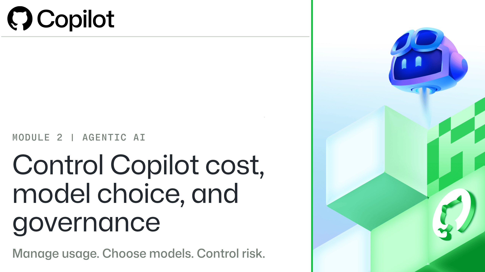

# Control Copilot costs, model choice, and governance

# Unit 1: Introduction

Teams spend time reading requests, preparing reports, and checking documents against approved information. Copilot can help with these activities, but using it well is a business operating decision: the team must obtain a trustworthy deliverable, control spending, protect approved sources, and know who has authority to start, change, review, and accept the work.

Copilot costs depend on the model, the information it processes, and the work it performs. Your role is to choose settings that fit the task, monitor usage, and decide what source-linked evidence makes the result acceptable. Spending fewer credits is useful only when the work still meets the requirements and leaves the approved sources unchanged.

In this module, you’ll follow a fictional team updating a leadership report to match its approved figures. You’ll use that task to investigate usage, choose a model, set boundaries for agentic work, identify the people with decision authority, and check the result before accepting it. The examples connect cost, risk, evidence, and accountability.

## Learning objectives

By the end of this module, you'll be able to:

•  Explain what drives Copilot costs: tokens, context, model prices, GitHub AI Credits, and GitHub Actions minutes.

•  Read usage reports, find the cause of an increase, and set spending controls.

•  Choose a model and its settings for the task.

•  Limit what the agent can reach, and keep human review where it matters.

•  Check AI-generated work against the requirements, and know when to stop.

## Prerequisites

•  A GitHub account

•  A basic understanding of GitHub repositories, branches, commits, issues, and pull requests

•  Familiarity with GitHub Copilot and its basic capabilities
