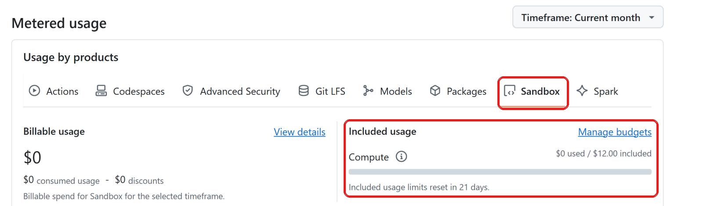

# Unit 2: Understand what drives Copilot costs

Before you start AI-assisted work, estimate its cost in AI credits and compute.

Every Copilot interaction sends information to an AI **model** and gets a response back. Models differ in capability, speed, and price.

> [!NOTE]
> GitHub calculates AI credits the same way across Copilot clients, including GitHub.com, the GitHub Copilot app, and VS Code. You pay the selected model's rates for the tokens Copilot processes. Available models, settings, and governance controls vary by client, and compute usage can add to the total cost.

## What a model reads: tokens and context

A **token** is a small piece of text that a model reads or writes. A token can be a whole word, part of a word, a symbol, or a space. Both your input and the model's output count in tokens.

- **Input tokens:** your message, attached files, conversation history, and tool results, at the model's base price.

- **Cached input tokens:** input the model already processed in an earlier request and can reuse. They usually cost about one-tenth of the input price.

- **Output tokens:** the text, code, and tests the model writes. They usually cost several times the input price.

Context adds input tokens beyond the message you type. It can include your instructions, attached files, pages or images, earlier messages, repository instructions, tool descriptions, and tool results.

For each new message in a conversation, Copilot sends the earlier messages again, so a long conversation sends more context with every request. The longer the chat, the more each new message costs, even a short one.

## How tokens become AI credits

On usage-based billing, Copilot measures AI usage in **GitHub AI Credits**. One AI credit currently equals $0.01 USD. GitHub counts tokens in each interaction and turns them into credits.

GitHub multiplies each count by the model's price for that kind of token and adds the results to get the cost in USD. Then it converts the cost to AI credits and deducts them from your allowance.

An AI credit measures cost, not a number of prompts. A small question can use part of one credit, and a long agent task can use dozens.

Here's a worked example with a model that costs $2.00 USD per million input tokens and $10.00 USD per million output tokens:

- A request to "summarize this short policy in two sentences" processes 1,000 input and 200 output tokens: $0.002 USD + $0.002 USD = $0.004 USD, or **0.4 credits**.

- A request to "review these service requests, find policy exceptions, draft follow-up actions, and check the results" processes 10,000 input and 2,000 output tokens: $0.02 USD + $0.02 USD = $0.04 USD, or **4 credits**.

The second request processes ten times as many tokens, so it costs ten times as much.

> [!NOTE]
> The prices in this module are for illustrative purposes. These examples exclude cached input pricing and cache-write fees. Actual costs can vary by model and caching behavior. Check [Models and pricing for GitHub Copilot](https://docs.github.com/en/copilot/reference/copilot-billing/models-and-pricing) for the latest pricing information.

## Understand Actions and cloud compute costs

These terms describe where Copilot work uses compute:

- **Runner:** A machine that runs GitHub Actions workflow jobs. A GitHub-hosted runner is a virtual machine that GitHub provides and bills by the minute. Larger runners have more CPU, memory, or disk space and cost more per minute. See [GitHub-hosted runners](https://docs.github.com/en/actions/concepts/runners/github-hosted-runners).
- **Cloud sandbox:** An isolated Linux environment that GitHub creates for a Copilot session. Copilot clones your repositories into it, then runs commands and tests and makes changes there instead of on your machine. 
- **Cloud session:** A Copilot session that runs in a cloud sandbox, for example a Copilot CLI session started with `copilot --cloud`. You can continue it from another client, and you don't need to stay connected while it works. See [About cloud sandboxes for GitHub Copilot](https://docs.github.com/copilot/concepts/about-github-sandbox).

The included Actions allowance is a shared amount in USD for standard GitHub-hosted runners and cloud sandboxes. On GitHub Team and GitHub Enterprise Cloud plans, this included compute amount also covers larger hosted runners. Each product has a published rate. Failed runs and reruns count toward usage. See [GitHub Actions runner pricing](https://docs.github.com/en/billing/reference/actions-runner-pricing) for current rates.

To check compute usage on a personal account, select your profile picture > **Settings** > **Billing and licensing** > **Overview**. Under **Metered usage**, select **Actions** or **Sandbox**. Both tabs show **Compute**, the amount in USD you've used out of your plan's included amount. 

## Copilot code review

Copilot code review reads the changes in a pull request and posts comments with suggested fixes. Each review uses AI credits. GitHub chooses the model for each review and doesn't disclose it, so the cost per review varies. Copilot code review also uses Actions compute.

Automatic review triggers can start additional paid reviews, so check both AI credits and compute usage before you turn them on.

## Options that change the cost of each request

While you work with Copilot, these settings change how much each request costs:

- **Model** (the model menu below the prompt): the price per token, and the quality and speed of the answer.

- **Auto** (**Efficiency**, **Balance**, or **Intelligence**, in the model menu): You pay the selected model's token rates, which may include a discount on paid plans, depending on the plan and Copilot surface. The tier can affect which model and price apply, but it doesn't cap the cost. Availability varies by client.

- **Copilot Fusion** (**Standard**, **High**, or **Max**, in the model menu): You pay each model's rate for every model Fusion uses. High and Max can add model calls and use more AI credits than Standard. Availability varies by client.

- **Reasoning effort** and **context window**: more effort, or a long-context tier, can use more tokens and cost more.

- **Attached context** (the **+** button and the repository selector): changes the amount of input sent.

- **Mode and tool permissions**: **Interactive** gives you checkpoints to stop unnecessary work; **Autopilot** can continue through multiple steps and use more AI credits and compute. **Always ask** requests your approval for tool use; **Assisted** approves requests a model judges safe; **Allow all** runs tools without asking. Fewer approval prompts mean fewer chances to stop unexpected work.

- **Review triggers and effort** (your Copilot settings, **Code review** page): how often and how deeply Copilot reviews pull requests.

If an option doesn't show up:

- **Update the app.** Check that you're using the latest version of the Copilot app or VS Code.

- **Check feature availability.** Auto tiers, Copilot Fusion effort levels, and model options can vary by plan, client, rollout, and organization policy.

- **A policy may hide it.** Organization and enterprise policies can hide models and preview features, and your administrator sets those policies.

## Included usage and additional usage

**Included usage** is the AI credit allowance that comes with your plan. **Additional usage** is any usage beyond that allowance. Additional usage creates charges only while the paid usage setting is on.

- **Individual plans** (Copilot Pro, Copilot Pro+, and Copilot Max) come with a monthly allowance. Paid usage beyond the allowance becomes available only after you set a budget for it.

- **Copilot Business and Copilot Enterprise**: each license adds a fixed number of credits to one shared pool every month, and everyone in the organization or enterprise uses credits from that pool. For example, 100 Copilot Business Licenses at 1,900 credits each share a pool of 190,000 credits. An authorized administrator can disable **AI credit paid usage** to prevent charges beyond the included credits.

On individual plans, part of the allowance is a flexible amount that GitHub can change over time. Copilot Free uses Auto or Copilot Fusion Standard, depending on the client.

Unused credits don't carry over. Allowances reset on the first day of each calendar month at 00:00 UTC.

When you run out of credits:

- **On an individual plan**, you can upgrade and pay only the price difference, set a budget to pay for more usage, or wait for the monthly reset.

- **On Copilot Business or Copilot Enterprise**, a banner on GitHub.com lets you request more budget from your administrator.

> [!NOTE]
> You might see the term "premium requests." Before June 1, 2026, Copilot billed **premium requests**, which GitHub also called **premium request units (PRUs)**. Each interaction counted as one or more requests, depending on a model multiplier. Usage-based billing with AI credits replaced that approach.

You can still see the old terms in older screens and on annual Copilot Pro and Copilot Pro+ plans that still use the old billing system. Model multipliers don't apply to AI credits.
