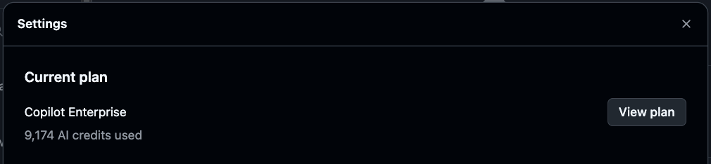
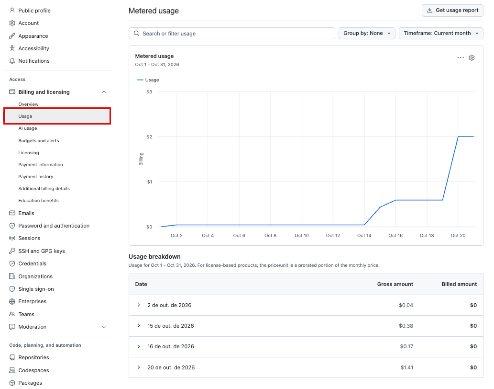
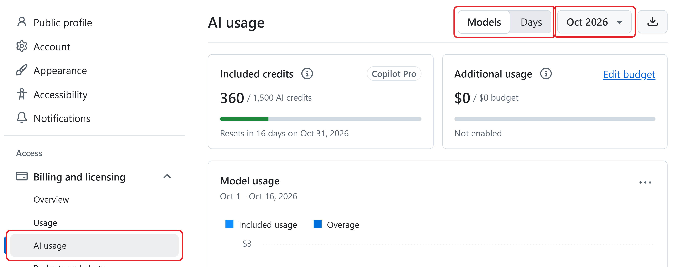
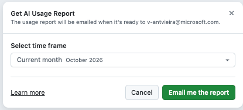
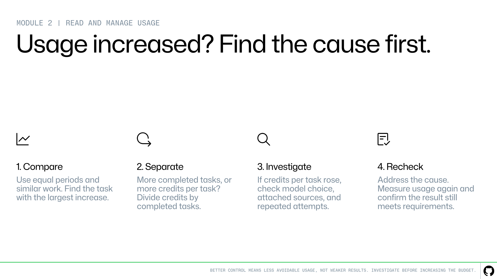
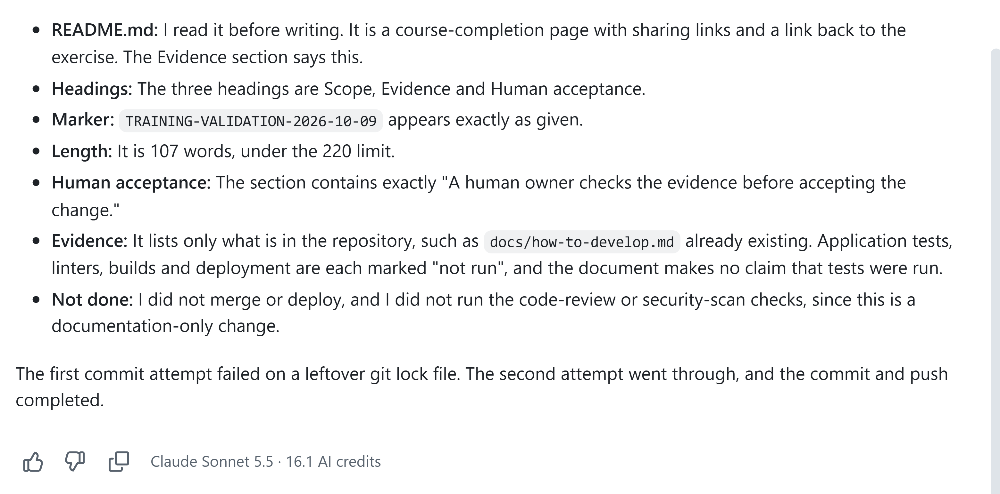
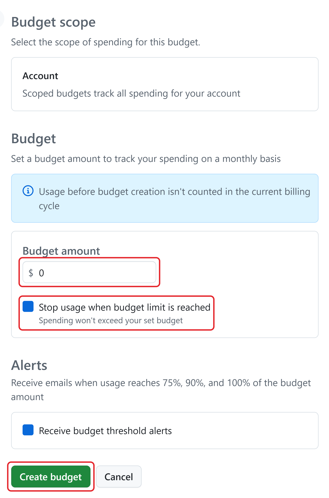

# Unit 3: Read and manage usage

When Copilot usage rises, compare the report with completed work before changing the budget or model. This unit shows where to read usage, trace an increase, and choose spending controls.

## Who decides what

Live actions in this module need specific people:

•  The **task owner** decides what the task needs and accepts the result. For a report update, this could be the report owner.

•  The **session operator** starts and directs the agent's work.

•  The **billing administrator** changes spending controls.

•  The **repository administrator** changes repository settings.

•  **Eligible reviewers** approve changes.

## Check your usage while you work

To check your usage while you work, go to **github.com/copilot**. In the lower-left corner, select **Settings**. Under **Current plan**, click on **View plan**, review the AI credits used for the current cycle.

For example, the Current plan section can show how many AI credits you have used and, when available for your plan, the amount used out of your allowance or budget. Use this quick view to monitor usage before starting another long or agentic task.

The information shown can differ by plan and billing arrangement. For more detailed usage by model or day, open the full AI usage report described next.

## Open the full AI usage report

The full report shows usage by model or by day. Where you open it depends on your plan and role. For all routes, sign in to **GitHub.com** first.

**Individual plan (Copilot Pro or Copilot Pro+):**

1. In the upper-right corner of any page, select your profile picture, and then select **Settings**.

1. In the left sidebar, under **Code, planning, and automation**, select **Copilot**, and then select **Features**.

1. In the **Usage** section, review **Included usage** and **Additional usage**, and then select **View details**.

The **AI usage** report opens. You can also open it from the left sidebar: under **Access**, expand **Billing and licensing**, and then select **AI usage**.

- **Other plans and roles:**

- **Copilot Business or Copilot Enterprise member:** select your profile picture > **Copilot settings**. Under **Usage**, review **Usage this cycle**. **Usage billed to** names the account that pays.

- **Organization owner with billing access:** open the organization > **Settings**. Under **Access**, open **Billing & Licensing**, and then select **AI usage**.

- **Enterprise owner or billing manager:** open the enterprise > **Billing & Licensing** > **AI usage**.

Account-wide reports need a billing role; anyone can see their own usage. If you can't open an account-wide report, use a shared copy or the fictional data in this unit.

## Read the AI usage report

The top of the report has two cards and two controls:

### Compare Usage and AI usage

Use **Usage** for the broader billing picture across GitHub products. It shows metered usage in currency, including gross and billed amounts.

Use **AI usage** for Copilot-specific detail, including included and additional credits, model usage, and daily trends. Use the two reports together when you need to connect Copilot activity with billed usage.

•  **Included credits** shows how many credits you used out of your allowance and when it resets.

•  **Additional usage** shows charges beyond the allowance and your budget for them.

•  **Models** and **Days** switch the chart between usage per model and usage per day. Select **Days** to see the usage trend across the period and spot the days when usage jumped.

•  The period selector (it shows the current month, such as **Oct 2026**) offers **Current month**, **Last month**, **This year**, and **Last year**.

### Request an emailed usage report

On the **AI usage** page, select the **Download** button to open the **Get AI Usage Report** dialog. Choose the period under **Select time frame**, and then select **Email me the report**. GitHub emails the report to the address shown in the dialog when it's ready. The following example requests a report for the current month.

### Use the report to investigate and explain spending

Open the report in a spreadsheet, such as Excel, to compare equal-length periods and spot usage increases. You can also use it in a presentation to team leads, alongside completed-work records and measured time spent doing similar work without AI. The usage report alone doesn't show time saved or what the work would have cost without AI.

Use only an organization-approved tool and data you're allowed to share. Try these prompts with an approved copy of the report:

•  **Find issues:** "Compare these two weeks. Using the available fields, show total credits and the largest increases by day or model. Separate facts from possible causes and list what to investigate next."

•  **Compare average usage:** "Using this report and our completed-task counts for the same work and dates, identify missing counts and prepare the data needed to compare the weeks. Don't count report rows as tasks."

•  **Prepare a team-lead summary:** "Draft one slide comparing these periods. Use our recorded manual-work hours and agreed hourly cost to estimate the cost of the same work without AI. Compare it with AI usage charges plus human review and rework costs. Label assumptions, distinguish time freed from cash savings, and don't invent missing figures."

Check the calculations against the original records before presenting them.

## Find the source of an increase

Compare two periods of the same length and similar work, and remember that the allowance resets each month. This fictional table groups usage by task. The real AI usage report groups usage by model or by day:

| **Task** | **Prior week: AI credits** | **Current week: AI credits** |
| --- | --- | --- |
| Issue summaries | 80 | 90 |
| Draft comparisons | 120 | 130 |
| Report updates | 100 | 580 |
| Total | 300 | 800 |

In this example, report updates explain 480 of the 500-credit increase, so investigate that work first. The table shows where usage grew, but not why. Check four possible causes: more tasks, a change to a more expensive model, more context per request, or failed attempts that had to run again.

### When usage increases

When usage rises, compare the work before changing a setting. Check whether requests included more context, required more attempts, used a different model, or ran autonomously for longer. Then adjust the cause: narrow unnecessary context, improve the prompt or checks to reduce retries, choose a model that fits the task, or shorten and monitor autonomous work. Confirm that the adjusted workflow still meets the same requirements.

The task owner knows how many tasks finished each week. Divide the credits by that number. If each completed task costs about the same as before, the team did more work.

If each task costs more, look at the model, the context, and the retries.

For Copilot work, the agent's session, one continuous stretch of work on a task, shows the model and the credits of each step:

1. On GitHub.com, open the repository, select **Pull requests**, and then open the agent's pull request.

1. In the **Conversation** timeline, find the entry "Copilot created this pull request from a session" and select **View session**.

You can also open the session from github.com/copilot under **Recent agent sessions**.

1. Under each Copilot response, read the model name and the credits it used, for example **Claude Sonnet 5.5 · 16.1 AI credits**.

If you can't open a session, use the fictional report. You don't need to start a new agent task.

## Recognize workflows that can cost more

Watch for these signals, and ask the matching question:

•  **A powerful model or high reasoning effort:** does the task need that capability?

•  **A large Code Review model line:** do automatic reviews run more often than the team needs?

•  **Fixes started from security alerts:** **Assign to Copilot** on a code scanning alert, a security problem GitHub found in the code, starts a fix with no confirmation, and each fix uses AI credits. Did the team agree who starts them?

Compare the cost of completed work with its quality and value.

## Choose when and how deeply Copilot reviews

1. To check or change your personal review settings:

1. On GitHub.com, select your profile picture > **Settings**.

1. In the left sidebar, under **Code, planning, and automation**, select **Copilot**, and then select **Code review**.

1. Under **Review automations**, set the three triggers:

  - **Automatic Copilot code review** requests a review on every pull request you open.

  - **Review new** **pushes** reviews again after each new push to a pull request that Copilot already reviews.

  - **Review draft pull requests** reviews pull requests that are still drafts.

1. Under **Review effort**, open **Review effort level** and choose the default depth.

The effort levels are **Lite** ("Efficient review, low cost") for routine, well-scoped changes and **Balanced** ("Deep analysis, moderate cost") for changes that touch security or many files. Balanced can also use more Actions minutes. **Max** ("Most thorough, high cost") For more important and risk tasks.

During frequent draft revisions, leave Review draft pull requests off and request a review when the draft is ready. Review effort is a separate setting from the model's reasoning effort and from the Auto tier.

A repository administrator can set a **ruleset**: a rule that requires reviews or checks before changes join the project. Your personal settings can't turn off those reviews. Both review levels still need a human to assess the result.

## Choose a spending control

The billing administrator sets these controls. Bring them four answers: who pays, which usage to limit, the amount, and what must happen when usage reaches the limit. A **cost center** groups users or resources for billing.

A cost center budget is separate from a person's budget.

**Keep the controls separate:** checking usage shows what has already been consumed; an alert notifies people when a threshold is reached; an enforced spending limit stops the covered paid usage at the limit. A budget does not always stop work—some budgets only alert unless stop-at-limit enforcement is enabled, and the effect depends on the budget scope.

Pick the control by what you need to limit:

- **One person's billed usage:** a **user-level budget**. It always stops usage at the limit and adds no credits. It can stop the person even while pooled credits remain.

- **Paid usage beyond included credits:** an **organization or cost center budget**, or an **enterprise spending limit**. Alerts don't stop usage; the administrator decides whether each budget stops usage when its limit is reached.

- **Any charge beyond included credits:** turn off the **AI credits paid usage** policy. It's on by default for organizations and enterprises, and turning it off doesn't share the pool fairly among people.

- **Expensive models:** **model policies**. Disabled models aren't available to users or to Auto. Policies don't cover code review and don't cap spending.

For example, a fictional $5 user budget, set before usage begins, allows 500 credits billed to that person. Usage stops at the limit. Copilot doesn't switch to a cheaper model.

Reviews that the organization pays for need an organization, cost center, or enterprise control instead.

A new budget only counts usage after you create it. It can't cap usage that already happened earlier in the month.

## Set up a budget for your account

Choose the route for the account that pays for your usage. If your organization or enterprise pays, ask its owner or billing manager to set the budget; a budget in your personal account won't control that spending.

- **Personal:** select your profile picture > **Settings** > under **Access**, expand **Billing and licensing** > **Budgets and alerts**.

- **Organization:** open the organization > **Settings** > under **Access**, select **Billing & Licensing** > **Budgets and alerts**.

- **Enterprise:** open the enterprise > select the **Billing & Licensing** tab > **Budgets and alerts**.

The available scopes differ: a personal budget covers your account, organization budgets stay within that organization, and enterprise AI credit budgets can cover the enterprise, an organization, a cost center, or users.

From **Budgets and alerts**:

**Shortcut:** on the AI usage report or in your Copilot settings, select **Edit budget** next to **Additional usage**.

1. Select **New budget**.

1. Under **Budget type**, select **AI credits budget** (called **Bundled AI credits budget** in some account views). Select **Next: Configure budget** if shown.

1. Under **Budget scope**, choose what the budget covers. For a personal budget, confirm **Account**, as shown in the following image.

1. Under **Budget**, enter the **Budget amount** in US dollars.

1. Select **Stop usage when budget limit is reached** if usage must stop at the limit. User-level budgets always enforce a stop.

1. Under **Alerts**, select **Receive budget threshold alerts** and configure recipients if available.

1. Select **Create budget**. For practice only, select **Cancel** instead.

After you save, the budget appears in the **Budgets and alerts** list with its spend and status. With threshold alerts enabled, GitHub sends emails and shows a banner on GitHub.com when spending reaches 75%, 90%, and 100% of the budget. User-level budget alerts aren't consistently available, so also monitor enterprise or cost center usage.

## Set limits on autonomous runs

An autonomous run can make many credit-consuming model calls, so agree on when it must stop before it starts. A Copilot session stops after 59 minutes at most, and a repository administrator can set a shorter limit.

A time limit doesn't cap credits and doesn't undo **commits**, the saved sets of changes, that the agent already pushed. A user-level budget caps everything billed to one person, not each run.

For example, a team updating a report could agree on **two monitored attempts** and name who can stop the run. An attempt is one full try at the task.

This is a team agreement: write the limit and the name of the person who stops the run in the task's issue, the to-do item on GitHub that describes the task, and add "Stop after two unsuccessful attempts" to the prompt. GitHub doesn't count attempts for you, so the session operator counts the sessions on the Agents page (github.com/copilot/agents).

## Habits that keep usage down

Most savings come from a few habits. Each one cuts tokens without lowering the quality of the result.

### Reduce retries with clear prompts

A good prompt has four parts:

- **A goal**: a short, direct description of what you want.

- **Relevant context**: the files, errors, or inputs that matter, if you know them.

- **Examples**: sample inputs or outputs that show the result you expect.

- **A stopping condition**: your definition of done. Agree on the attempt limit before starting.

These fictional pairs show the difference. Nobody measured their usage outcomes. A **path** is a file's location in the repository, such as its folder and file name.

- **Vague prompt:** "Fix the summary and improve anything else you find."  
**Focused prompt:** "Update report/q3-summary.md so every figure matches data/approved-figures.csv. Change only that file. For each changed figure, name the row it comes from in the pull request description. Stop at the agreed attempt limit."

- **Vague feedback:** "The result needs another update. Try again."  
**Specific feedback:** "The summary still says North had the highest operating margin. The figures show East at 17.3% and North at 16.8%. Correct that sentence, keep the other changes, and list what you changed."

A vague prompt makes the agent search the whole repository, and every file it reads adds input tokens.

"In report/q3-summary.md, the West sentence says revenue grew. Check it against the West row in data/13-figures.csv and propose a fix." costs less than asking Copilot to check every report in the repository.

A useful prompt can be longer than a vague one. Scope, evidence, and a stopping condition reduce unnecessary exploration and corrections.

Compare total usage against result quality.

### Start a new chat at the right time

Stay in the same chat while you make small corrections to the same task, because the earlier messages are useful context there. Start a new chat when you switch to unrelated work, when you finish a phase such as planning, or when answers get slower or miss earlier details.

Carry forward only the checked decisions, relevant sources, limits, and open questions. Compare total credits and correction attempts to confirm that starting fresh helps without losing necessary context.

***After a long break, consider starting a new chat if you’re beginning a new phase or no longer need the earlier context. Longer threads can process more context and use more AI credits.***

### Add automatic checks the agent can run

Agents can give different answers to the same request, and in a long task one wrong step leads to the next. Automatic checks tell the agent right away whether a change works, so it corrects itself early instead of building on a mistake. Tests check that the change behaves as expected, and security checks catch risky code and leaked passwords.

•  **Team agreement:** add "Run the tests before you finish" to the prompt.

•  **GitHub setting:** Copilot's validation tools stay on: CodeQL code scanning, Copilot code review, secret scanning, and dependency vulnerability checks. The setting needs the administrator role.

### Make a personal improvement plan

Use what you learned to improve one habit at a time. Write down your answers:

•  **Tasks:** What do you use Copilot for most?

•  **Workflow:** Do you chat with Copilot step by step, or run longer agent tasks and automations?

•  **Frequency:** Which tasks do you do most often? The biggest savings usually come from them.

Pick one task and one to three habits from this unit to try for a week. Write down what success looks like, for example "fewer follow-up prompts to correct the code." After the week, check the AI usage report and the quality of the results. Compare cost and result quality.

