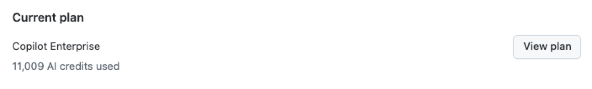
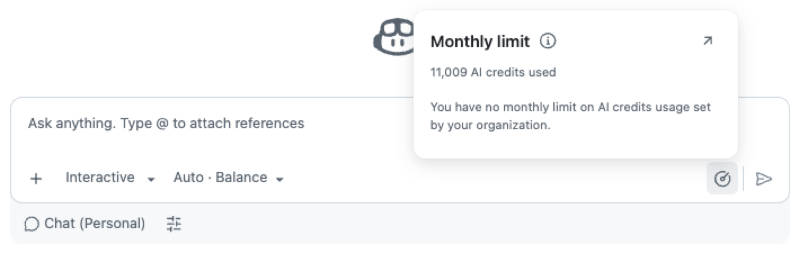
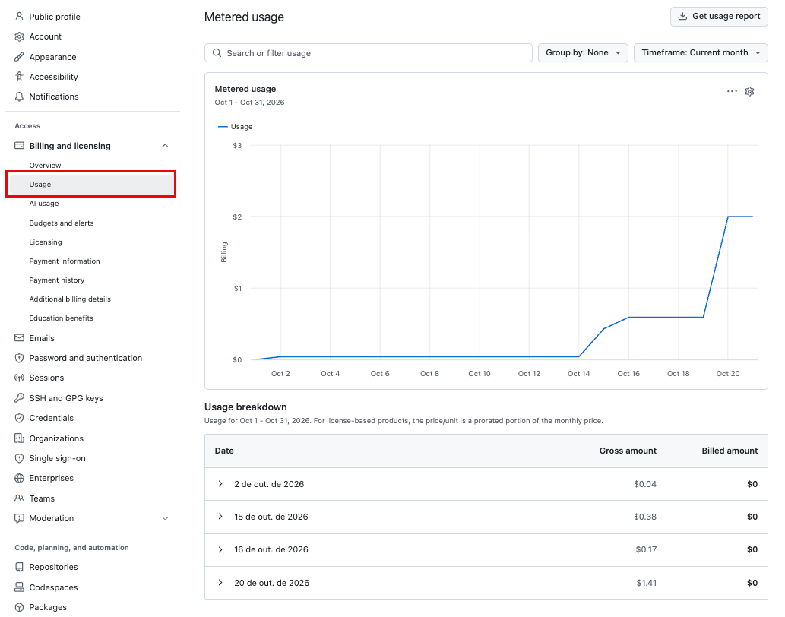
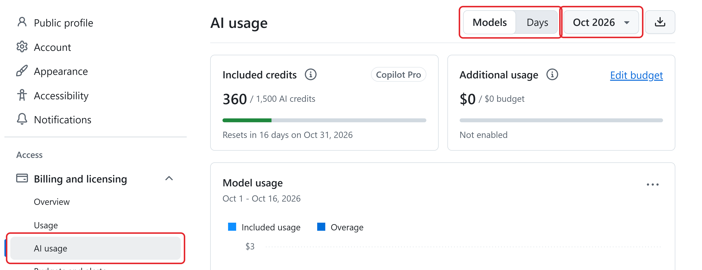
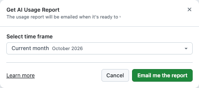
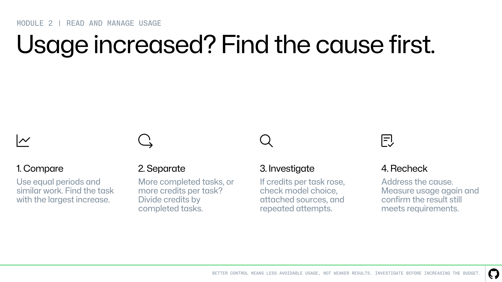
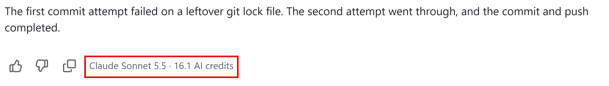
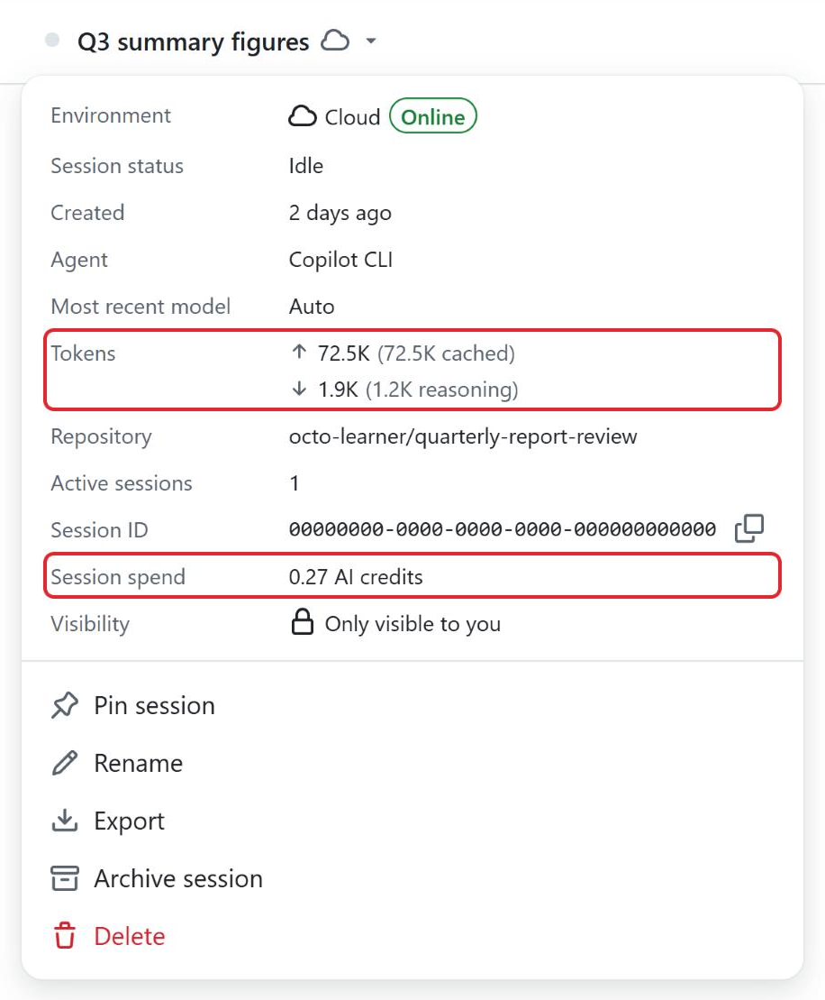
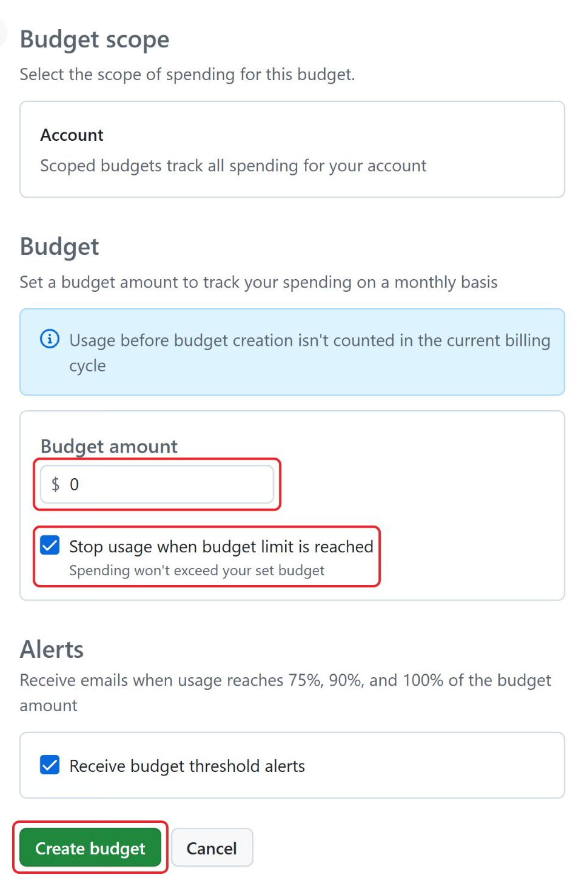
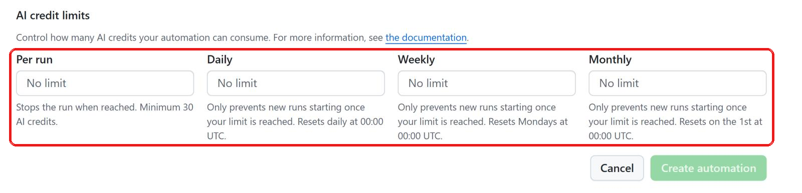

# Unit 3: Read and manage usage

When Copilot usage rises, compare the report with completed work before changing the budget or model. This unit shows where to read usage, trace an increase, and choose spending controls.

## Who decides what

In this module, specific people take the live actions:

- The **task owner** decides what the task needs and accepts the result. For a report update, this could be the report owner.

- The **session operator** starts and directs the agent's work.

- The **billing manager** changes spending controls.

- The **repository administrator** changes repository settings.

- **Eligible reviewers** approve changes.

## Check your usage while you work

To check your usage while you work, open [Copilot settings](https://github.com/settings/copilot) on GitHub.com. Under **Usage**, check your AI credit consumption for the current billing period.

You can also check your usage on the [Copilot home page](https://github.com/copilot):

- Select **Settings**. Under **Current plan**, select **View plan** to review the AI credits you used for the current cycle with extra details.

    

- As a visual shortcut, a gauge icon next to the prompt box opens the **Monthly limit** panel, which shows how many AI credits you used this month.

    

For example, the Current plan section can show how many AI credits you have used and, when available for your plan, how much of your allowance or budget you've used. Use this quick view to monitor usage before starting another long or agentic task.

What the **Current plan** section shows differs by plan and billing arrangement. For more detailed usage by model or day, open the full AI usage report in the next section.

## Open the full AI usage report

The full report shows usage by model or by day. Where you open it depends on your plan and role. For all routes, sign in to **GitHub.com** first.

**Individual plan (Copilot Free, Copilot Pro, Copilot Pro+, or Copilot Max):**

1. Open [your billing overview](https://github.com/settings/billing).

2. Under **Access**, expand **Billing and licensing**, and then select **AI usage**.

**Other plans and roles:**

- **Copilot Business or Copilot Enterprise member:** open Copilot settings. Under **Usage**, review **Usage this cycle**. **Usage billed to** names the account that pays.

- **Organization owner with billing access:** open the organization > **Settings**. Under **Access**, open **Billing and licensing**, and then select **AI usage**.

- **Enterprise owner or billing manager:** open the enterprise > **Billing and licensing** > **AI usage**.

Anyone can see their own usage, but account-wide reports need a billing role. If you can't open an account-wide report, use a shared copy or the fictional data in this unit.

## Read the AI usage report

The top of the report has two cards and two controls, which the following sections describe.

### Compare Usage and AI usage

Use **Usage** for the broader billing picture across GitHub products. It shows metered usage in currency, including gross and billed amounts.

Use **AI usage** for Copilot-specific detail, including included and additional credits, model usage, and daily trends. Use the two reports together when you need to connect Copilot activity with billed usage.

- **Included credits** shows how many credits you used out of your allowance and when it resets.

- **Additional usage** shows charges beyond the allowance and your budget for them.

- **Models** and **Days** switch the chart between usage per model and usage per day. Select **Days** to see the usage trend across the period and spot the days when usage jumped.

- The period selector shows the current month, such as **Oct 2026**, and offers **Current month**, **Last month**, **This year**, and **Last year**.

### Request an emailed usage report

On the **AI usage** page, select **Get usage report** to open the **Get AI Usage Report** dialog. Choose the period under **Select time frame**, and then select **Email me the report**. GitHub emails the report to the address the dialog shows when the report is ready. The following example requests a report for the current month.

### Use the report to investigate and explain spending

Open the report in a spreadsheet, such as Excel, to compare equal-length periods and spot usage increases. You can also use it in a presentation to team leads, alongside completed-work records and measured time spent doing similar work without AI. The usage report alone doesn't show time saved or what the work would have cost without AI.

Use only an organization-approved tool and data your organization permits you to share. Try these prompts with an approved copy of the report:

- **Find increases:** "Compare these two weeks. Using the available fields, show total credits and the largest increases by day or model. Separate facts from possible causes and list what to investigate next."

- **Compare average usage:** "Using this report and our completed-task counts for the same work and dates, identify missing counts and prepare the data needed to compare the weeks. Don't count report rows as tasks."

- **Prepare a team-lead summary:** "Draft one slide comparing these periods. Use our recorded manual-work hours and agreed hourly cost to estimate the cost of the same work without AI. Compare it with AI usage charges plus human review and rework costs. Label assumptions, distinguish time freed from cash savings, and don't invent missing figures."

Check the calculations against the original records before presenting them.

## Find the source of an increase

Compare two periods of the same length that involve similar work, and remember that the allowance resets each month. This example table groups usage by task. The real AI usage report groups usage by model or by day:

| **Task** | **Prior week: AI credits** | **Current week: AI credits** |
| --- | --- | --- |
| Issue summaries | 80 | 90 |
| Draft comparisons | 120 | 130 |
| Report updates | 100 | 580 |
| Total | 300 | 800 |

In this example, report updates explain 480 of the 500-credit increase, so investigate that work first. The table shows where usage grew, but not why. Check four possible causes: more tasks, a change to a more expensive model, more context per request, or retries after failed attempts.

### When usage increases

When usage rises, compare the work before changing a setting. Check whether requests included more context, required more attempts, used a different model, or ran autonomously for longer. Then adjust the cause: narrow unnecessary context, improve the prompt or checks to reduce retries, choose a model that fits the task, or shorten and monitor autonomous work. Confirm that the adjusted workflow still meets the same requirements.

The task owner knows how many tasks finished each week. Divide each week's credits by that number. If each completed task costs about the same as before, the team did more work.

If each task costs more, look at the model, the context, and the retries.

The agent's session shows the model and the AI credits for each response:

1. On GitHub.com, open the repository, select **Pull requests**, and then open the agent's pull request.

2. In the **Conversation** timeline, find the entry **Copilot started work on behalf of** your username, and select **View session**.

    - You can also open the session under **Sessions** in the Copilot sidebar or from the repository's **Agents** tab.

3. For a response, check **View message info** to see the model and AI credits. To display the tooltip with a mouse, point to the response and then to the icon. If you can't access the tooltip, you can still review session totals in the next step, but they don't identify individual responses.

    

4. Select the session title to open its details. **Session spend** shows the total AI credits, and **Tokens** shows the input and output tokens. Use these totals alongside response details, when available, to distinguish one costly response from a long session.

    

If you can't open a session, use the example report. You don't need to start a new agent task.

## Recognize workflows that can cost more

Watch for these signals, and ask the matching question:

- **A powerful model or high reasoning effort:** Does the task need that capability?

- **A large Code Review model line:** Do automatic reviews run more often than the team needs?

- **Automations without a limit:** Each trigger can start another session. Does the automation have appropriate AI credit limits?

Compare the cost of completed work with its quality and value.

## Choose a spending control

The **billing manager** sets these controls. Give the billing manager four answers: who pays, which usage to limit, the amount, and what must happen when usage reaches the limit. A **cost center** groups users or resources for billing.

A cost center budget is separate from a person's budget.

Each control does something different. Checking usage shows what Copilot work has already used. An alert tells people when usage reaches a set level. An enforced spending limit stops the paid usage it covers at the limit. A budget doesn't always stop work. Some budgets only send alerts unless you configure them to stop usage at the limit, and the effect depends on what the budget covers.

Pick the control by what you need to limit:

- **One person's billed usage:** a **user-level budget**. It always stops usage at the limit and adds no credits. It can stop the person even while pooled credits remain.

- **Paid usage beyond included credits:** an **organization or cost center budget**, or an **enterprise spending limit**. Alerts don't stop usage; the administrator decides whether each budget stops usage when usage reaches its limit.

- **Any charge beyond included credits:** disable the **AI credits paid usage** policy. GitHub enables it by default for organizations and enterprises, and disabling it doesn't share the pool fairly among people.

- **Expensive models:** **model policies**. When an enterprise or organization Disabled models aren't available to users, to Auto, or to Copilot Fusion. Enterprise administrators can also disable a model for Copilot Fusion only. Model policies don't cover code review and don't cap spending.

For example, the billing manager can set a $5 USD user budget before usage begins. GitHub calculates the equivalent AI credit limit using its [current conversion rate](https://docs.github.com/en/copilot/concepts/billing-and-usage/organizations-and-enterprises/billing#how-can-i-control-costs-with-budgets). Usage stops at the limit. Copilot doesn't switch to a cheaper model.

Reviews that the organization pays for need an organization, cost center, or enterprise control instead.

A new budget counts only the usage that occurs after you create it. It can't cap usage from earlier in the month.

## Set up a budget for your account

Choose the route for the account that pays for your usage. If your organization or enterprise pays, ask its owner or billing manager to set the budget; a budget in your personal account won't control that spending.

- **Personal:** select your profile picture > **Settings** > under **Access**, expand **Billing and licensing** > **Budgets and alerts**.

- **Organization:** open the organization > **Settings** > under **Access**, select **Billing and licensing** > **Budgets and alerts**.

- **Enterprise:** open the enterprise > select the **Billing and licensing** tab > **Budgets and alerts**.

The available scopes differ: a personal budget covers your account, organization budgets stay within that organization, and enterprise AI credit budgets can cover the enterprise, an organization, a cost center, or users.

**Shortcut:** on the AI usage report or in your Copilot settings, select **Edit budget** next to **Additional usage**.

From **Budgets and alerts**:

1. Select **New budget**.

2. Under **Budget type**, select **AI credits budget** (called **Bundled AI credits budget** in some account views). If **Next: Configure budget** appears, select it.

3. Under **Budget scope**, choose what the budget covers. For a personal budget, confirm **Account**, as the following image shows.

4. Under **Budget**, enter the **Budget amount** in USD.

5. Select **Stop usage when budget limit is reached** if usage must stop at the limit.

6. Under **Alerts**, select **Receive budget threshold alerts**, and then choose who receives them, if that option is available.

7. Select **Create budget**. For practice only, select **Cancel** instead.

After you save, the budget appears in the **Budgets and alerts** list with its spend and status. With threshold alerts enabled, GitHub sends emails and shows a banner on GitHub.com when spending reaches 75%, 90%, and 100% of the budget.

## Set limits on autonomous runs

Set a stopping condition before an autonomous run: each run can make multiple credit-consuming model calls, and a time limit doesn't cap credits. GitHub Actions sessions have a maximum runtime; cloud sandbox sessions follow a different lifecycle.

A **Copilot automation** starts a session on a schedule or repository event. You can set AI credit limits per run, day, week, or month. Automations can use MCP tools and, when permitted, merge pull requests or mark them ready for review. Shared automations are visible to anyone with read access; GitHub bills the repository owner and shows Copilot as the author.

Time limits don't undo commits or cap a person's total usage; a user-level budget applies across all usage billed to that person.

For example, a team might allow two attempts and name who can stop the run. Record the limit and contact in the task issue, and add "Stop after two unsuccessful attempts" to the prompt. GitHub doesn't count attempts; the session operator tracks sessions in the repository's **Agents** tab.

### Configure automation credit limits

You need write access to a private or internal repository where you can use Copilot cloud agent and automations.

1. In the repository, select **Agents**, and then select **Automations** in the sidebar.

2. Edit an approved automation. For a new approved task, select **Create automation** > **Create manually**.

3. Under **AI credit limits**, enter limits in **Per run**, **Daily**, **Weekly**, or **Monthly**. A blank field means no limit.

4. Review the configuration before saving it. If you're only practicing, select **Cancel**.

**Per run** stops an active run at its limit (minimum: 30 AI credits). **Daily**, **Weekly**, and **Monthly** block new runs at their limits but don't stop an active run.

Limits reset at 00:00 UTC: daily, every Monday, or on the first day of the month. Combine a per-run limit with a period limit when you need both controls.

## Habits that keep usage down

Most savings come from a few habits. Each one cuts tokens without lowering the quality of the result.

### Reduce retries with clear prompts

A good prompt has four parts:

- **A goal**: a short, direct description of what you want.

- **Relevant context**: the files, errors, or inputs that matter, if you know them.

- **Examples**: sample inputs or outputs that show the result you expect.

- **A stopping condition**: your definition of done. Agree on the attempt limit before starting.

These pairs show the difference. Nobody measured how much each prompt uses. A **path** is a file's location in the repository, such as its folder and file name.

- **Vague prompt:** "Fix the summary and improve anything else you find."  
  **Focused prompt:** "Update report/q3-summary.md so every figure matches data/q3-figures.csv. Change only that file. For each changed figure, name the row it comes from in the pull request description. Stop at the agreed attempt limit."

- **Vague feedback:** "The result needs another update. Try again."  
  **Specific feedback:** "The summary still says North had the highest operating margin. The figures show East at 17.3% and North at 16.8%. Correct that sentence, keep the other changes, and list what you changed."

A vague prompt can lead the agent to search more files, adding input tokens.

The prompt "In report/q3-summary.md, the West sentence says revenue grew. Check it against the West row in data/q3-figures.csv and propose a fix" can use fewer tokens than asking Copilot to check every report in the repository.

A useful prompt can be longer than a vague one. Scope, evidence, and a stopping condition reduce unnecessary exploration and corrections.

### Start a new chat at the right time

Stay in the same chat while you make small corrections to the same task, because the earlier messages are useful context there. Start a new chat when you switch to unrelated work, when you finish a phase such as planning, or when answers get slower or miss earlier details.

Carry forward only the checked decisions, relevant sources, limits, and open questions. Compare total credits and correction attempts to confirm that starting fresh helps without losing necessary context.

### Make a personal improvement plan

Use what you learned to improve one habit at a time. Write down your answers:

- **Tasks:** What do you use Copilot for most?

- **Workflow:** Do you chat with Copilot step by step, or run longer agent tasks and automations?

- **Frequency:** Which tasks do you do most often? The biggest savings usually come from them.

Pick one task and one to three habits from this unit to try for a week. Write down what success looks like, for example, "fewer follow-up prompts to correct the code." After the week, check the AI usage report and the quality of the results. Compare cost and result quality.
