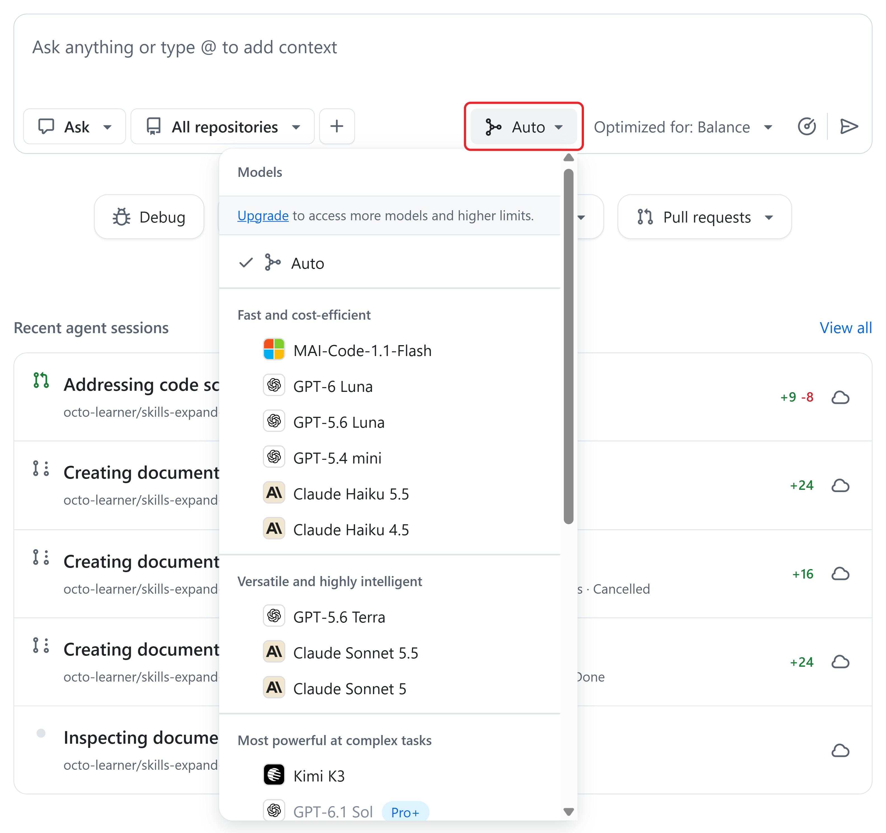
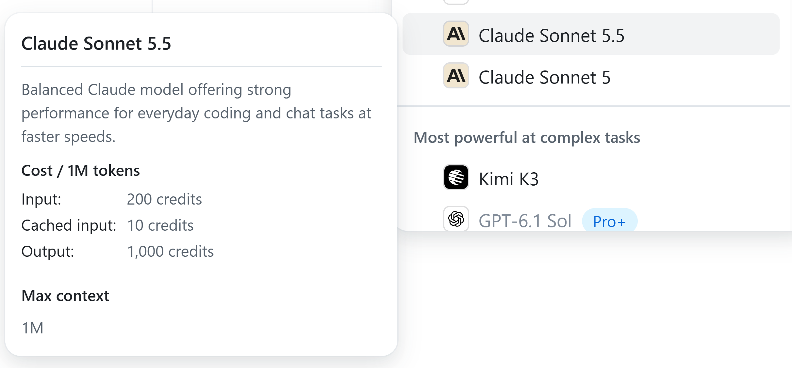
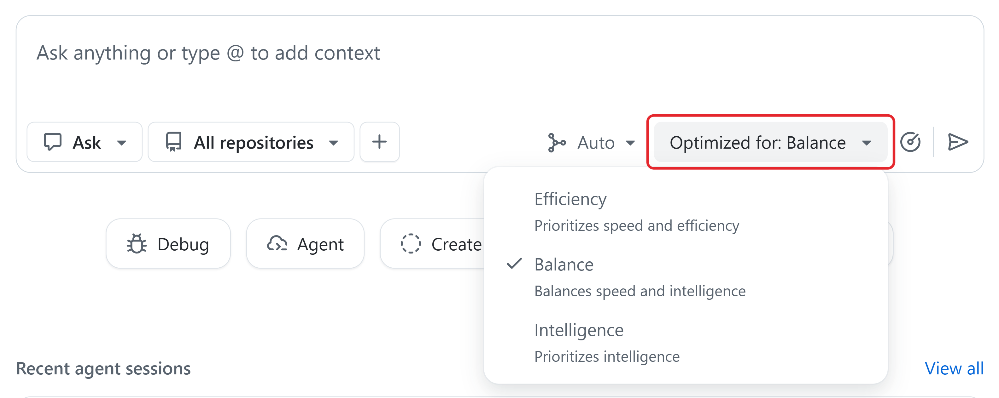

# Unit 4: Choose a model for the task

Compare models by the cost of producing a result that meets the same requirements, not by price alone. A cheaper response may need more corrections; a more expensive model may add cost without improving the result.

For example, ask the model to correct a summary using only the approved figures. Track credits and attempts, and check every changed figure before accepting the result. A model change doesn't authorize broader access, changes to the source figures, or spending beyond the agreed limits.

## Questions to ask before you start a task

Before you choose or change a model, check the factors that affect usage, cost, and risk. These example answers show how to scope a task.

- **What does "done" look like?** A clear stopping point keeps the agent on task. Example: every figure in a report matches the approved source, and every statement about growth or **margin** (the share of revenue left after costs) is right in direction and size.

- **How will I check the result?** If you can't check it, you can't accept it. Example: compare each changed figure with its row in the figures file, and read the whole report again, including lines the agent didn't change.

- **Is it one task or several?** Mixed work carries old context into every request. Example: one task, match the report to the figures. Removing the client's name is a separate task with its own issue.

- **What can the agent access?** Identify the files and tools the task needs. Example: only this repository and an organization-approved tool.

- **Who pays?** Know which account the usage lands on. Example: the team's organization budget, owned by the billing administrator.

- **Who accepts the result?** Identify who reviews the work and who decides whether it meets the business requirements.

## Know the three groups of models

The model menu in Copilot in GitHub sorts models into three groups. The names come from the menu itself:

- **Fast and cost-efficient** (lightweight models): optimized for speed and lower cost.

- **Versatile and highly intelligent** (mid-tier models): balance speed with capability.

- **Most powerful at complex tasks** (reasoning models): designed for work that needs greater reasoning capability.

## Compare prices for the same work

Model names and prices change often, so this module uses four example models, one or two from each group, as a reference for cost and use. Your model menu may show different models. Check supported Copilot models, then compare them the same way.

The table shows what one job costs on each example model: **100,000 input tokens and 10,000 output tokens**, with no cached input. That's roughly a long chat with a few attached files.

| **Example model** | **Group** | **Price per 1M tokens (input / output)** | **Cost of the same job** | **AI credits** |
| --- | --- | --- | --- | --- |
| GPT-6 Luna | Fast and cost-efficient | $0.10 / $0.50 | $0.015 | 1.5 |
| Claude Sonnet 5.5 | Versatile and highly intelligent | $2.00 / $10.00 | $0.30 | 30 |
| GPT-6.1 Sol (Pro+) | Most powerful at complex tasks | $2.00 / $10.00 | $0.30 | 30 |
| GPT-6 Astra (Pro+) | Most powerful at complex tasks | $10.00 / $50.00 | $1.50 | 150 |

What the examples show:

- **The same job costs 100 times more on GPT-6 Astra (150 credits) than on GPT-6 Luna (1.5 credits).** Save the most expensive models for work that clearly needs them.

- **"Most powerful" doesn't always mean "most expensive."** GPT-6.1 Sol costs the same as Claude Sonnet 5.5 for the same tokens.

- **Long context costs more.** Some models charge a higher rate when a request goes above an input threshold. For example, GPT-6 Astra doubles its input price above 272,000 input tokens.

## Check a model's price before you choose it

In Copilot in GitHub, hover over any model in the model menu. A card shows the model's description, its **Cost / 1M tokens** in AI credits (input, cached input, and output), and its **Max context**. 100 credits equal $1.

## Use Auto and its tiers

Auto chooses a model for each request based on what the request needs and on which models are available and healthy. It only picks models that your subscription includes and that your administrators allow. Auto is a good default when you're new or when your work varies. On paid subscriptions, Auto also gives a **10% discount** on the model cost in Copilot Chat, Copilot CLI, and the GitHub Copilot app.

Next to the model button, **Optimized for** sets Auto's tier:

- **Efficiency** ("Prioritizes speed and efficiency") fits short, routine requests where low cost matters most.

- **Balance** ("Balances speed and intelligence") fits everyday work and is a good starting point.

- **Intelligence** ("Prioritizes intelligence") fits multi-step work that needs greater reasoning.

Use Auto when:

•  Your work mixes short questions and multi-step tasks in the same day.

•  You aren't sure which model fits the task.

•  You want the 10% Auto discount on paid subscriptions.

Pick a model yourself when:

•  You compare models in a trial and need the same model for every request.

•  The task needs a feature that only some models have, such as image input.

•  A task still fails after you check its requirements, context, and permissions. Use "Check the task before you step up" before changing the model or effort.

•  Your team requires a specific model for the work.

All three tiers can use the same models. The tier only changes which ones Auto prefers. Even on Intelligence, Auto can send a short request to a small model.

To see which model Auto used, hover over the response in Copilot Chat or the GitHub Copilot app, or read the line at the end of a Copilot response.

### What affects the cost of an Auto request

With Auto, you don't pick the price. Auto picks the model, and the model sets the price. Four things decide what a request costs:

- **The model Auto picks.** You pay that model's token prices. A short question routed to a fast model costs a fraction of the same question routed to a powerful model.

- **The tier.** It changes which models Auto prefers, so it changes the price. It doesn't cap the cost.

- **The tokens.** Your message, attachments, the conversation history, and the answer all count, the same as with a model you pick yourself.

- **The Auto discount.** 10% off the model cost on paid subscriptions.

**Example:** you send the same job (100,000 input tokens and 10,000 output tokens) twice with Auto. For the first request, Auto picks GPT-6 Luna: 1.5 credits, minus 10%, is **1.35 credits**. For the second, a request that needs more reasoning, Auto picks Claude Sonnet 5.5: 30 credits, minus 10%, is **27 credits**. Same tokens, same setting, twenty times the cost, because Auto chose a different model.

Auto switches models only at natural break points in a conversation, or when the work changes a lot, so it doesn't throw away cached context on every message.

## Understand HydraFusion

**HydraFusion** is a research preview that goes one step further than Auto. Auto sends a request to one model. HydraFusion builds a short plan that can use several models, from different providers, for the same request. For example, a fast, cheaper model drafts a solution, and a stronger model takes over only if the draft fails a quality check.

- **What you pay:** the tokens of every model that takes part, each at its own standard price. That includes drafts, reviews, revisions, retries, and fallbacks, so one answer can carry the cost of several model calls.

- **What you can save:** in GitHub's tests on three coding benchmarks, HydraFusion cost 36% to 67% less than Claude Opus 5, with quality from 1.5 percentage points lower to 4.9 points higher. A job that cost 100 credits on Claude Opus 5 cost about 33 to 64 credits. GitHub ran these tests offline under controlled conditions, so measure your own: run the same approved task with Auto and with HydraFusion, and compare the credits, the time, and the quality.

- **Where it works best:** substantial, well-scoped coding tasks that you can give in a single prompt.

HydraFusion is off by default. Check its current availability and behavior before enabling a research preview.

For everyday work, start with Auto. As a research preview, HydraFusion's models, patterns, names, and availability can change.

## Match the model to the work

Use this table to choose a starting point without paying for capability the work does not need. Follow the business path first: drafting from approved sources, correcting a summary, comparing reports, and checking figures. The coding examples remain useful technical references, but they are not the main decision path. Compare credits, retries, review effort, and the quality of source-linked evidence against the same requirements.

| **Task examples** | **Start with** | **Step up to** | **Avoid** |
| --- | --- | --- | --- |
| Technical example: summarize a short document, explain code, or fix formatting | Auto on **Efficiency**, or a fast model such as GPT-6 Luna | A versatile model if the answer misses important points | Powerful models: they can cost up to 100 times more for no gain |
| Business path: draft standard content from approved sources | Auto on **Balance** | A versatile model such as Claude Sonnet 5.5 |  |
| Business path: update a summary to match approved figures | Auto on **Balance**, or Claude Sonnet 5.5 | GPT-6.1 Sol if the task needs deeper reasoning | Starting on the most expensive model |
| Technical example: plan a feature, make an architecture decision, or debug an unclear failure | Auto on **Intelligence**, or GPT-6.1 Sol | GPT-6 Astra, or another model in the Most powerful group |  |
| Technical example: run a long autonomous coding task with continuous planning and verification | GPT-6.1 Sol | GPT-6 Astra for the hardest long tasks |  |
| Business path: compare report drafts or check a report against source figures | Auto on **Balance** | A versatile model if the comparison misses discrepancies |  |
| Business path: read a usage-chart screenshot and identify the highest-usage day | A fast model with image input supported in your client | A versatile image-capable model if it misreads clear labels; verify against the report | Guessing values from unreadable labels; use the report data instead |

Escalate only when checked evidence shows that the starting choice cannot meet the requirement. Evidence can include omitted source facts, inconsistent treatment of similar items, unresolved ambiguity, repeated verified discrepancies, or explanations that do not identify the supporting source. First correct missing context, permissions, and instructions. Then step up the model or effort while keeping the same task, sources, acceptance criteria, and spending boundary.

## Evaluate model output as evidence

Model choice can affect completeness, consistency, how well ambiguity is handled, and whether explanations help a reviewer understand the result. Require each important claim or changed figure to identify its approved source, and require the output to state uncertainty when the source is incomplete or conflicting. A fluent, convincing explanation is not proof: verify it against the source and the acceptance criteria. Learners need the evidence used for the answer, not access to a model’s private reasoning.

**Reviewer check:** ask the output to identify the sources used, show calculations that can be reproduced, label assumptions, and state limitations or unresolved uncertainty. Verify each item against the approved material. An explanation can help the reviewer understand the result, but it is not proof; use observable evidence rather than a model's hidden internal reasoning.

## Choose Auto or a model

1. To try the controls live, sign in to **GitHub.com** with a Copilot subscription.

1. Go to **github.com/copilot**.

1. Below the prompt, select the model button (it shows **Auto** or the current model name).

1. Hover over a model to read its price card, and then select **Auto** or a model.

1. With **Auto** selected, select **Optimized for** and choose **Efficiency**, **Balance**, or **Intelligence**.

1. Before you send, check the context:

  - Select **+** to see what you attach: **Files and folders...**, **Spaces...**, or **Upload from computer**. Select only sources needed for this task.

  - Check the repository selector (**All repositories** by default) and narrow it to the repository the task needs.

**App-only exception:** The next controls apply to the GitHub Copilot app, not the primary GitHub.com workflow.

In the GitHub Copilot app, select the model control below the session prompt. It shows the model and effort, such as **Claude Sonnet 5.5 · Medium**.

If **Effort** or **Context window** isn't visible in the app, turn off Auto.

## Adjust reasoning effort and context window

Start with the model's default effort and context window. Before raising effort, follow "Check the task before you step up." Raise the context window only when the relevant material doesn't fit.

Both can increase tokens, credits, and response time. A larger context window is capacity, not a count of tokens used: you pay for the tokens processed, at the long-context rate when a request crosses the model's threshold.

Set these options before you start a session and keep them the same until it ends. Changing the model, the effort, or the context window in the middle of a session resets the cached context, so the next request processes the full context at the normal input price.

To change them in the GitHub Copilot app, open the model control below the session prompt and turn off Auto. The menu shows Effort (Low, Medium, **High**, **Extra High**, Max) and Context window (for example, **328K** or **1.1M**).

## Compare the cost of the whole task

Compare models on completed work that meets the same requirements. Count every model call, the context, the retries, and the time people spend reviewing. A cheap model can cost more overall if it needs many corrections.

For example, in a fictional comparison, GPT-6 Luna needs three attempts at a task (3 × 1.5 = 4.5 credits) while Claude Sonnet 5.5 succeeds once (30 credits). Luna still costs less, but if the three attempts also cost a reviewer an hour, Sonnet may give better value.

## Check the task before you step up

Before you step up, meaning switch to a more powerful model or more effort:

1. State the requirement and how to test it.

1. Check that the agent has the relevant files, the failure evidence, and the permissions it needs. Fix missing information or access first.

1. Step up the model or the effort only if the clear, well-supported task sctill fails.
