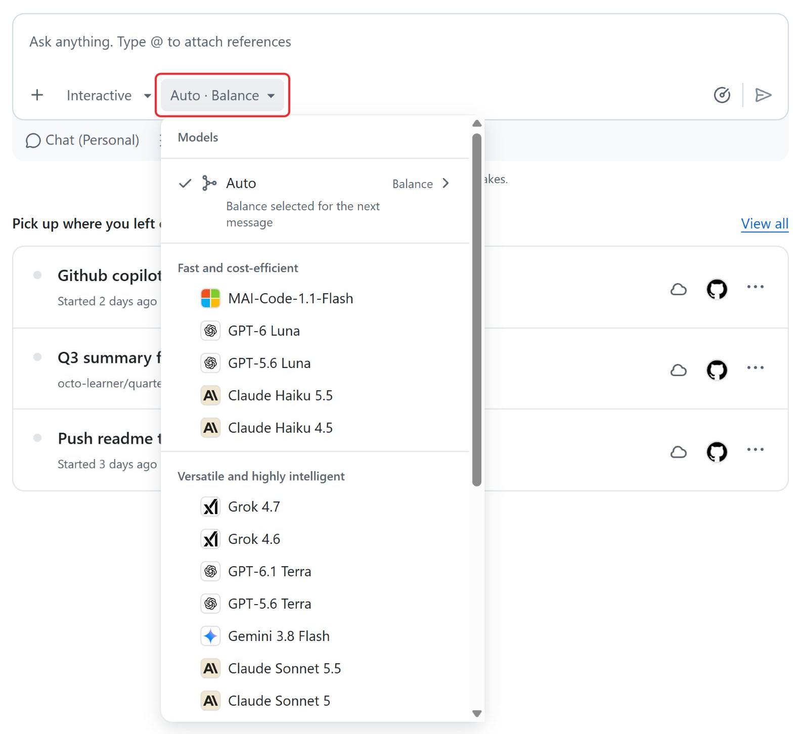
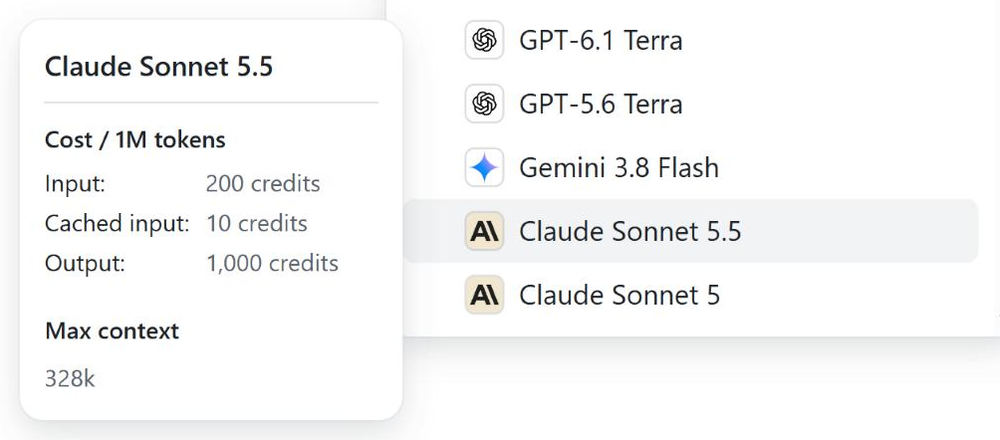
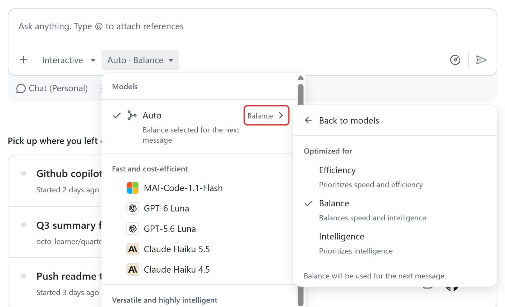

# Unit 4: Choose a model for the task

Compare models by the cost of producing a result that meets the same requirements, not by price alone. A cheaper model may need more corrections, and a more expensive model may add cost without improving the result.

For example, give each model the same task: correct a summary using only the approved figures. Track credits and attempts, and check every changed figure before you accept the result. A model change doesn't authorize broader access, changes to the source figures, or spending beyond the agreed limits.

## Questions to ask before you start a task

Before you compare models, define an equivalent task and decide how to measure an acceptable result:

- **What does "done" look like?** A clear stopping point keeps the agent on task. Example: every figure in a report matches the approved source, and every statement about growth or **margin** (the share of revenue left after costs) is right in direction and size.

- **Which costs will you compare?** Give each model the same task and track credits, retries, and human review effort until the result meets the requirements.

- **Is it one task or several?** Mixed work carries old context into every request. For example, matching the report to the figures and removing a client's name are separate tasks.

- **Who pays?** Find out which account pays for the usage. Example: the team's organization budget, owned by the billing manager.

## Know the three groups of models

The model menu in Copilot in GitHub sorts models into three groups. The names don't tell you each model's price, so check the rates before comparing costs:

- **Fast and cost-efficient** (lightweight models): favor speed and lower cost.

- **Versatile and highly intelligent** (mid-tier models): balance speed with capability.

- **Most powerful at complex tasks** (reasoning models): support work that needs greater reasoning capability.

## Compare prices for the same work

Model names and prices change often. The following table and its related cost examples use fictional model names and illustrative prices and credit amounts, not current offerings or rates. Check the models and prices available in your Copilot model menu, and compare them the same way.

The table shows what one request costs on each example model: 100,000 input tokens and 10,000 output tokens, with no cached input. That's about the size of a long chat with a few attached files.

| **Example model** | **Group** | **Price per 1M tokens (input / output)** | **Cost of the same job** | **AI credits** |
| --- | --- | --- | --- | --- |
| Example Fast Model A | Fast and cost-efficient | $0.10 USD / $0.50 USD | $0.015 USD | 1.5 |
| Example Versatile Model B | Versatile and highly intelligent | $2.00 USD / $10.00 USD | $0.30 USD | 30 |
| Example Reasoning Model C | Most powerful at complex tasks | $2.00 USD / $10.00 USD | $0.30 USD | 30 |
| Example Reasoning Model D | Most powerful at complex tasks | $10.00 USD / $50.00 USD | $1.50 USD | 150 |

What the examples show:

- **The same job costs 100 times more on Example Reasoning Model D (150 credits) than on Example Fast Model A (1.5 credits).** Save the most expensive models for work that clearly needs them.

- **"Most powerful" doesn't always mean "most expensive."** Example Reasoning Model C costs the same as Example Versatile Model B for the same tokens.

- **Long context costs more.** Some models charge a higher rate when a request goes above an input threshold. For example, suppose Example Reasoning Model D doubles its input price above 272,000 input tokens.

## Check a model's price before you choose it

In Copilot in GitHub, hover over any model in the model menu. A card shows the model's description, its **Cost / 1M tokens** in AI credits (input, cached input, and output), and its **Max context**. See [GitHub's AI credits documentation](https://docs.github.com/en/copilot/concepts/billing-and-usage/individuals/billing) for the current USD conversion rate.

## Use Auto and its tiers

The Auto tier and selected model affect what you pay. Availability varies by client. If your model menu shows **Copilot Fusion** instead of **Auto**, see [Use Copilot Fusion and its effort levels](#use-copilot-fusion-and-its-effort-levels).

In the model menu, select the tier name in the **Auto** row, such as **Balance**, to open **Optimized for** and set Auto's tier:

- **Efficiency** favors lower cost for routine requests.

- **Balance** balances speed and intelligence for everyday work.

- **Intelligence** prioritizes capability and can select a higher-priced model.

All three tiers can use the same models, so no tier guarantees a fixed price. For a cost trial, select a specific model to keep the comparison consistent. Before you move to a more capable model or higher effort.

On GitHub.com, hover over a Copilot response to see which model Auto used.

### What affects the cost of an Auto request

These factors affect what an Auto request costs:

- **The model Auto picks.** The model's token prices affect what you pay. When Auto routes a short question to a fast model, the question costs a fraction of what it costs when Auto routes it to a powerful model.

- **The tier.** It changes which models Auto prefers, so it changes the price. It doesn't cap the cost.

- **The tokens.** Your message, attachments, the conversation history, and the answer all count, the same as with a model you pick yourself.

**Example:** Suppose you send the same job (100,000 input tokens and 10,000 output tokens) twice with Auto. For the first request, Auto picks Example Fast Model A, for an illustrative cost of 1.5 credits. For the second, Auto picks Example Versatile Model B, for an illustrative cost of 30 credits. The tokens and the setting are the same, but the second request costs twenty times as much because Auto chose a different model.

Auto switches models only at natural breakpoints in a conversation, or when the work changes significantly, so it doesn't discard cached context with every message.

## Use Copilot Fusion and its effort levels

Availability varies by client. Select **Copilot Fusion** in the model menu when your client offers it.

Copilot Fusion can use more than one model for a request, so compare the cost of each effort level with the quality of the result.

Choose an effort level in the model menu:

- **Standard** balances cost, quality, and speed, and fits everyday work. Copilot Fusion uses one model for each task.

- **High** fits substantial, well-scoped tasks where extra model calls can be worth the extra time and AI credits.

- **Max** fits tasks that need the deepest reasoning and most thorough analysis.

Standard is available on every plan. High and Max are available on Copilot Pro+, Copilot Max, Copilot Business, and Copilot Enterprise. If Max doesn't appear, a policy might disable a model that it needs.

### What affects the cost of a Copilot Fusion request

You pay for each model Copilot Fusion uses, at that model's standard rate. There's no separate charge for Copilot Fusion. Because High and Max can use more than one model for a request, the same task can use more AI credits than it does on Standard. To see which models Copilot Fusion used, hover over the effort level name below the response.

Like Auto, Copilot Fusion switches models only at natural breakpoints in a conversation, or when the work changes significantly. It also keeps the main conversation on the same model whenever possible, so the conversation keeps its cached context. Models that assist, such as a reviewer, receive only the context they need.

## Match the model to the work

Use this table to choose a starting point without paying for capability the work doesn't need. Follow the business path: drafting from approved sources, correcting a summary, comparing reports, and checking figures. Compare credits, retries, review effort, and the quality of source-linked evidence against the same requirements.

In the table, **Auto or Copilot Fusion** means Auto on **Balance** or Copilot Fusion on **Standard**, depending on what's available in your client.

| **Task examples** | **Start with** | **Step up to** | **Avoid** |
| --- | --- | --- | --- |
| Business path: draft standard content from approved sources | Auto or Copilot Fusion | A versatile model | None |
| Business path: update a summary to match approved figures | Auto, Copilot Fusion, or a versatile model | A reasoning model if the task needs deeper reasoning | Starting on the most expensive model |
| Business path: compare report drafts or check a report against source figures | Auto or Copilot Fusion | A versatile model if the comparison misses discrepancies | None |
| Business path: read a usage-chart screenshot and identify the highest-usage day | A fast model that supports image input in your client | A versatile image-capable model if it misreads clear labels; verify against the report | Guessing values from unreadable labels; use the report data instead |

## Choose Auto or a model

1. To try the controls live, sign in to **GitHub.com** with an account that has a Copilot subscription.

1. In the upper-right corner of any page, select the Copilot icon.

1. Below the prompt, select the model button. It shows **Auto** and its tier, or the current model name.

1. Hover over a model to read its price card, and then select **Auto** or a model.

1. After you select **Auto**, select the tier name in the **Auto** row. Under **Optimized for**, choose **Efficiency**, **Balance**, or **Intelligence**.

1. Before you send, check the context: select **+** to see the attachment options, including **Files and folders**, **Upload from computer**, **Repository**, and **Space**. Select only the sources the task needs.

To work in one repository, select the **Chat** button below the prompt. It shows the chat's scope, for example **Chat (Personal)**. Under **Work in a repository**, select the repository the task needs.

## Adjust reasoning effort and context window

Start with the model's default effort and context window. Before you raise the effort, check the task's requirements, test criteria, relevant files, failure evidence, and permissions. Raise the context window only when the relevant material doesn't fit.

Both can increase tokens, credits, and response time. A larger context window is capacity, not a count of the tokens you use: you pay for the tokens Copilot processes, at the long-context rate when a request crosses the model's threshold.

Set these options before you start a session and keep them the same until it ends. Changing the model, the effort, or the context window in the middle of a session resets the cached context, so the next request processes the full context at the normal input price.

To change them in the GitHub Copilot app, open the model control below the session prompt and select a specific model instead of Copilot Fusion. The menu shows Effort (Low, Medium, High, Extra High, Max) and Context window (for example, **328K** or **1.1M**).

## Compare the cost of the whole task

For example, suppose Example Fast Model A needs three attempts to succeed (3 × 1.5 = 4.5 credits) while Example Versatile Model B succeeds on its first attempt (30 credits). Model A still costs less, but if the three attempts also cost a reviewer an hour, Model B may give better value.

## Check the task before you step up

Before you step up:

1. State the requirement and how to test it.

1. Check that the agent has the relevant files, the failure evidence, and the permissions it needs. Fix missing information or access first.

1. Step up the model or the effort only if the task still fails after you complete the first two steps.
