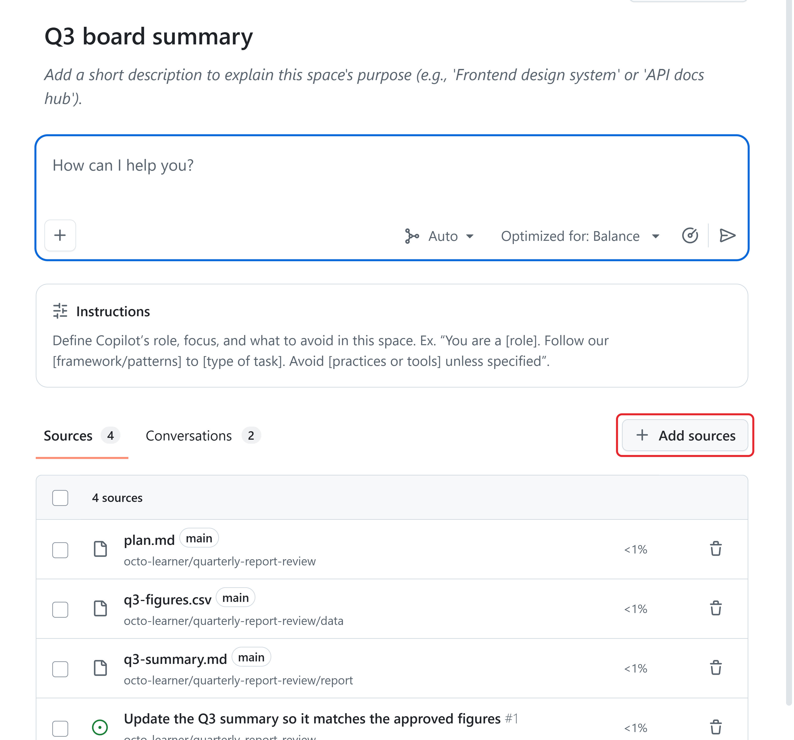
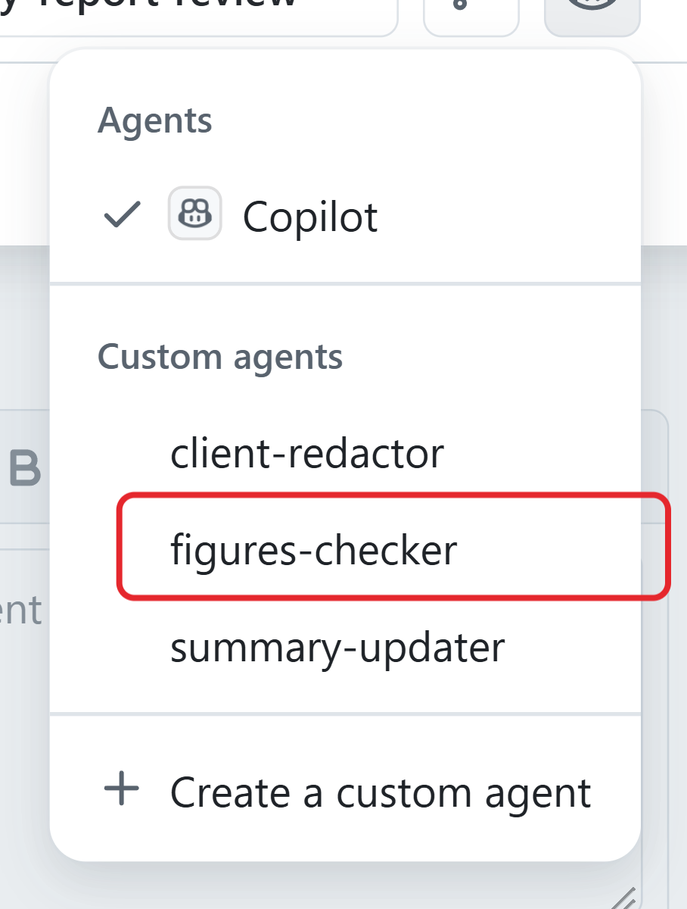

# Unit 5: Apply risk controls to agentic work

Limit the agent's access to what the task requires. For example, checking a report against approved figures doesn't require client contracts or passwords.

Decide what the agent may read, change, and run. **Least privilege** means giving the agent only the access the task needs. Low-risk actions that someone approved and that you can reverse can run automatically, but riskier actions need a human's approval.

Model choice can affect completeness, consistency, how well ambiguity is handled, and whether explanations help a reviewer understand the result. Require each important claim or changed figure to identify its approved source, and require the output to state uncertainty when sources are incomplete or conflicting. A convincing explanation is not proof: verify it against the approved sources and acceptance criteria. Learners need the evidence supporting the answer, not access to a model's private reasoning.

## Check the agent's access

For a report update, provide the report and its approved source. Exclude client contracts, other clients' files, passwords, or other repositories unless the task requires them. Check these boundaries before you start:

- **Repository and files:** allow changes only to the files the task needs, for example report/q3-summary.md. Team agreement: list allowed files in the task's issue. Check the actual changed files before accepting the work.

- **Tools and actions:** allow only what the agent needs to inspect, edit, and test the fix. GitHub setting: the repository administrator limits connected tools and internet access. In the Copilot app, choose **Always ask**. By default, Copilot's internet access allows the locations used to install tools, packages, and libraries, so a task can add outside code. Blocking those downloads needs the administrator role and stops tasks that need a library to build or test. The repository administrator also manages connected tools; ask them to enable only those the task needs, using read-only access when inspection is enough.

- **Connected services and credentials:** withhold everything the task doesn't need. For credentials, see "Protect secrets and personal information."

- **Approval settings:** keep human approval for riskier actions. GitHub setting: the repository administrator keeps **Require approval for workflow runs** turned on.

An administrator can review the repository's agent and ruleset settings before work starts.

Check the actual environment. Restrictions on Copilot don't automatically apply to agents in the Copilot app or an editor. Each feature supports a different set of policies.

### Choose a branch strategy

Use a separate branch for each approved task and bring the change back through a reviewed pull request. This protects the approved shared version while reviewers compare the diff, checks, and source evidence. Direct changes to the default branch bypass that review point, and mixing unrelated work into one branch makes scope, evidence, rollback, and approval harder to verify.

GitHub builds these protections into **Copilot in the cloud**, the agent that runs on GitHub:

- Copilot in the cloud can't push directly to the **default branch**, the main version of the files. It works on a separate branch; changes need human review and a merge to enter the main version. See [Building guardrails for GitHub Copilot cloud agent](https://docs.github.com/en/copilot/tutorials/cloud-agent/build-guardrails#adapt-rulesets).

- It gets only the secrets added for it, not the repository's or organization's other secrets.

- Workflows on its pull requests wait for approval from someone with write access.

- A firewall limits its internet access by default.

- Its commits name Copilot as the author and the person who asked as a co-author, with a link to the session log.

You still review every change and every request for more access.

## Choose the mode and tool permissions

In the GitHub Copilot app, the mode menu below the session prompt controls how independently the agent works. Consider the usage implications:

•  **Interactive:** guide each stage and catch misunderstandings before they lead to more paid work.

•  **Plan:** planning uses credits, but reviewing the approach first can avoid unnecessary implementation and retries.

•  **Autopilot:** more independent work can mean more model calls before you intervene. Agree on scope and a stopping condition before starting.

For example, a task to correct report figures doesn't include preparing new leadership slides. Reviewing the plan can catch that extra work before the agent spends credits preparing it. No mode guarantees lower cost: compare total usage for a result that meets the requirements.

Tool permissions decide whether the agent asks you before it runs a tool, such as a command or a connected service. In the GitHub Copilot app, they're in the mode menu below the session prompt:

•  **Always ask** asks every time. Use it while you learn and for higher-risk work.

•  **Approve all** runs tools without asking. Use it only for a bounded, approved task in a constrained environment.

The less often the agent stops, the more these permissions and the repository's settings have to do the controlling.

Tool permissions don't override enforced policies. Pausing for approval doesn't cap tokens, because the model work before the pause already counts.

## Check policies and connected tools

The organization owner sets which features, models, and integrations your organization allows. Organization policies can't override enterprise policies. Access to a model doesn't authorize every connected action.

Before you enable a capability, check:

- Does the approved task need it, with permitted tools and source access?

- Does it upload or keep information? Confirm you have permission to share that data.

- Can its context, model calls, or connected services add usage or charges?

- Is it a preview? The essential spending and review controls in this example must work without previews.

Turning on a feature or a repository never approves a task or caps spending.

## Choose prompts, instructions, skills, and MCP connections

| **Option** | **Purpose** |
| --- | --- |
| Prompt | The immediate request for this task and this run. |
| Instructions | Reusable guidance that applies within a defined scope. |
| Skill | A reusable workflow or capability for a specific kind of task. |
| MCP server | A maintained connection that exposes approved tools or external context. |

These options solve different problems. None automatically authorizes a task, grants access beyond its configured permissions, proves that an output is correct, or replaces human review.

### When to use an MCP server

Suppose the approved source is a frequently updated policy system outside the repository. Use an approved MCP connection when the team repeatedly needs current records or controlled tool actions and a maintained connection is worth governing. If the task is a one-time comparison and an approved, current export contains everything needed, attaching that file is usually sufficient and avoids a persistent connection. Before using MCP, resolve who may access the source, what data may be shared with Copilot, which tools are read-only or can take action, who approves those actions, and how the connection’s model calls or services affect cost. Prefer the narrowest approved tools and data needed for the task.

## Separate guidance, permissions, and review

Instructions guide the agent, but the agent may not follow them every time. Two controls guide, and two enforce:

- **Repository instructions guide** project work, for example "use only the figures in the data folder." The repository maintainer edits the instructions file.

- **Task instructions guide** the assigned work, for example "change only report/q3-summary.md." You write them in the issue or the prompt.

- **Permissions and policies enforce** what the agent can access and do, for example by withholding deployment credentials. GitHub setting: the repository administrator manages passwords, keys, and connected tools, and the organization owner manages [Copilot policies](https://docs.github.com/en/copilot/how-tos/administer-copilot/manage-for-organization/manage-policies).

- **Required reviews and checks enforce** the merge rules: the merge waits until they pass. GitHub setting: the repository administrator adds them in **Settings** > **Rulesets**.

**Merging** adds the pull request's changes to the project. A required review can block the merge, but it can't stop the agent from making the edit.

A **code owner** is a person or team that a repository designates to review specified files.

**Example review rule:** the change needs two different authorized human reviewers: a code owner and a second reviewer. Neither may have collaborated with Copilot. In this example, people who start or help steer the agent's task count as collaborators. Follow stricter rules in real repositories.

A rule decides whether a code owner must approve. A rule that requires the example's reviews before a merge, including review from the code owners, goes into the repository's settings and needs the administrator role.

Also find out who can skip the rule. The rule only counts reviews, so the team checks that each reviewer is eligible. The repository administrator configures the required reviewers and checks in the ruleset.

## Reuse instructions, context, and agents

Relevant context helps control both usage and risk: unnecessary files can expose information the task doesn't need. For example, to check a report, provide the report and approved figures, not client contracts or every earlier draft. Keep enough evidence to check the result; removing necessary sources can create mistakes and paid retries.

Choose reusable guidance and context according to their purpose. Reusable context doesn't replace access controls.

### Put standing rules in instruction files

Rules your team repeats on every task belong in an instruction file, not in every issue. This keeps one maintained version instead of conflicting copies. Keep the file focused: "Use the approved figures in data/; report discrepancies instead of changing them" gives each reporting task the same boundary without copying the reporting handbook into every prompt. Treat the file as a short project map of recurring limits, naming rules, output expectations, and checks. Link existing guides instead of copying them, remove obsolete rules, and leave one-off requests in the issue. Have a person review the instructions.

Split the text like this:

| **Where** | **What belongs there** | **What the team writes there** |
| --- | --- | --- |
| .github/copilot-instructions.md | Standing rules for all work in the repository | "The approved figures are in data/. Never edit them. If a number in a report doesn't match, stop and list the sentence, both values, and the source row." |
| .github/instructions/NAME.instructions.md | Standing rules for some files only, chosen with an applyTo pattern | For leadership summaries in report/: "Write amounts as $16.8 million, growth as a change from the prior quarter, and name the region in every claim." |
| The issue assigned to Copilot | The one task: what changes, which files, which figures, and the evidence the reviewer needs | "Make every figure in report/q3-summary.md match data/13-figures.csv before Thursday's leadership review. Change only that file. In the pull request, list each changed figure as old value, new value, and source row." |

Adding or changing any of these files is a commit, so it needs write access.

A path-specific file starts with a short header that names the files it covers. For the team's reports:

---

applyTo: "report/**/*.md"

---

- Show money in millions with one decimal, and percentages with one decimal.

- Follow the team's writing guide in docs/style-guide.md.

- Never name a client in a file under report/drafts/.

Keep a writing guide, glossary, or report template in the repository and name its path in the instructions, so the guidance lives in one place and Copilot can open it while it works. Copilot also reads AGENTS.md files, where the nearest file in the folder tree applies.

### Share rules across repositories

For rules that many repositories share, use organization instructions:

•  **Organization instructions:** organization owners on Copilot Business or Copilot Enterprise add them in the organization's **Settings** > **Copilot** > **Custom instructions**. They apply to Copilot Chat, Copilot code review, and Copilot on GitHub.com, with lower priority than repository instructions.

•  **Organization custom agents:** an organization owner can place an agent profile in the agents folder of the organization's .github or .github-private repository so repositories across the organization can use it.

In Copilot Chat, attach the repository that contains shared instructions when the task needs those rules as context.

### Keep the plan in a Copilot Space

For work that continues across chats, keep one checked plan, such as plan.md, in the repository. Record decisions, approved sources, file limits, and open questions. Saving it requires write access. Add the plan to a Copilot Space so each new chat can use the maintained version.

A Copilot Space is a saved collection of context that you chat against. You can add repositories, files, issues, pull requests, notes, and uploads. Files from GitHub stay up to date in the Space as they change, so a plan.md committed to the repository is always current there.

Anyone with a Copilot license can use Spaces, and organization-owned Spaces can be shared using GitHub permissions. Chatting in a Space still uses AI credits.

To set up a Space, follow this quarterly-report example shown in the screenshot:

1. Go to **github.com/copilot/spaces** and select **Create space**.

1. Enter a name, such as "Q3 board summary," and select **Create space**.

1. Select **Add sources** > **Link files, pull requests, and issues**.

1. Paste the address of each source, selecting **Add another** between them: plan.md, data/q3-figures.csv, report/q3-summary.md, and issue #1. Then select **Add**.  

1. Type your next instruction in the chat box at the top of the Space.

When the report owner adds a new open question to plan.md, the next chat in the Space already knows it, with no upload. A teammate who opens the shared Space starts from the same plan.

The new chat knows only what the Space holds, so check plan.md before you rely on it.

### Let Copilot Memory learn the repository

Copilot Memory lets Copilot keep facts it learns about a repository and use them in later tasks. Copilot sessions, Copilot code review, Copilot CLI, and agentic autofix can use it. Each fact stays with its repository, and Copilot deletes a fact after 28 days if nothing uses it.

Copilot Memory is available on all paid Copilot subscriptions. It's on by default for individual subscriptions. For Copilot Business and Copilot Enterprise, an administrator must enable the policy first. It learns facts on its own, so your decisions and standing rules still belong in the instruction files and the plan.

### Give each kind of work its own agent

A **custom agent** is a specialized version of Copilot with its own instructions and list of tools. A team can keep one agent for each kind of regular work. One person acts as the **orchestrator**: they read each new issue, pick the agent that fits, and check what comes back before the next step starts.

For example, three agents could cover regular reporting work:

| **Agent** | **Its job** | **Tools** | **Typical issue** |
| --- | --- | --- | --- |
| figures-checker | Compares a report with data/ and lists every mismatch with its source row | read, search | "Check a report against the approved figures." |
| summary-updater | Corrects report text to match the approved figures | read, edit, search | "Update a summary so it matches the approved figures." |
| client-redactor | Removes client names before a report leaves the team | read, edit, search | "Remove the client's name before a report leaves the team." |

A typical round runs like this. The report owner, as orchestrator, assigns the check to figures-checker and reads its list of mismatches in the session. The report owner adds that list to the update issue and assigns it to summary-updater.

After the reviewer approves that pull request, client-redactor prepares the version that goes out.

The agents don't hand work to each other: the orchestrator moves it, and each handoff is a point where a person checks the result. A person reviews and approves every pull request, so no change goes in on another agent's word.

Each agent is a Markdown file in .github/agents/, with a short header and its instructions:

---

name: figures-checker

description: Checks a report against the approved figures and lists every mismatch

tools: ["read", "search"]

---

Compare every figure in the report with data/13-figures.csv. For each mismatch, give the sentence, the value in the report, the value in the figures, and the source row. Don't change any file.

Leaving edit out of the tools list means this agent can't change files. That's least privilege applied to an agent: the checker only needs to read. If you leave out tools entirely, the agent gets every available tool.

### Hand an issue to a custom agent

Use a browser signed in to GitHub.com with write access to the repository.

1. Open the issue, and in the right sidebar select **Assign to Agent**.

1. In the **Assign agent to issue** dialog, which is in preview, select the agent button next to the branch button. The menu lists **Copilot** under **Agents**, and the repository's agents under **Custom agents**.

1. Select the agent for this task, for example **figures-checker**.

   

1. In **Optional prompt**, add anything that applies to this run only. Standing rules stay in the instruction files.

1. Select **Assign**. The session starts and uses AI credits, so assign only an approved task.

### Create a custom agent

Creating an agent is a commit to the repository, so it needs write access.

1. Go to **github.com/copilot/agents**.

1. In the prompt box, select the repository, and optionally a branch.

1. Open the menu and select **Create an agent**. GitHub opens a template file, my-agent.agent.md, in the .github/agents folder.

1. Rename the file after the agent's job, for example figures-checker.agent.md. File names can use letters, numbers, dots, hyphens, and underscores.

1. Fill in the header: you must fill in description, and name and tools are optional. Below the header, write the agent's instructions.

1. Commit the file and merge it into the default branch. The agent then appears in the agent menu.

An organization can also share agents with all its repositories from its .github or .github-private repository.

### Use instructions and custom agents in VS Code

You can also reuse instructions and limit tools in **Visual Studio Code (VS Code)**. Put shared project guidance in .github/copilot-instructions.md, or use targeted instruction files for particular files or tasks. A custom agent can combine task-specific instructions with a reusable tool selection.

Tool availability and approval are separate: making a tool available doesn't bypass approval settings. The tools and instruction formats supported can differ by the agent selected in VS Code.

## Protect secrets and personal information

Use fictional data, such as the figures in this module. Keep credentials, client contracts, confidential client or financial data the task doesn't need, and unnecessary personal data out of prompts, attachments, logs, and outputs.

For example, remove a client's name from a report before sharing it outside the team if your organization's rules require it. Use the AI tools your organization approved, not a personal account, for client and company files.

If the agent needs a secret, an authorized administrator configures it in the repository's agent secrets before the work starts. Keep secret values out of prompts.

**Content exclusion** keeps specified files out of Copilot's context, but its coverage varies by feature. It doesn't apply to Agent mode in VS Code Chat or to third-party coding agents.

If the agent asks for sensitive data or broader access, stop and follow your organization's escalation process.

## Keep human approval in the process

**Human oversight** means a person checks the agent's work at the points where a mistake would be costly. Require an owner's decision before irreversible actions, broader access or spending, sensitive-data exposure, unclear requirements, or external sharing. Name who authorizes each action; an instruction alone isn't approval.

Different approvals authorize different decisions. On one pull request, they come in this order:

- Someone with write access checks any workflow changes and approves the waiting workflows.

- Automated checks and Copilot code review add results and comments. They're evidence, not approval.

- Eligible reviewers approve the pull request, and the task owner accepts the business result.

Keep these approvals apart. When the task owner accepts the result, that isn't a pull request approval. The task owner may also review the pull request if they meet the reviewer-eligibility rules described in "Example review rule."

Copilot code review leaves a Comment review, even when it says **Approval recommended**, and comments don't count toward required approvals. A repository setting can let Copilot approve pull requests. For this example, keep it off: in the repository's Settings > Copilot > Code review, leave **Allow Copilot to approve pull requests** turned off.

An administrator configures the review requirement in the repository's ruleset.
