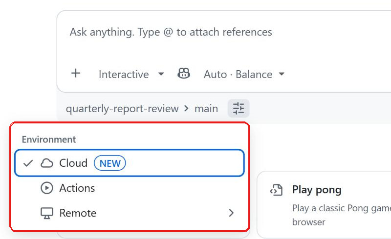
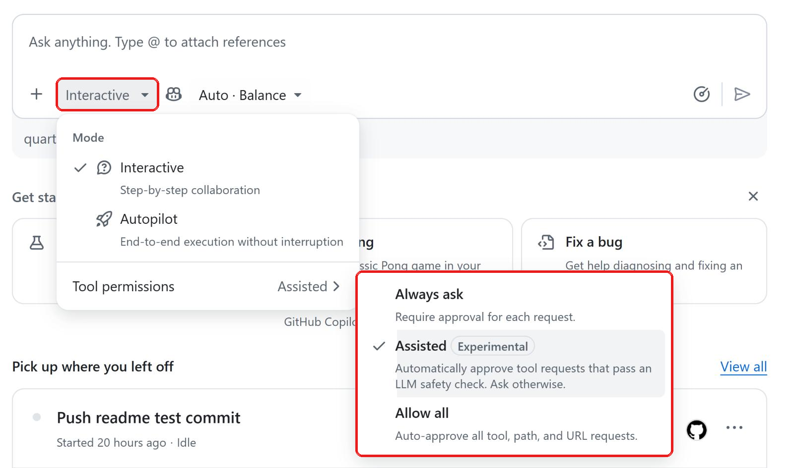
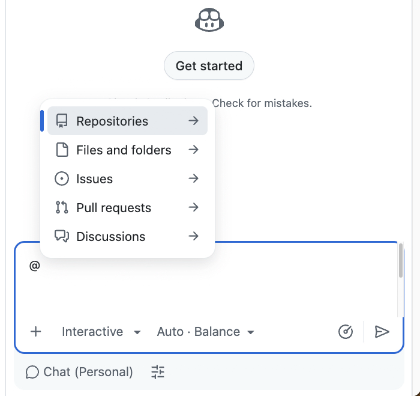
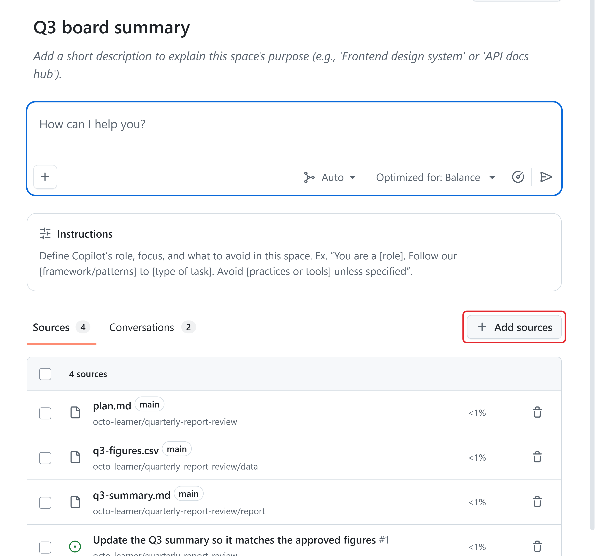

# Unit 5: Apply risk controls to agentic work

Limit the agent's access to what the task requires. For example, checking a report against approved figures doesn't require client contracts or passwords.

Decide what the agent may read, change, and run. **Least privilege** means giving the agent only the access the task needs. Low-risk actions that someone approved, and that you can undo, can run on their own. Riskier actions need a person's approval.

## Check the agent's access

For a report update, give the agent the report and its approved source. Leave out client contracts, other clients' files, passwords, and other repositories unless the task requires them. Check these boundaries before you start:

- **Repository and files:** allow changes only to the files the task needs, for example report/q3-summary.md. Team agreement: list allowed files in the task's issue. Before you accept the work, check which files the agent actually changed.

- **Tools and actions:** allow only what the agent needs to inspect, edit, and test the fix. GitHub setting: the repository administrator limits connected tools and internet access. On GitHub.com, choose **Always ask** under **Tool permissions**. By default, Copilot's internet access allows the locations used to install tools, packages, and libraries, so a task can add outside code. Only a repository administrator can block those downloads, and blocking them stops tasks that need outside code to build or test.

- **Connected services and credentials:** don't give the agent anything the task doesn't need. Credentials are passwords, keys, and other sign-in secrets. For credentials, see [Protect secrets and personal information](#protect-secrets-and-personal-information).

- **Approval settings:** keep human approval for riskier actions. GitHub setting: the repository administrator keeps **Require approval for workflow runs** enabled.

The repository administrator can review the repository's agent and access settings before work starts.

After you select a repository on GitHub.com, check the **Environment** menu below the prompt. It offers **Cloud**, **Actions**, and **Remote**. Where environment choices are available, GitHub selects **Cloud** by default and runs the session in a cloud sandbox.



Without write access to a repository, your Copilot use there is read-only.

GitHub builds these protections into **Copilot in the cloud**, the agent that runs on GitHub:

- Copilot in the cloud can't push directly to the **default branch**, the main version of the files. It works on a separate branch, and its changes reach the main version only after a person reviews and merges them, unless someone gives a Copilot automation the tool to merge pull requests.

- It gets only the secrets an administrator adds for it, not the repository's or organization's other secrets.

- Workflows on its pull requests wait for approval from someone with write access.

- A firewall limits its internet access by default.

- For a task you start, its commits name Copilot as the author and you as a co-author, with a link to the session log. Actions by a shared automation show Copilot as the author, not one requester.

You still review every change and every request for more access, because these protections limit what the agent can do. They don't show that its work is right.

## Choose the mode and tool permissions

The mode you choose affects usage as well as oversight:

- **Interactive:** guide each stage and catch misunderstandings before they lead to more paid work.

- **Plan (GitHub Copilot app):** planning uses credits, but reviewing the approach first can avoid unnecessary implementation and retries.

- **Autopilot:** more independent work can mean more model calls before you intervene. Agree on scope and a stopping condition before you start.

For example, a task to correct report figures doesn't include preparing new leadership slides. Reviewing the plan can catch that extra work before the agent spends credits preparing it. No mode guarantees lower cost: compare total usage for a result that meets the requirements.

Tool permissions decide whether the agent asks you before it runs a tool, such as a command or a connected service. On GitHub.com, they're in the same menu as the mode, under **Tool permissions**:

- **Always ask** asks every time. Use it while you learn and for higher-risk work.

- **Assisted** automatically approves tool requests that pass a safety check and asks you about the rest. The menu marks this option as experimental.

- **Allow all** runs tools without asking. Use it only for a bounded, approved task in a constrained environment.

To set these controls on GitHub.com:

1. In the upper-right corner of any page, select the Copilot icon.

1. In the prompt box, select the **Mode** button, which shows the current mode, such as **Interactive**.

1. Select **Tool permissions**, and then select **Always ask**, **Assisted**, or **Allow all**.

1. To change the mode, open the **Mode** menu again and select **Interactive** or **Autopilot**.



The less often the agent stops, the more you rely on these permissions and the repository's settings for control.

Tool permissions don't override enforced policies. Pausing for approval doesn't cap tokens, because the model work before the pause already counts.

## Check policies and connected tools

The organization owner sets which features, models, and integrations your organization allows. Organization policies can't override enterprise policies. Access to a model doesn't authorize every connected action.

Before you enable a capability, check:

- Does the approved task need it, with permitted tools and source access?

- Does it upload or keep information? Confirm you have permission to share that data.

- Can its context, model calls, or connected services add usage or charges?

- Is it a preview? The essential spending and review controls in this example must work without previews.

Turning on a feature or a repository never approves a task or caps spending.

## Choose prompts, instructions, skills, and MCP connections

| **Option** | **Purpose** |
| --- | --- |
| Prompt | The immediate request for this task and this run. |
| Instructions | Reusable guidance that applies within a defined scope. |
| Skill | A reusable workflow or capability for a specific kind of task. |
| MCP server | A maintained connection that exposes approved tools or external context. |

These options solve different problems. None automatically authorizes a task, grants access beyond its configured permissions, proves that an output is correct, or replaces human review.

### When to use an MCP server

Suppose the approved source is a frequently updated policy system outside the repository. Use an approved MCP connection when the team repeatedly needs current records or controlled tool actions and a maintained connection is worth governing. If the task is a one-time comparison and an approved, current export contains everything the task needs, attaching that file is usually sufficient and avoids a persistent connection. Before using MCP, resolve who may access the source, what data your team may share with Copilot, which tools are read-only or can take action, who approves those actions, and how the connection's model calls or services affect cost. Prefer the narrowest approved tools and data the task needs.

## Separate guidance, permissions, and review

Instructions guide the agent, but the agent may not follow them every time. Two controls guide, and two enforce:

- **Repository instructions guide** project work, for example "use only the figures in the data folder." The repository maintainer edits the instructions file.

- **Task instructions guide** the assigned work, for example "change only report/q3-summary.md." You write them in the issue or the prompt.

- **Permissions and policies enforce** what the agent can access and do, for example by withholding deployment credentials. GitHub setting: the repository administrator manages secrets and connected tools, and the organization owner manages [Copilot policies](https://docs.github.com/en/copilot/how-tos/administer-copilot/manage-for-organization/manage-policies).

- **Required reviews and checks enforce** the merge requirements: the merge waits until they pass. The repository administrator configures them in the repository settings.

**Merging** adds the pull request's changes to the project. A required review can block the merge, but it can't stop the agent from making the edit.

A **code owner** is a person or team that a repository designates to review specified files.

**Example review rule:** the change needs two different authorized human reviewers: a code owner and a second reviewer. Neither may have collaborated with Copilot. In this example, people who start or help steer the agent's task count as collaborators. If a real repository has stricter rules, follow those.

A rule decides whether a code owner must approve. In the repository's settings, the repository administrator adds a rule that requires the example's reviews, including review from the code owners, before a merge.

Also find out who can skip the requirement. It only counts reviews, so the team checks that each reviewer is eligible. The repository administrator configures the required reviewers and checks in the repository settings.

## Reuse instructions, context, and agents

Relevant context helps control both usage and risk: unnecessary files can expose information the task doesn't need. For example, to check a report, provide the report and approved figures, not client contracts or every earlier draft. Keep enough evidence to check the result; removing necessary sources can create mistakes and paid retries.

Choose reusable guidance and context according to their purpose. Reusable context doesn't replace access controls.

### Add task context with mentions

Use `@` mentions in Copilot Chat to attach specific files, folders, issues, pull requests, discussions, or repositories as context. In the prompt box, type `@`, choose a category such as **Files and folders** or **Issues**, and then select the resource. Repeat for each source you need, and then write the request and its limits.



For the report task, type `@`, select **Files and folders**, select the repository that contains the report, and then select report/q3-summary.md. Repeat the steps to add data/q3-figures.csv, and use **Issues** to add the task issue. Ask Copilot to match the summary to the approved figures and change only the summary. 

Mentions don't bypass access controls or authorize changes. Include only approved sources the task needs; extra context can expose unnecessary information and add token costs.

### Put standing rules in instruction files

Keep recurring limits and checks in the instruction file, and put one-off requests in the issue. Have a person review the instructions and remove outdated rules.

Split the text like this:

| **Where** | **What belongs there** | **What the team writes there** |
| --- | --- | --- |
| .github/copilot-instructions.md | Standing rules for all work in the repository | "The approved figures are in data/. Never edit them. If a number in a report doesn't match, stop and list the sentence, both values, and the source row." |
| The issue you assign to Copilot | The one task: what changes, which files, which figures, and the evidence the reviewer needs | "Make every figure in report/q3-summary.md match data/q3-figures.csv before Thursday's leadership review. Change only that file. In the pull request, list each changed figure as old value, new value, and source row." |

Committing additions or changes to any of these files requires write access.

Keep a writing guide, glossary, or report template in the repository and name its path in the instructions, so the guidance lives in one place and Copilot can open it while it works.

### Keep the plan in a Copilot Space

For work that continues across chats, keep one checked plan, such as plan.md, in the repository. Record decisions, approved sources, file limits, and open questions. Saving it requires write access. Add the plan to a Copilot Space so each new chat can use the maintained version.

A Copilot Space keeps a set of sources for your chats. You can add repositories, files, issues, pull requests, notes, and uploads. Files from GitHub stay up to date in the Space as they change, so when you commit plan.md to the repository, the Space keeps it current.

Anyone with a Copilot license can use Spaces, and organizations can share their Spaces using GitHub permissions. Chatting in a Space still uses AI credits.

To set up a Space, follow this quarterly-report example shown in the screenshot:

1. Go to **github.com/copilot/spaces** and select **Create space**.

1. Enter a name, such as "Q3 board summary," and select **Create space**.

1. Select **Add sources** > **Link files, pull requests, and issues**.

1. Paste the address of each source, and select **Add another** between them: plan.md, data/q3-figures.csv, report/q3-summary.md, and issue #1. Then select **Add**.

    

1. Type your next instruction in the chat box at the top of the Space.

When the report owner adds a new open question to plan.md, the next chat in the Space already knows about it, and no one needs to upload anything. A teammate who opens the shared Space starts from the same plan.

The new chat knows only what the Space holds, so check plan.md before you rely on it.

### Give each kind of work its own agent

A **custom agent** is a specialized version of Copilot with its own instructions and list of tools. A team can keep one agent for each kind of regular work. One person acts as the **orchestrator**: they read each new issue, pick the agent that fits, and check what comes back before the next step starts.

For example, three agents could cover regular reporting work:

| **Agent** | **Its job** | **Tools** | **Typical issue** |
| --- | --- | --- | --- |
| figures-checker | Compares a report with data/ and lists every mismatch with its source row | read, search | "Check a report against the approved figures." |
| summary-updater | Corrects report text to match the approved figures | read, edit, search | "Update a summary so it matches the approved figures." |
| client-redactor | Removes client names before a report leaves the team | read, edit, search | "Remove the client's name before a report leaves the team." |

A typical round runs like this. The report owner, as orchestrator, assigns the check to figures-checker and reads its list of mismatches in the session. The report owner adds that list to the update issue and assigns it to summary-updater.

After the reviewer approves that pull request, client-redactor prepares the version that goes out.

The agents don't hand work to each other: the orchestrator moves it, and each handoff is a point where a person checks the result. A person reviews and approves every pull request, so no change goes in only because another agent says it's right.

Each agent is a Markdown file in .github/agents/, with a short header and its instructions:

```markdown
---
name: figures-checker
description: Checks a report against the approved figures and lists every mismatch
tools: ["read", "search"]
---

Compare every figure in the report with data/q3-figures.csv. For each mismatch, give the sentence, the value in the report, the value in the figures, and the source row. Don't change any file.
```

When you leave "edit" out of the tools list, this agent can't change files. That's least privilege applied to an agent: the checker only needs to read. If you leave the tools line out of the header, the agent gets every available tool.

### Hand an issue to a custom agent

In a browser, sign in to GitHub.com with an account that has write access to the repository.

1. Open the issue, and then in the right sidebar, select **Assign to Agent**.

2. In the **Assign agent to issue** dialog, select the agent button next to the branch button. The menu lists **Copilot** under **Agents**, and the repository's agents under **Custom agents**.

3. Select the agent for this task, for example **figures-checker**.

4. In **Optional prompt**, add anything that applies to this run only. Standing rules stay in the instruction files.

5. Select **Assign**. The session starts and uses AI credits, so assign only an approved task.

### Create a custom agent

Committing a new agent to the repository requires write access.

1. Open the repository and select the **Agents** tab.

2. In the prompt box, select the agent button, and then select **Create a custom agent**. GitHub opens a new file, my-agent.agent.md, in .github/agents on the main branch. The template has empty name and description lines and placeholder instructions.

3. In the file name field, rename the file after the agent's job, for example figures-checker.agent.md.

4. Complete the name and description lines, and write the agent's instructions in place of the placeholder.

5. Select **Commit changes**. In the dialog, select the option to commit directly to the main branch.

An organization can also share agents with all its repositories from its .github or .github-private repository.

### Use instructions and custom agents in VS Code

You can also reuse instructions and limit tools in Visual Studio Code (VS Code). Put shared project guidance in .github/copilot-instructions.md, or use targeted instruction files for particular files or tasks. A custom agent can combine task-specific instructions with a reusable tool selection.

Tool availability and approval are separate: making a tool available doesn't bypass approval settings. The available tools and instruction formats can differ depending on which agent you select in VS Code.

## Protect secrets and personal information

Use fictional data, such as the figures in this module. Keep credentials, client contracts, confidential client or financial data the task doesn't need, and unnecessary personal data out of prompts, attachments, logs, and outputs.

For example, remove a client's name from a report before sharing it outside the team if your organization's rules require it. Use the AI tools your organization approved, not a personal account, for client and company files.

If the agent needs a secret, an authorized administrator configures it in the repository's agent secrets before the work starts. Keep secret values out of prompts.

If the agent asks for sensitive data or broader access, stop and follow your organization's escalation process.

## Keep human approval in the process

**Human oversight** means a person checks the agent's work at the points where a mistake would be costly. Require an owner's decision before irreversible actions, broader access or spending, sensitive-data exposure, unclear requirements, or external sharing. Name who authorizes each action; an instruction alone isn't approval.

Different approvals authorize different decisions. On one pull request, they come in this order:

1. Someone with write access checks any workflow changes and approves the waiting workflows with **Approve and run workflows** in the pull request's merge box.

1. Automated checks and Copilot code review add results and comments. They're evidence, not approval.

1. Eligible reviewers approve the pull request, and the task owner accepts the business result.

Keep these approvals apart. When the task owner accepts the result, that isn't a pull request approval. The task owner may also review the pull request if they meet the reviewer-eligibility rules in the example review rule under [Separate guidance, permissions, and review](#separate-guidance-permissions-and-review).

**Approval recommended** comments don't count toward required approvals. For this example, keep Copilot approvals disabled so the designated human reviewers satisfy the rule:

1. Open **Settings** > **Copilot** > **Code review** > **Approvals**.
2. Keep **Allow Copilot to approve pull requests** disabled.

An administrator configures the review requirement in the repository settings.
