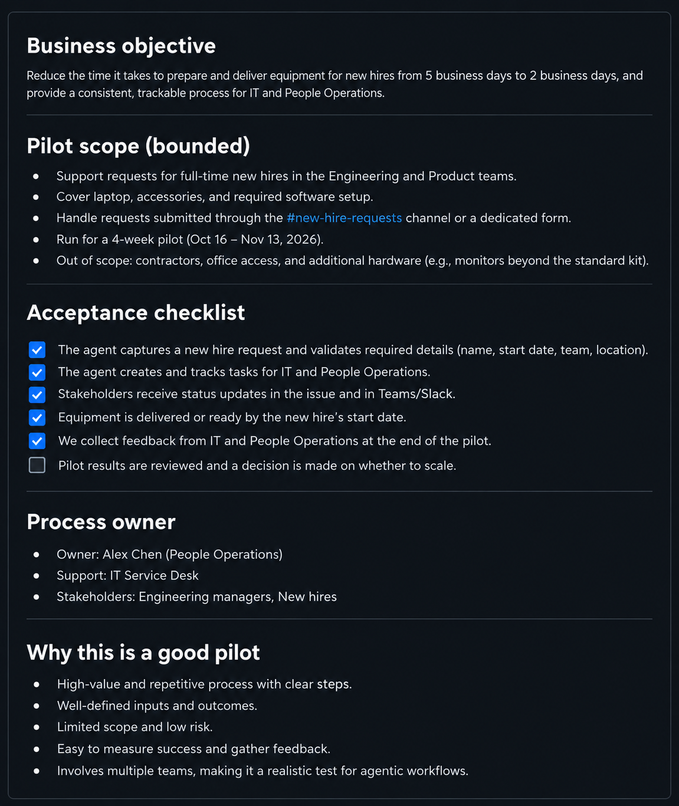

## **Unit 2 — Identify the Right Automation Problem**

Start with a task people already perform and identify the difficulty you want to reduce. "Use AI to manage work" doesn't describe a result. "Prepare a source-linked summary of recent issues for a weekly planning meeting" identifies an audience, an output, and a purpose.

An issue is a GitHub record used to track a request, question, or problem. Reading many issues to identify themes requires interpretation. Checking whether one required field is empty usually needs only a fixed rule. Choose the approach that matches the work rather than adding an agent to every step.

### **Distinguish repetitive work from unresolved ambiguity**

Repetitive work doesn't require identical inputs. Requests can use different wording while still following an agreed intake process. An agent may help interpret those descriptions and prepare consistent summaries.

However, distinguish uncertainty in the input from uncertainty in the process:

- Unclear input: A request says a guide is confusing but doesn't identify the page. The workflow can identify the missing detail and prepare a clarification question.

- Unclear process: The team hasn't agreed who can approve a change to the guide. Resolve the authority question before delegating the decision.

A stronger model can't establish a business policy that doesn't exist. Automate a defined process, not an organizational disagreement.

### **Check inputs, outputs, and available context**

Stable inputs and outputs have a predictable shape, even when their content varies. An issue usually provides a title and description. A report can have agreed sections, a reporting period, and links to supporting records.

Inspect actual examples before designing the workflow. If essential information is often absent, improve the intake process or define a clarification path. Don't assume an agent can reconstruct missing facts.

The agent also needs context: the reference information used to interpret inputs. For triage, this might include category definitions and handling guidance. Confirm that these sources are current, accessible, and authorized for use. A policy in someone's memory isn't available workflow context.

### **Define measurable criteria**

Decide how someone will recognize a useful result before generating it. "Write a good report" isn't testable. More useful criteria include:

- Required sections are present.

- Counts follow the agreed date range and selection rules.

- Significant findings link to source issues.

- Recommendations are clearly separated from recorded facts.

- Missing information is identified rather than invented.

Use representative inputs to test the criteria, including incomplete and conflicting cases. A fluent result on one straightforward example doesn't establish reliability.

### **Consider frequency, volume, and business value**

Frequency describes how often work occurs. Volume describes how much work each occurrence contains. A weekly report covering many issues may offer more value than a daily task involving one simple record.

Compare the current effort with the work automation introduces: reviewing outputs, correcting mistakes, maintaining instructions, and investigating failures. GitHub Agentic Workflows can incur both Actions execution costs and agent inference costs, depending on the configuration.

For illustration, reducing a report from 60 minutes to 15 minutes of review and 10 minutes of average correction saves 35 minutes before maintenance and service costs. These figures aren't product benchmarks; they show why gross time saved isn't the same as net benefit.

Value can also include more consistent handling or earlier visibility of unresolved work. Identify who benefits and how you'll observe that improvement.

### **Assess risk and retain human accountability**

Consider the consequence of a wrong result. An inaccurate draft is different from a published statement or an unauthorized assignment. Specify who owns the process, who reviews consequential outputs, and how errors will be corrected.

Don't automate the proposed task when:

- A fixed rule already performs it reliably.

- Decision criteria or ownership are unresolved.

- Required information is unavailable or inappropriate to use.

- Nobody can evaluate the result.

- The proposed action exceeds delegated authority.

- Consequences or review costs outweigh the benefit.

You can narrow the scope instead. Preparing information for a decision may be appropriate even when making that decision must remain with a person.

### **Compare candidate tasks before choosing a pilot**

A pilot is a limited trial used to evaluate the design before broader adoption. Choose a task whose results people can inspect and whose scope can be contained. Don't begin with the largest process merely because it consumes the most time.

Consider three possible improvements to issue handling:

| **Candidate** | **What automation would contribute** | **What to establish first** |
| --- | --- | --- |
| Check whether a page link is present. | A predictable completeness check. | Whether a fixed validation rule is sufficient. |
| Summarize similar documentation concerns. | Interpretation across different descriptions. | Source access, a useful summary format, and review criteria. |
| Approve changes to published policy. | Preparation of evidence and a proposal. | The authorized decision-maker; approval itself remains reserved. |

The second candidate is a stronger starting point for agentic analysis. It has a bounded information task and a reviewable result. The first might not need AI, while the third includes an authority decision that shouldn't be delegated simply to save effort.

Before the pilot, record the current process's effort and common errors. During the trial, compare the same measures, including reviewer effort. If people spend longer checking a summary than preparing it themselves, the design hasn't yet demonstrated its intended benefit.

Also inspect omissions, not just incorrect statements. A report can contain only true sentences and still overlook the concern most important to its audience. Review source coverage alongside factual accuracy.

### **Separate acceptance requirements from improvement targets**

Some criteria are conditions of use. Authorized access, the correct audience, and no invented commitments are examples. Other criteria measure improvement, such as reduced preparation time or fewer corrections.

Don't average them together. Saving time doesn't compensate for disclosing information to the wrong audience. A useful pilot decision may be to continue testing quality while withholding publication permissions.

Finish the suitability assessment with a clear recommendation: proceed with a bounded pilot, improve the process first, or keep the task human-led. Include the evidence and unresolved questions so another person can understand the decision.

