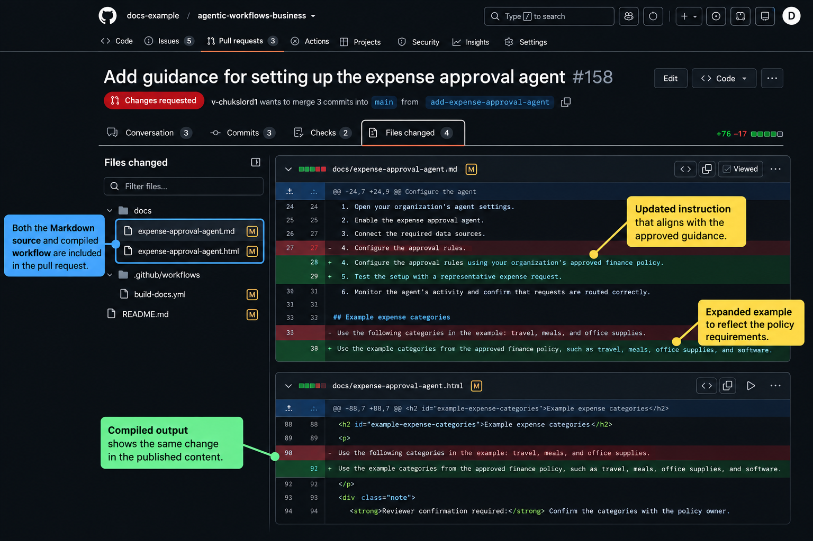
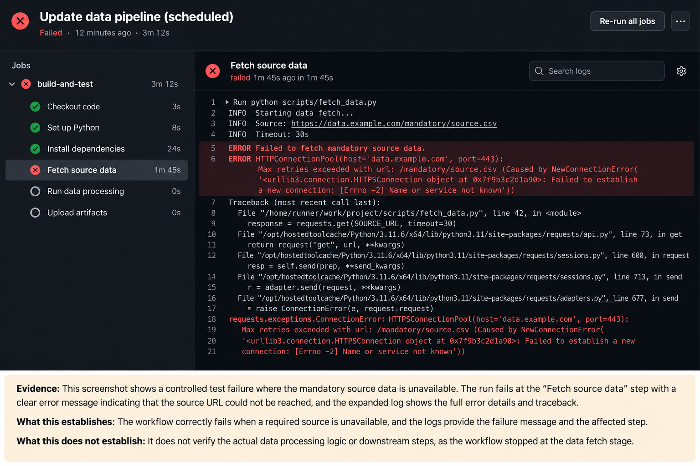
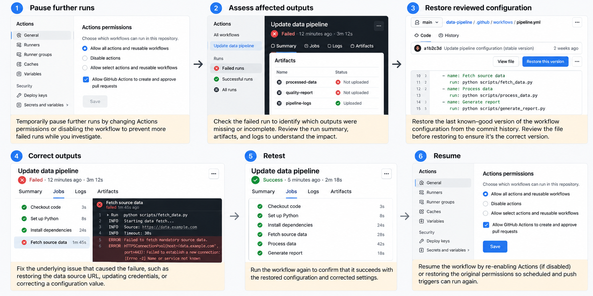

## **Unit 7 — Version the Workflow**

A workflow is a controlled artifact: its instructions and configuration affect a business process, so changes need ownership, review, and a record.

GitHub repositories retain file history. A commit records a set of changes; a pull request proposes integrating those changes into the shared version. These mechanisms let people inspect what changed and discuss why.

### **Assign ownership and record the rationale**

Identify the business owner responsible for purpose and acceptance criteria, and the technical maintainer responsible for configuration and operation. One person may hold both roles, but neither responsibility should be left implicit.

For each meaningful change, record:

- The problem and intended improvement.

- The behavior that should change.

- The behavior, access, and outputs that must remain unchanged.

- Test evidence and relevant limitations.

- Who reviewed and accepted the proposal.

"Improve reporting" is too vague. "Add source links to significant findings while preserving the reporting period, required sections, and permissions" gives reviewers something specific to inspect.

### **Review source and compiled changes together**

GitHub's documented update process is to edit the Markdown source, recompile, and review and commit both the source and .lock.yml files.

Use the pull request's Files changed tab to inspect the proposal.

This illustration shows documentation changes. For an agentic workflow, review its Markdown source and compiled .lock.yml file together.

Files changed shows the proposed file differences. Review instruction changes against the business requirement and ask the maintainer to explain generated configuration changes. Source: [GitHub Docs: Reviewing proposed changes](https://docs.github.com/en/pull-requests/how-tos/review-pull-requests/reviewing-proposed-changes-in-a-pull-request?utm_source=chatgpt.com).

You don't need to understand every generated operation to contribute. Check the wording, scope, output, approval boundaries, and evidence. Involve the appropriate owner if permissions or publication behavior expand.

Repeat checks for previously accepted behavior as well as the intended improvement. These regression checks can reveal that a clearer report has accidentally lost its limitations section or begun making commitments.

### **Recognize when a change is larger than it appears**

Adding recommendations to a report changes its content. Allowing the workflow to assign those recommendations to people changes its authority. Although the wording of a change request may combine them, they need different review.

Separate the proposal into its effects:

1. What new reasoning or content is required?

1. What new action could occur?

1. Who or what becomes affected?

1. Which access or output permissions change?

1. Which tests show that the new behavior stays within scope?

A business owner may approve richer recommendations while declining automated assignments. Splitting the decisions prevents a useful content improvement from carrying an unnoticed expansion of authority.

Other small-looking changes can also affect behavior: broadening an event trigger, switching a reference source, or changing a model. Include them in review even when the main instructions are unchanged.

### **Preserve a known-good configuration**

A known-good configuration is an identifiable, reviewed, and tested state with understood limitations. Record its commit, relevant dependencies or references, and validation evidence. "The version that worked last week" isn't enough.

After a change, inspect both execution and output quality. Open Actions, select the workflow run, and inspect its jobs and logs.

Logs provide execution evidence. This generic screenshot doesn't establish an agentic workflow or the cause of its failure. Source: [GitHub Docs: Using workflow run logs](https://docs.github.com/en/actions/how-tos/monitor-workflows/use-workflow-run-logs?utm_source=chatgpt.com).

A successful run doesn't prove its report is accurate. Check that the output meets the business criteria and reached its destination. A failed run may also have produced an output before a later step failed.

### **Reuse configurations with review**

Reusable Actions workflows centralize repeatable execution logic. Imported agentic workflows provide existing sources that can be adapted and updated through GitHub's documented tooling. These are different reuse mechanisms.

For either, inspect ownership, trust, permissions, outputs, dependencies, and update behavior. Reuse doesn't transfer another team's authorization to yours. Upstream changes can also conflict with local adaptations or alter behavior, so review and test updates rather than adopting them blindly.

When adopting an update, compare it with the local business agreement. Check whether it changes source coverage, introduces another destination, or expects different credentials. Preserve intentional local adaptations and have the maintainer resolve conflicts and recompile where required.

### **Keep an operational record useful to the next owner**

Version history explains file changes, but a successor also needs to find the accepted purpose, tests, known limitations, and recovery procedure. Keep those records discoverable with the workflow rather than only in an author's private messages.

When investigating a problem, record the affected run, configuration identity, expected behavior, and observed difference. "The report omitted its source links after the update" is actionable; "the agent seems worse" isn't.

Don't copy sensitive inputs into a broadly visible troubleshooting record. Link to authorized evidence or provide a suitably limited description. The record should support diagnosis without widening information access.

Use this evidence to decide what to change. An outdated reference needs correction at its source; a delivery failure may need an operational fix. Neither necessarily requires rewriting all the instructions.

### **Plan how to recover**

GitHub's Revert control can create a new pull request reversing a merged pull request, where available and with appropriate permissions.

Revert proposes a reversal; it doesn't immediately restore operations or undo earlier outputs. Source: [GitHub Docs: Reverting a pull request](https://docs.github.com/en/pull-requests/how-tos/merge-and-close-pull-requests/reverting-a-pull-request?utm_source=chatgpt.com).

Restoring files doesn't retract a published report, undo a business decision, or necessarily stop a running execution. Recovery may require pausing the workflow, restoring the accepted configuration, correcting affected outputs, and retesting before resuming.

Use a consistent change-management sequence: describe the change, assess its impact, update and compile, review, test, approve, then observe the result. Keep a manual fallback so the business process can continue while automation is unavailable.