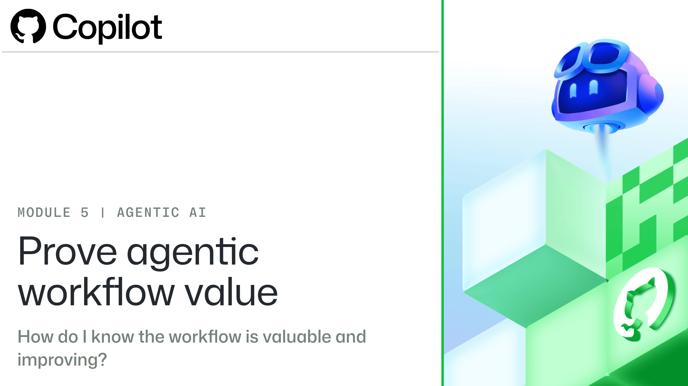

# **Prove agentic workflow value**

# **Unit 1: Introduction**

Teams spend time preparing reports, checking documents, comparing versions, and finding work that needs attention. An AI agent can help with these activities, but a useful workflow needs more than an instruction to “handle the work.” It needs a defined purpose, reliable evidence, clear limits, and acceptance criteria.

An **agentic workflow** combines instructions for the work with the tools and controls that govern how the agent operates. The team defines the task and the acceptable result; the workflow determines what information and actions are available to the agent.

For example, a reporting workflow might compare a summary with approved figures, identify unsupported claims, and leave the final acceptance decision to a person. The workflow is valuable only when the result meets the requirements and the evidence supports its claims.

Your role is to define what the process should accomplish, what the agent may access or change, and what makes an output acceptable. Technical colleagues can help configure the workflow, but the business owner still decides whether the implementation and results match that intent.

In this module, you’ll evaluate a fictional five-day reporting trial. You’ll establish a baseline, inspect run evidence, measure quality and cost, and use the results to improve the workflow one controlled change at a time.

## Learning objectives

By the end of this module, you are able to:

- Measure how the current process performs, and set targets before a trial.

- Check that the evidence supports each claim, for the version you review.

- Calculate acceptance, rework, and recovery rates.

- Calculate the cost of each accepted result.

- Make one change at a time and measure its effect.

## Prerequisites

### Required knowledge

Before starting the module, you should have:

- A GitHub account

- A fundamental understanding of repositories, GitHub Issues, and pull requests

- Basic familiarity with GitHub Actions workflows and run records

- Familiarity with GitHub Copilot and its basic capabilities