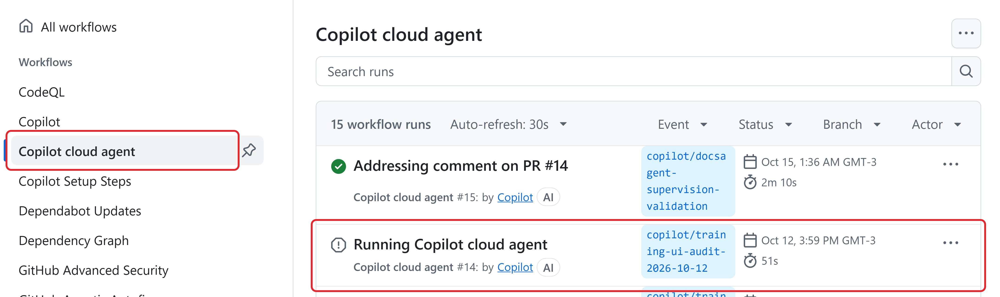
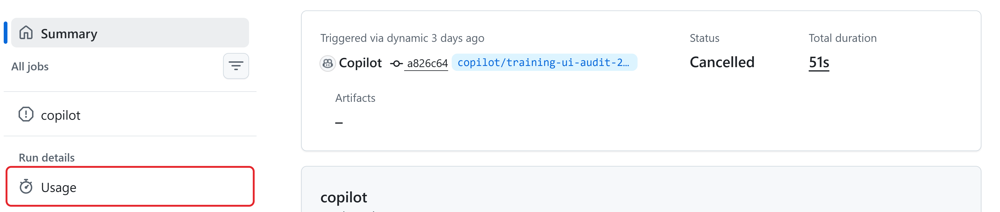
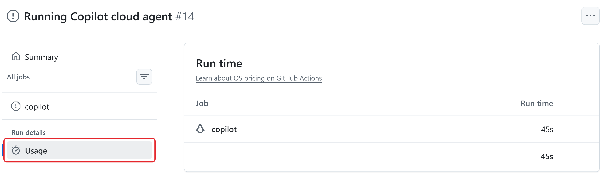
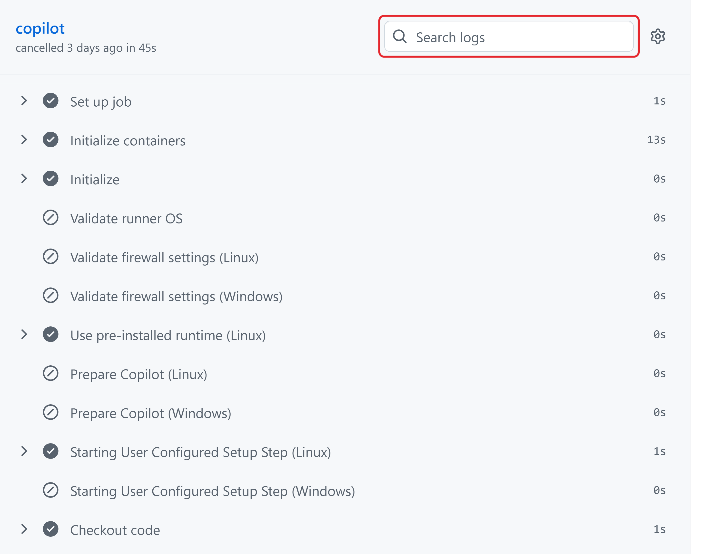
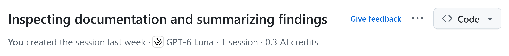

# **Unit 3: Inspect Run Evidence**

When an agent run reports success, trace what happened to records a reviewer or auditor can open.

In this module, "workflow" has two meanings. Your team's workflow is the way your team uses an agent. A **GitHub Actions workflow** is a set of automated steps that GitHub runs.

Its records use these terms:

- A **run** is one execution of a GitHub Actions workflow.

- A **job** is a group of related work inside a run.

- A **step** is one task inside a job: it runs a script or an action.

- **Logs** record messages during the run.

- **Artifacts** are files that the run saves as output.

- A **Verified** badge means GitHub successfully verified the commit's signature. For an agent commit, check that the verified signer is the agent; the signature confirms the signed commit contents, and changing them would create a different commit that needs a new signature. The badge alone does not prove who authored the commit.

GitHub Copilot sessions run as GitHub Actions workflows, so the same run records apply to them.

## Use evidence in the right order

Check the output against its requirements. Write down which version you reviewed: the commit in a repository, or the revision label you agreed on with the owner for a document, such as v3. If the output changes, review the new version.

Use the evidence in this order:

1. **The output itself and the check results for that version.** These decide acceptance.

1. **Logs and run records.** They show what happened, including errors and tool activity.

1. **Summaries, including the agent's own.** Use them to find evidence, and then check that evidence.

## Request evidence when you can't inspect the system

In a text editor, write an evidence request for the **task owner**, the person who accepts the work, or the technical reviewer. Identify the task, the output version, the requirements, and the claims to check. Ask for:

- The output and source links you're allowed to see.

- The check results and the version each one covers.

- Any checks that didn't run.

- The records of every attempt.

- The review and correction time.

The agreed cost records come from the billing administrator.

For example, when reviewing a report, check each figure against the approved source yourself. If the agent's description says "all figures checked against data/13-figures.csv," look for the record of which figures it checked and for which version of the file. Without it, mark the claim unverified. If you can't check an essential requirement, keep the output unaccepted.

## Open a run and read its records

You need read access to a repository that uses GitHub Actions and a completed run that the owner points you to. If you don't have one, create your own with the exercise at the end of this unit, or use the fictional example.

1. On the repository's main page, select the **Actions** tab.

1. In the left sidebar, select the workflow, for example **Copilot**. The list on the right is the workflow's **run history**. Each run shows its trigger, branch, date, and duration. Select the run you need.

The Actions tab. Select a workflow, and then a run. This screenshot retains the earlier workflow label.

1. On the run's **Summary** page, record the **Status**, **Total duration**, the run's commit, and its URL. Check **Artifacts** for output files. Record the run's commit separately from the version of the output you reviewed.

A run's Summary page. Total duration is the run's time, not the request's cycle time.

1. Note whether the run has **Annotations**. They can record errors or cancellations; use them as evidence when you assess the run.

1. Under **Run details**, select **Usage** and record each job's run time. This isn't necessarily the billable time: billable minutes depend on the repository and runner, and eligible job times are rounded up. The billing administrator has the billed minutes.

The run's Usage page lists the run time per job.

1. In the left sidebar, select a job to open its log. Expand the steps you need, and then use the **Search logs** field above the steps. The search covers only expanded steps, so an empty result doesn't prove that the information is absent.

A job log. Each step shows its own time, and Search logs searches the expanded steps.

1. To share a log line, select its line number and copy the URL from the address bar. Check that the people who need it can open it.

## Find the model and credits for an agent session

A Copilot session shows its own cost evidence:

1. Go to **github.com/copilot/agents** and select the session in the left sidebar.

1. Under the session title, read the summary line: who created the session, the model, the number of sessions, and the AI credits used.

The session summary line names the model and the AI credits used.

Each response in the session log also ends with the model and the credits that response used.

## Keep an evidence record

For a document outside GitHub, agree on a document identifier and a revision label with the owner. Keep the reviewed copy, the approved source version, the requirement checklist, the review decision, and any run or check references together in the approved location. The owner confirms which version the checks cover.

In a text editor, record:

- The original request and its acceptance criteria.

- The run URL, date, attempt number, workflow version, and commit. If you can't find the workflow version or the commit, the technical reviewer has them.

- Links to the output and to the relevant jobs and steps.

- The agent and model, but only when the evidence names them.

- The tool actions you saw, the errors, the review minutes, the correction minutes, the human interventions, and the owner's decision.

To keep the counts consistent, use one row per request in a shared spreadsheet, with columns like these. The rates then come straight from the sheet, with no recounting:

### Operational results

| **Request** | **Attempts** | **Accepted** | **Cycle time (min)** | **Human minutes** |
| --- | --- | --- | --- | --- |
| R-01 | 1 | Yes | 35 | 15 |
| R-02 | 2 | Yes | 70 | 30 |

### Exceptions and resource usage

| **Request** | **Rework** | **Exception** | **AI credits** | **Actions minutes** |
| --- | --- | --- | --- | --- |
| R-01 | No | No | 0.3 | 1 |
| R-02 | Yes | Yes | 0.7 | 2 |

Several attempts still count as one request. Mark missing evidence as "unavailable," never as zero or "passed." Follow the access and retention rules, and keep passwords, keys, and personal information out of the record.

Logs and artifacts can expire. When only some jobs run again, keep the earlier logs too, because the latest log download includes only the jobs that ran again.
