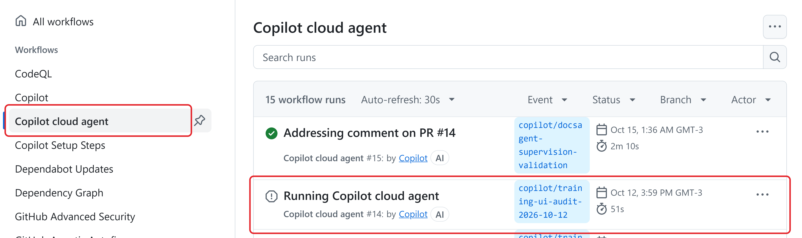
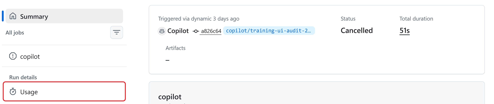
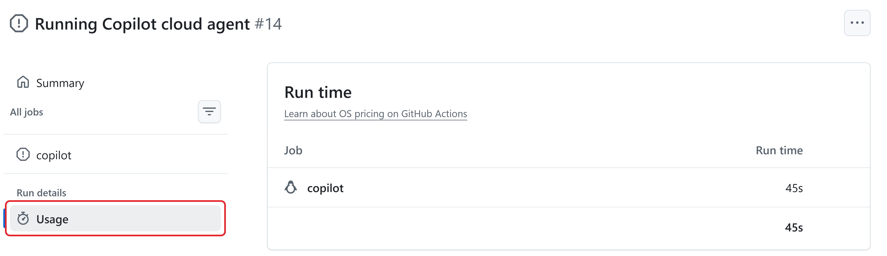
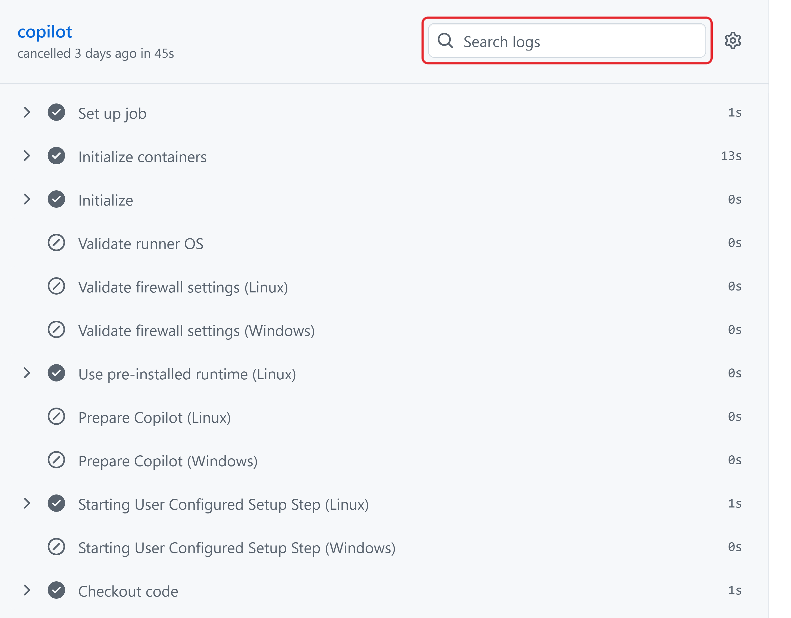
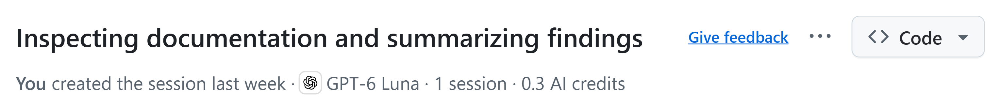
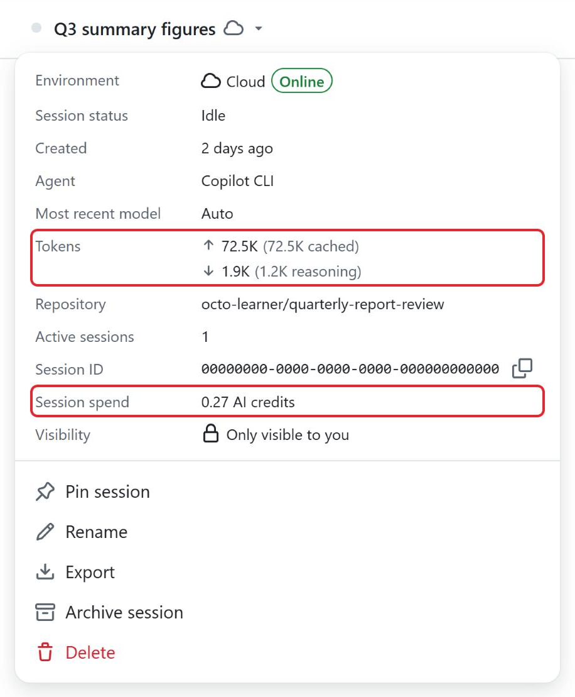

# **Unit 3: Inspect Run Evidence**

When an agent run reports success, use records that a reviewer or auditor can open to verify what happened.

In this module, "workflow" has two meanings. Your team's workflow is the way your team uses an agent. A **GitHub Actions workflow** is a set of automated steps that GitHub runs.

A GitHub Actions workflow's records use these terms:

- A **run** is one execution of a GitHub Actions workflow.

- A **job** is a set of related steps inside a run.

- A **step** is one task inside a job: it runs a script or an action.

- **Logs** record messages during the run.

- **Artifacts** are files that the run saves as output.

Copilot sessions that you start by assigning an issue to Copilot, or by mentioning @copilot in a pull request, run on GitHub Actions, so they have Actions run records. GitHub Agentic Workflows also run on GitHub Actions. Cloud sandbox sessions have a session log instead of an Actions run record.

## Use evidence in the right order

Check the output against its requirements. Write down which version you reviewed. In a repository, that's the commit. For a document, it's the revision label you agreed on with the person who assigned the task. If the output changes, review the new version.

Use the evidence in this order:

1. **The output itself and the check results for that version.** These decide acceptance.

2. **Logs and run records.** They show what happened, including errors and tool activity.

3. **Summaries, including the agent's own.** Use them to find evidence, and then check that evidence.

## If you can't open the run

When you can't open the run, the person who assigned the task or the repository administrator sends you the evidence. It covers the task, the output version, the requirements, and the claims to check, and it includes:

- The output and source links you can open
- The check results and the version each one covers
- Any checks that didn't pass, including errors and warnings
- The records of every attempt
- The review and correction time

When you review a report, check each figure against the approved source yourself. Record which figures you checked and the version of the source file. Keep this record as part of your evidence. If you can't check an essential requirement, leave the output unaccepted.

## Open a run and read its records

You need read access to a repository that uses GitHub Actions and a completed run that a team member points you to. If the session ran in a cloud sandbox, use its session log instead.

1. On the repository's main page, select the **Actions** tab.

2. In the left sidebar, select the workflow, for example **Copilot cloud agent** for an issue assigned to Copilot. The separate **Copilot** workflow is Copilot code review. The list on the right is the workflow's **run history**. Each run shows its trigger, branch, date, and duration. Select the run you need.

    

    The Actions tab. Select a workflow, and then a run.

3. On the run's **Summary** page, record the **Status**, **Total duration**, the run's commit, and its URL. Under **Artifacts**, check for output files. Record the run's commit separately from the version of the output you reviewed.

    

    A run's Summary page. Total duration is the run's time, not the request's cycle time.

4. Note whether the run has **Annotations**. They can record errors or cancellations. Use them as evidence when you assess the run.

5. Under **Run details**, select **Usage** and record each job's run time. This isn't necessarily the amount billed. The charge depends on the repository and the runner, the server that runs the job. Ask the billing manager for billed compute costs.

    

6. In the left sidebar, select a job to open its log. Expand the steps you need, and then use the **Search logs** field above the steps. The search covers only expanded steps, so an empty result doesn't prove that the information is absent.

    

    A job log. Each step shows its own time, and Search logs searches the expanded steps.

7. To share a log line, select its line number and copy the URL from the address bar. Check that the people who need it can open it.

## Find the model and credits for an agent session

A Copilot session shows its own cost evidence:

1. In the repository, select the **Agents** tab, and then select the session you need. You can also open it under **Sessions** in the Copilot sidebar.

2. Under the session title, read the summary line: who started the session, where it came from, and the agent. Then point to a response, and point to the **View message info** icon below it. The tooltip shows the model and AI credits for that response.

    

3. Select the session title to open its details. **Session spend** shows the total AI credits, **Tokens** shows input and output tokens, and **Environment** shows where the session ran. Record the whole session's spend, not just one response's credits.

    

## Keep an evidence record

For a document outside GitHub, keep the reviewed copy, the approved source version, the checklist, and the decision together in the team's approved location, with the revision label the owner confirmed.

In a text editor, record:

- The original request and its acceptance criteria.

- For an Actions session, the run URL, date, attempt number, workflow version, and commit. For a cloud sandbox session, the session link and the reviewed output version. If you can't find a workflow version or commit, ask the technical reviewer.

- Links to the output and to the relevant jobs and steps.

- The agent and model, but only when the evidence names them.

- The tool actions you saw, the errors, the review minutes, the correction minutes, the human interventions, and the owner's decision.

To keep the counts consistent, use one row per request in a shared spreadsheet, with columns like these. The rates then come straight from the sheet, with no recounting:

### Operational results

| **Request** | **Attempts** | **Accepted** | **Cycle time (min)** | **Human minutes** |
| --- | --- | --- | --- | --- |
| R-01 | 1 | Yes | 35 | 15 |
| R-02 | 2 | Yes | 70 | 30 |

### Exceptions and resource usage

| **Request** | **Rework** | **Exception** | **AI credits** | **Actions compute cost** |
| --- | --- | --- | --- | --- |
| R-01 | No | No | 0.3 | $1 USD |
| R-02 | Yes | Yes | 0.7 | $2 USD |

Mark missing evidence as "unavailable," never as zero or "passed." Follow the access and retention rules, and keep passwords, keys, and personal information out of the record.

Logs and artifacts can expire.
