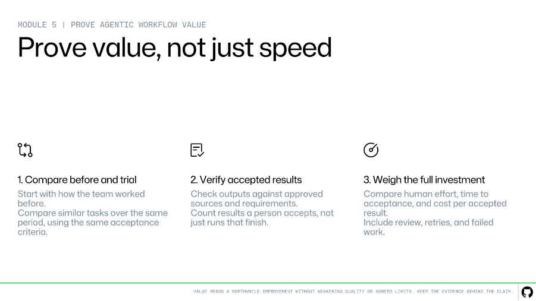
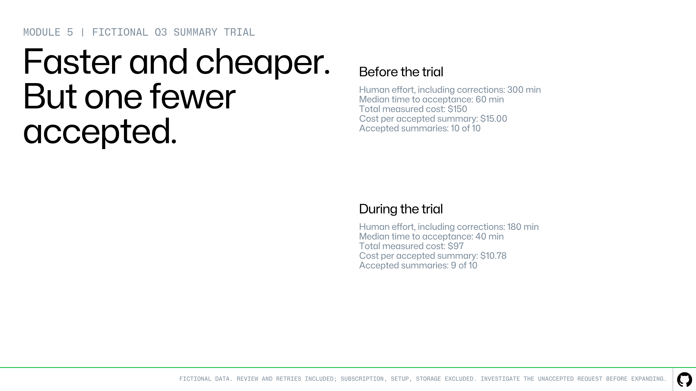

# **Unit 5: Connect Cost to Value**

An AI-assisted workflow uses AI credits, compute, and people's time to review and correct outputs. In this unit, you'll learn to calculate one number: the cost of each accepted deliverable, including the time people spent fixing drafts.

Prove value by comparing similar work, verifying accepted results, and counting the full investment.

## How AI credits measure cost

**Tokens** measure the input and output a model processes, including cached input it reuses. The token counts and the model's prices determine AI usage cost. One GitHub AI credit currently equals $0.01 USD, so 500 credits have a value of $5 USD. AI-credit allowances and pricing can change, so check current rates and allowances before a trial, and record the rate you use.

## Find the cost records

No single report shows every cost, and a missing cost makes the workflow look cheaper than it is. Collect each cost from its own source:

- **AI credits for one agent session:** select the session title and read **Session spend**. Point to **View message info** under a response to see its model and credits.

- **AI credits for an automation:** in the repository's **Agents** tab, select **Automations**, and record the automation's usage for the trial. Use it to reconcile session usage, not as an extra charge to add to the same sessions.

- **AI credits by model for the month:** if you pay for your own subscription, select your profile picture > **Settings** > **Billing and licensing** > **AI usage**. If your organization pays, select your profile picture > **Copilot settings**. **Usage this cycle** shows only your total. The billing manager exports figures by model and the organization's costs from the AI usage report.

- **Compute costs:** ask the billing manager for billed Actions runner or cloud sandbox usage. To review an Actions run, open the repository's **Actions** tab, select the run, and then select **Usage**.

    For a personal account's sandbox usage, select your profile picture > **Settings** > **Billing and licensing** > **Overview**. Under **Metered usage**, select **Sandbox**. Sandbox compute and eligible Actions runner usage draw from the same included compute amount.

- **AI credits per person or team:** in an organization, the billing manager filters the AI usage report by user, model, organization, or cost center, and can export it.

- **People's time:** your team's own records of review and correction minutes.

Credits within your subscription's included allowance don't add a charge. Copilot code review and GitHub Agentic Workflows use Actions compute. Both also use AI credits. GitHub Agentic Workflows are generally available.

Estimates can differ from the invoice, so check final charges with the billing manager. Count human review and correction time separately from AI usage.

## Include the whole cost boundary

Assign a value to people's time and the resources used. This **valuation** is an estimate for comparison, not an invoice. Agree on one hourly rate with the measurement owner and record it in the trial plan.

Divide everyone's total minutes by 60, and multiply by that rate. Add the resource costs and other relevant expenses to get the cost of the group of requests, the **batch**.

Divide the total batch cost by the number of accepted outcomes. Include the costs of failed requests, incomplete requests, and retries. If nobody accepts any outcome, you can't calculate a cost per accepted outcome.

State whether you included a share of the subscription, setup fees, and storage. Count each cost once. If you estimate the cost of AI credits, leave out the invoice charge for the same credits.

## Worked comparison

Suppose the team compared five days of summary work before and during the trial. All numbers are fictional.

At the agreed $30 USD hourly rate, 300 human minutes before the trial cost $150 USD. During the trial, 180 minutes, including fixes, cost $90 USD. The trial also used 500 AI credits ($5 USD at list price) and $2 USD of compute, including retries. The team's Copilot license included the credits, and the GitHub plan's shared allowance in USD covered the compute, so they added nothing to the invoice. The team counts them anyway, because the trial used those resources, and their list price still matters once the included amounts run out. Trial total: $97 USD.

| **Measure** | **Before the trial** | **During the trial** |
| --- | --- | --- |
| Accepted summaries | 10 of 10 accepted | 9 of 10 accepted |
| Total cost (people plus usage at list prices) | $150 USD | $97 USD |
| Cost per accepted summary | $15.00 USD | $10.78 USD |
| Typical time to acceptance (median) | 60 min | 40 min |

Throughput, the number of accepted summaries in the same five days, fell from 10 to 9.

What the results mean: The trial reduced human effort, the measured cost, and the median time to acceptance, but it produced 9 accepted summaries compared with 10 at baseline. Investigate the unaccepted request, review the quality evidence, and confirm that the workflow stayed within the agreed limits before you expand it.

Lower cost and faster delivery do not tell the whole story. Investigate the unaccepted request before expanding the trial.

## Read value beyond cost

- **Time saved** creates capacity for other work. It becomes a cash saving only if actual spending falls.

- **Cost avoided** needs a real alternative that the team would otherwise have paid for.

- **Risk reduction** needs evidence about defects, severity, or incidents.

Counts of requests and users show that people use the workflow, but use alone isn't value.

A value claim holds up when it shows three things: people use the workflow for the work it supports, the work meets the acceptance criteria reliably, and the result improves a measure the business already tracks, such as time per task, error rate, or cost per outcome.

The baseline you recorded before the trial holds the starting numbers for those measures.

Before you continue, compare the trial results with the targets, the quality standards, the budget, and the agreed limits. The example's $97 USD total is below the approved $120 USD budget recorded before the trial. Staying within budget doesn't establish quality or authorize broader work.