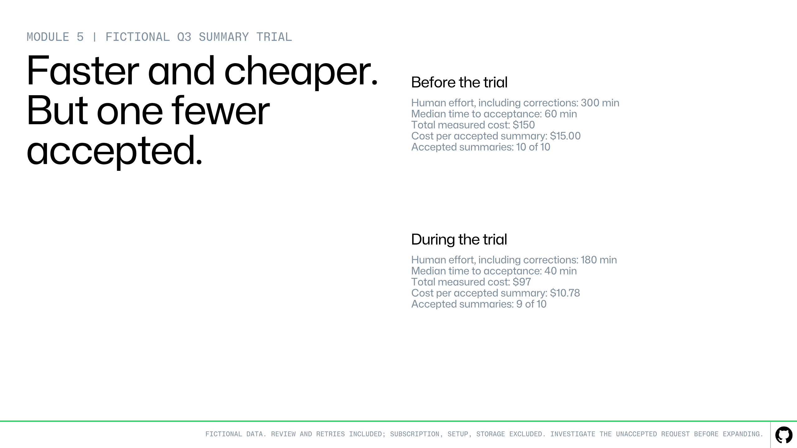

# **Unit 5: Connect Cost to Value**

An AI-assisted workflow uses AI credits and people's time to review and correct outputs. With this unit, you can put one number on the table: the cost of each accepted deliverable, including the time people spent fixing drafts.

[Image: image8 (image file unavailable)]

Prove value by comparing similar work, verifying accepted results, and counting the full investment.

**Tokens** measure the input and output a model processes, including saved context it reuses. AI usage cost depends on the token counts and the model's prices. One GitHub AI credit equals $0.01.

## Find the cost records

No single report shows every cost, and a missing cost makes the workflow look cheaper than it is. Collect each cost from its own source:

- **AI credits for one agent session:** the session's summary line at github.com/copilot/agents.

- **AI credits by model for the month:** if you pay for your own subscription, profile picture > **Settings** > **Billing and licensing** > **AI usage**. If your organization pays, profile picture > **Copilot settings** > **Usage this cycle** shows only your total. The billing administrator exports figures by model and the organization's costs from the AI usage report.

- **GitHub Actions run time:** the repository's **Actions** tab > the run > **Usage**.

- **AI credits per person or team:** in an organization, the billing administrator filters the AI usage report by user, model, organization, or cost center, and can export it.

- **People's time:** your team's own records of review and correction minutes.

Credits within your subscription's included allowance don't add a charge. Fixes started with **Assign to Copilot** on a security alert also use AI credits, so count them in the trial. Every Copilot code review also uses GitHub Actions minutes for the infrastructure that runs it. GitHub Agentic Workflows (in public preview) also use GitHub Actions minutes.

Estimates can differ from the final invoice, so check final charges with the billing administrator. Record the model when the evidence names it. Copilot code review uses a model that GitHub chooses, so record its model as "not disclosed," and count human review and corrections separately from the model's running time.

## Include the whole cost boundary

Give a value to people's time and the resources used. This **valuation** is an estimate for comparison, not an invoice. Agree on one hourly rate with the measurement owner and write it down.

Divide everyone's total minutes by 60, and multiply by that rate. Add the resource costs and other relevant expenses to get the cost of the group of requests, the **batch**.

Divide the total batch cost by the number of accepted outcomes. Include the costs of failed requests, incomplete requests, and retries. Count each accepted request once, however many attempts it needed, and if a person accepts no outcome, you can't calculate a cost per accepted outcome.

State whether you included a share of the subscription, setup fees, and storage. Count each cost once. If you estimate the cost of AI credits, leave out the invoice charge for the same credits.

## Fictional worked comparison

Here's how the team compared five days of summary work before and during the trial. All numbers are fictional.

At the agreed $30 hourly rate, 300 human minutes before the trial cost $150. During the trial, 180 minutes cost $90, fixes included. The trial also used 500 AI credits and some Actions minutes, retries included. At list prices, that usage is worth $5 and $2. Both amounts stayed within the allowances included in the team's Copilot licenses and GitHub plan, so they added nothing to the invoice. The team counts them anyway, because the allowance is a resource the trial consumed, and the trial would still cost that much once the allowance ran out. Trial total: $97.

|  | **Before the trial** | **During the trial** |
| --- | --- | --- |
| Accepted summaries | 10 of 10 accepted | 9 of 10 accepted |
| Total cost (people plus usage at list prices) | $150 | $97 |
| Cost per accepted summary | $15.00 | $10.78 |
| Typical time to acceptance (median) | 60 min | 40 min |

**Decision interpretation:** The trial reduced human effort, measured cost, and median time to acceptance, but it produced 9 accepted summaries compared with 10 at baseline. Investigate the unaccepted request, review the quality evidence, and confirm that the workflow stayed within the agreed limits before expanding it. These results don’t yet prove ROI or that quality was preserved.

Lower cost and faster delivery do not tell the whole story. Investigate the unaccepted request before expanding the trial.

## Read value beyond cost

- **Time saved** creates capacity for other work. It becomes a cash saving only if actual spending falls.

- **Cost avoided** needs a real alternative that the team would otherwise have paid for.

- **Risk reduction** needs evidence about defects, severity, or incidents.

Counts of requests and users show that people use the workflow, but use alone isn't value.

A claim holds up when it connects three links: people use the workflow for the work it supports, the work meets the acceptance criteria reliably, and the result moves a measure the business already tracks, such as time per task, error rate, or cost per outcome.

The baseline you recorded before the trial holds those starting numbers.

Before you continue, compare the trial results with the targets, the quality standards, the budget, and the agreed limits. The example doesn't set a resource budget, so you can't say whether the trial stayed within budget.