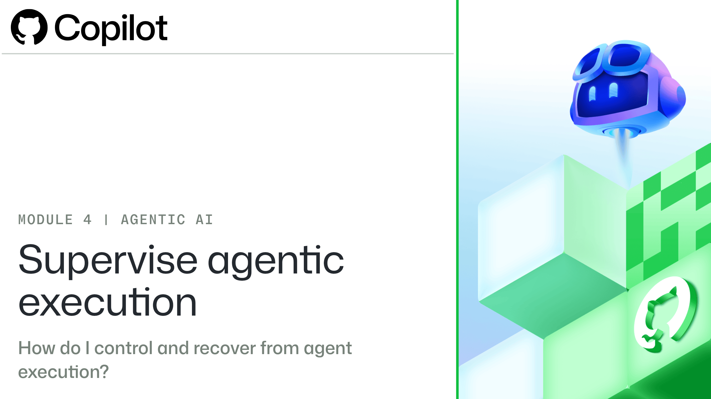

# Module 4: Supervise agentic execution

# Introduction

Teams spend time updating reports, checking documents, and preparing information for leadership or clients. An AI agent can help with this work, but a completed task isn't necessarily an acceptable result. A report can read well and still contain a wrong figure, an unsupported claim, or a change outside the agreed scope.

Useful supervision needs more than watching the agent work. It needs agreed points where a person reviews the evidence and decides whether to approve, revise, redirect, stop, or accept the work. The task's purpose, source information, and limits guide those decisions.

Your role as the person supervising the task is to decide when the agent may continue and what makes the result acceptable. The agent can prepare changes and report what it did, but you need to check whether the evidence supports its claims. If the work goes off track, you decide whether to request a correction or involve another owner.

In this module, you'll follow a fictional team using GitHub Copilot to update a leadership report against approved figures. You'll move from setting human control points to responding to proposed changes, steering a session, recovering from failure, stopping unsafe work, and validating the final result.

## Learning objectives

By the end of this module, you'll be able to:

- **Set approval, review, escalation, and acceptance gates, and name who owns each one.**

- **Approve, reject, revise, or ask for clarification, based on the evidence.**

- **Redirect a running session within the approved task.**

- **Find out why a task failed, then fix it or escalate it.**

- **Stop a session and keep a record for recovery.**

- **Accept a result only when the evidence supports it.**

## Prerequisites

- A GitHub account

- A fundamental understanding of GitHub and GitHub Issues

- Familiarity with GitHub Copilot and its basic capabilities
