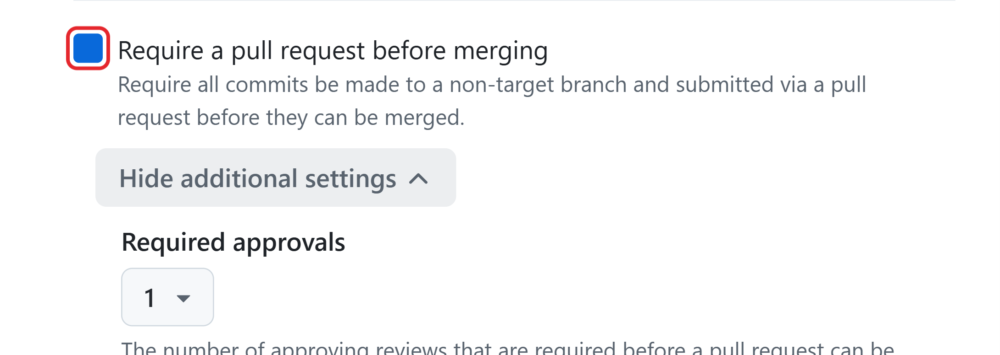

# Unit 2: Human Control Points

An agent can prepare a deliverable, but a person decides whether it's ready to go to leadership. With this unit, you can decide in advance where a person must step in, so the agent never makes a decision that belongs to you, such as what goes to leadership or a client.

**Human-in-the-loop** means a person makes decisions at agreed points in the work. That person needs the information and the authority to act. Watching a session gives you little control unless you know when and how to step in.

## Decide where a person must intervene

One rule keeps the whole system safe: the agent proposes, and people and settings accept. Gates are where that acceptance happens. At each **gate**, someone decides whether the work can move forward.

**Acceptance criteria** are the conditions the result must meet, such as "every number matches the figures file." Some gates are GitHub settings that block the work until a person acts. Others are team agreements that you write, with the person who decides, in the task's issue.

- **Approval gate:** may the agent take the proposed next action? Ask for the purpose, the approved work, the access it needs, the expected effects, and the limits.

  - **Team agreement:** agree who approves the plan, then instruct the agent to propose its approach and wait for that person's approval before making changes.

  - **GitHub setting:** **Require approval for workflow runs** stays on.

- **Review gate:** is the proposed work ready for the next stage? Ask for the proposed changes, the check results, and any unresolved problems. **GitHub setting:** a rule that requires pull request approvals before a **merge**.

- **Escalation gate:** does this need a decision from someone else? Ask for the conflict or risk, its impact, and the decision needed. **Team agreement:** list the contacts in the **task's** issue. For security problems, the repository's security policy, under **Security and quality** > **Security policy**, says where to report them.

- **Acceptance gate:** has the named owner accepted the agreed outcome? Ask for the acceptance criteria, the supporting evidence, and the named person's decision. **Team agreement:** the owner posts the decision as a comment on the pull request.

    

    **Note:** The GitHub settings above are managed in repository settings. Changing **Require approval for workflow runs** needs the administrator role. Managing rulesets needs repository admin access or a custom role with the "edit repository rules" permission. See [About rulesets](https://docs.github.com/en/repositories/configuring-branches-and-merges-in-your-repository/managing-rulesets/about-rulesets).

### The approval gate in repository settings.

To decide where a gate belongs, ask:

- **Is the next action permanent or slow to reverse, such as merging a change into the main files or deleting a file?**

- **Does it affect another system, a workflow, permissions, or data outside the task, such as the approved figures?**

- **Does it add or update a dependency, outside code such as an open-source library that a project needs to run? That code runs inside your organization, and Copilot can download libraries by default.**

- **Could it expose client data, personal data, or passwords and keys?**

- **Does it need more access, cost, or time than the owner approved?**

- **Is the requirement unclear, or did it change during the work, for example because the data owner revised the figures?**

- **Is this the point where someone accepts the work or shares it outside the team?**

If any answer is yes, put a gate there and name the task owner. A gate costs a short wait. Without one, the agent's next action becomes a decision that no person made.

Reviewing a proposed change, letting a workflow run, and accepting a finished task are three separate decisions. Each one has its own gate.

## Add a gate: a worked example

GitHub already blocks some actions for you. Copilot can't merge its own pull request. Author's approval generally won’t satisfy required-approval gates (depending on ruleset configuration). 

In the quarterly-report example shown in this unit's images, the team adds two gates before anyone assigns the task:

1. **A review gate, as a GitHub setting.** Create an **Active** ruleset for the branch receiving the changes, in the repository's settings **Settings > Rulesets**. Enable **Require a pull request before merging**, set **Required approvals** to 1, and leave the bypass list empty. GitHub then blocks merging until an eligible reviewer approves. You need repository admin access or a custom role with "edit repository rules" permission. On GitHub Free, rulesets are available only in public repositories.

    

2. **An acceptance gate, as a team agreement.** The report owner adds one line to the **task's** issue: "Done only when the report owner posts the acceptance as a comment on the pull request." GitHub **doesn't** block anything here. The line works because everyone can read it, and the pull request shows whether the comment exists.

Here's the task passing both gates. The agent opens its pull request, the reviewer checks it and selects Approve, and GitHub allows the merge. Then the report owner checks the result against the acceptance criteria and posts "Accepted: every figure and statement matches data/q3-figures.csv." Only now is the task done.

Without the first gate, anyone could merge an unreviewed change. Without the second, the task would count as done the moment the agent finished, with nobody answerable for the result.

You can also ask the agent to plan first, and you can review its plan before it changes anything. Post your team's decision at each stage as a comment on the issue.

## Name the human owner

Before a task begins, write in the task's issue who can authorize the work, who reviews it, and who accepts the result. Also write the scope and the constraints. The scope defines what the agent is allowed to do, and the constraints define what it must never do, such as changing the approved figures.

**Business acceptance** means the team member who owns the requirement decides that the result meets the agreed needs.

One person can hold more than one role when the repository rules and the risk allow it. If the rules require different people, say so. Without a named owner, acceptance falls to whoever is available, and nobody can show who accepted the risk.

In the following screenshot example, the report owner owns the requirement and accepts the result. The reviewer checks the change without helping the agent create it. The **session operator** is the person who controls the agent and acts on review feedback.

The repository's approval rules still apply.

The report owner writes the roles, the scope, and the limits in the task's issue before anyone assigns it to Copilot. To do the same, **create an issue** with an agreement like this one:

**Task agreement**

- Goal: every number and statement in report/q3-summary.md matches data/q3-figures.csv

- Files the agent may change: report/q3-summary.md only

- Limits: don't change anything in data/, don't share the summary outside the team, don't paste client documents

- Accepts the result: the report owner

- Reviews the change: the reviewer (didn't work with the agent)

- Access questions: the repository administrator

- Stop contacts: the session operator, then the report owner

- Done only when the report owner posts the acceptance as a comment on the pull request

Add the approved task agreement to the issue before assigning it to Copilot.

1. When the report owner approves the agreement and the team is ready, hand the task to the agent. In the issue's right sidebar, select **Assign to Agent**.

2. In the **Assign agent to issue** dialog, which is in preview, check the repository, and add anything that applies to this run only in **Optional prompt**. Then select **Assign**. Assigning starts a session and uses AI credits, so do it only for an approved task.

  

The agreement uses three ideas you'll see again:

- The **source of truth** is the file the team treats as correct. Here it's data/q3-figures.csv, the approved figures. The summary must match it, never the other way around.

- A **check** is one test of the result against its source, such as "Q3 revenue in the summary matches the Total row." A check covers only the version you checked. A skipped check isn't a pass.

- **Sharing outside the team** means the summary leaves the people named in the issue, for example to leadership or the client.

## Handle exceptions

An **exception** is a situation outside the agreed plan. For example, the agent reports that West's figures look wrong and proposes to change the figures file. For each exception, post a comment on the issue or the pull request with its owner, the reason, and the permitted next action.

Keep the original limits in place while the owner decides.

### Optional: Check the example yourself

You don't need this section to follow the module. It shows the two files behind the quarterly-report example, so you can do the checks from the later units yourself.

The team's source of truth is data/q3-figures.csv. Here are its approved Q3 figures by region. Revenue is in thousands of US dollars.

| Region | Q3 revenue (thousands) | Change from Q2 | Operating margin |
|---|---|---|---|
| North | 4,820 | +9.5% | 16.8% |
| South | 3,950 | +1.8% | 14.2% |
| East | 5,210 | +5.3% | 17.3% |
| West | 2,780 | -2.5% | 9.7% |
| Total | 16,760 | +4.2% | 15.2% |

The agent starts from report/q3-summary.md. Here are the claims in it that the later units check:

> Q3 revenue reached $16.9 million, up 4.2% from Q2. North grew revenue 9.5% to $4.8 million and had the highest operating margin of any region, at 16.8%. South grew revenue 1.8% to $4.0 million. West grew revenue 2.5% to $2.8 million. The team expects all four regions to grow in Q4.

**Try it.** The summary has four problems: one wrong number, two wrong comparisons, and one claim the figures don't support. Find them before you read on.

**Answers.** Revenue should read $16.8 million, because the Total row is 16,760 thousand. East has the highest operating margin, at 17.3%, not North. West's revenue fell 2.5%, as the Change from Q2 column shows. The figures hold no Q4 numbers, so the outlook is unsupported until the report owner decides how to label it. South's $4.0 million is a rounding choice, not an error. Unit 4 treats it as a question for the report owner.

