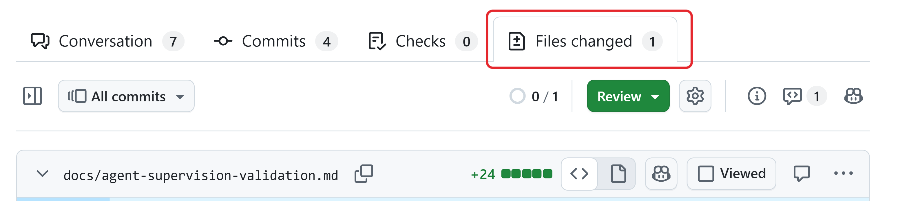
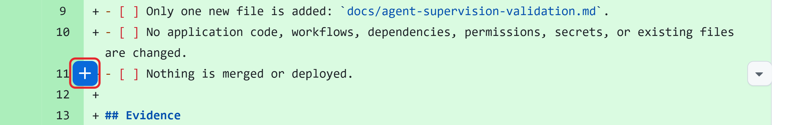
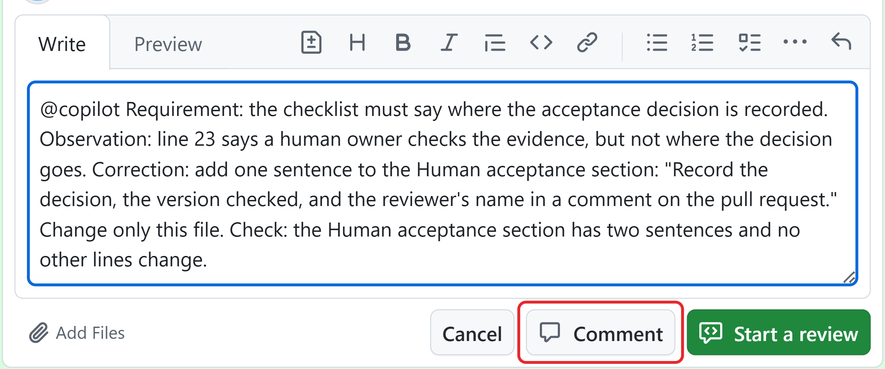
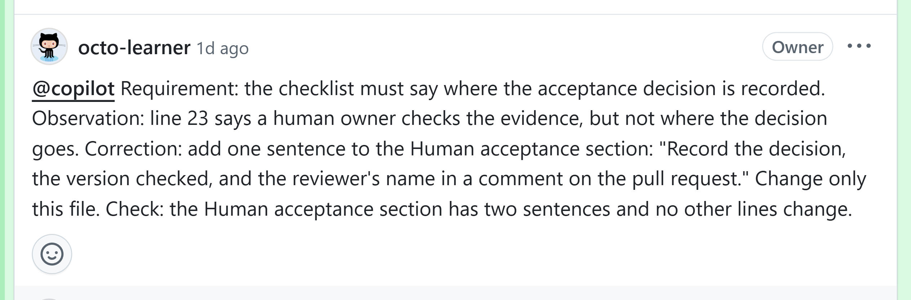
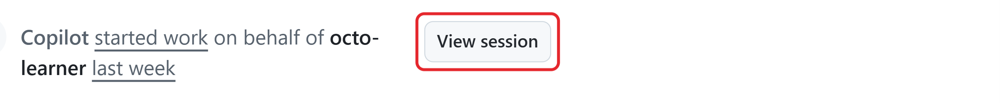
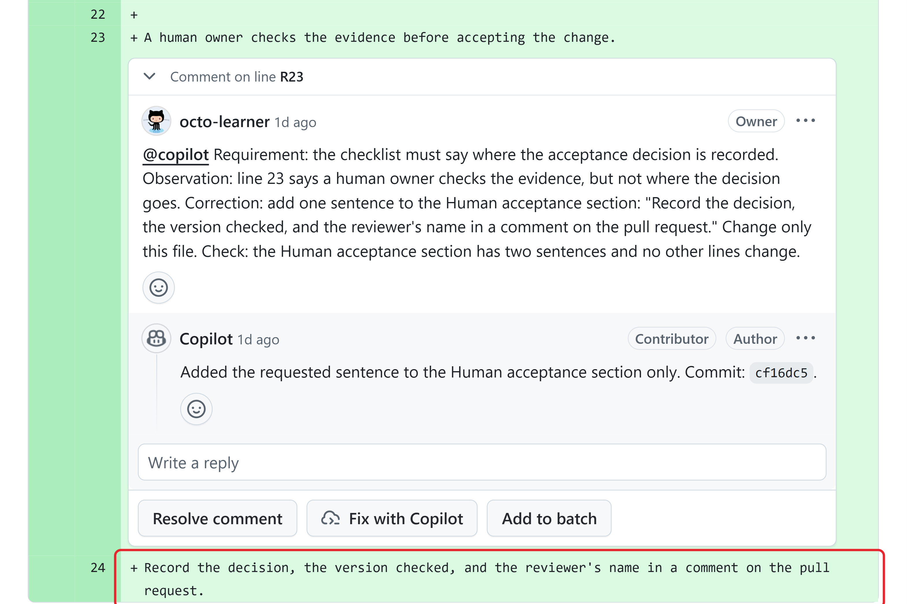

# Unit 3: Approve, Reject, Revise

A first draft may include a statement its sources don't support. With this unit, you can turn a wrong first draft into the right result with one clear comment, instead of rewriting it yourself.

Choose a response based on the proposed action and the evidence.

## Choose the response that resolves the problem

Suppose the task is to update a summary using an approved figures file. The agent may change the summary, but not the source file.

- **Approve** when the agreement permits the next action and enough evidence supports it. Name the action, the evidence you checked, and the limits that still apply.

**Example:** The summary now matches the approved figures, and no other files changed. You checked both, so you approve the correction.

- **Reject** when the proposed action is unacceptable or the agreement doesn't permit it. Explain which limit it crosses and whether the agent may propose another approach.

**Example:** The agent proposes changing the approved figures to match the summary. The source file is outside the task, so reject that change.

- **Revise** when the goal is valid, but the proposed work has a specific problem. Explain what's wrong, the correction you need, and how to check it.

**Example:** The approved figure is $16.8 million, but the summary says $18.6 million. Ask the agent to correct the number in the summary.

- **Clarify** when the intended result is unclear or essential information is missing. Ask the question someone must answer before you choose the next action.

**Example:** The summary includes a prediction for next quarter, but the source file has no figures for that quarter. The report owner decides whether to keep the prediction and how to label it.

## Give feedback the agent can act on

Useful feedback says **what the requirement says, what you found, what must change, and how to check it**. For example:

The summary must match the approved figures file. It says $18.6 million, but the approved figure is $16.8 million. Correct that number in the summary and check it against the source. Don't change the figures file or any other text.

This corrects the problem without expanding the task. "Fix it" doesn't explain the next action, and "make the summary better" invites unrelated changes.

**Accountability** means a named person makes each decision and records the reason. Post your decision as a comment on the issue or the pull request, so the next reviewer knows who approved what. If the agent already made changes, check them too, because a rejection or a revision request leaves them in place.

## Review a sensitive change

The same method works with client information. Suppose the task is to remove a client's name from the summary and its earlier draft. The agent removes it from the summary but leaves it in the draft. It also proposes posting the summary in a public issue, where people outside the team could read it.

Reject the post and don't accept the change yet. If the agent is still running, the session operator stops the session. Then give the session operator, or the agent's pull request, a correction like this one:

Remove the client's name from the earlier draft too. Change nothing else, and don't post either document in a public issue. List both files in the pull request description so we can check them.

The reviewer checks both files for the client's name and any other information the team must not share. They record their decision on the pull request.

## What you need to request a correction

To ask Copilot to update an existing pull request on GitHub, use an account with write access to a repository where Copilot is enabled.

A repository administrator manages your access to the repository. Your organization or enterprise can also restrict Copilot through policies. Write access alone doesn't override those restrictions.

Sessions and follow-up work use AI credits. Copilot also uses GitHub Actions, so running time can add cost.

Follow the responsibilities and reporting arrangements recorded in the task's issue.

## Request a correction on a pull request

Sign in to GitHub.com and request only an authorized correction. A wider change needs an owner's decision first.

1. In the repository, select **Pull requests**, open the pull request you want Copilot to update, and select the **Files changed** tab. The **Review** button on this tab submits a review of the whole change.

**The Files changed tab lists each changed file. Review submits a review of the whole change.**

1. Point to the line you want to comment on. A blue **+** button appears next to the line number. Select it.

**Point to a line to show the + button, and then select it to comment on that line.**

1. **In the comment field, mention @copilot and use the feedback pattern: requirement, what you found, correction, and how to check it. Keep the existing scope and limits.**

**A correction written in the feedback pattern. Comment posts it on its own. Start a review holds it until you submit the review.**

1. Select **Comment** to post this single comment. If you select **Start a review** instead, submit the review to publish your feedback. When Copilot starts a session for your comment, an eyes reaction (👀) appears on it.

**The posted comment. While the agent works on it, the eyes reaction appears below the text.**

1. Select the **Conversation** tab. For a comment posted there, the timeline shows **Copilot started work**, and **View session** opens the session. For a comment on a line, the agent replies in that comment's thread when it finishes, and its new commit appears in the timeline.

**The timeline entry for a comment posted on the Conversation tab. Select View session to follow the work.**

1. When Copilot finishes, return to **Files changed**. Check the correction against the figures file, then review every changed file for unrelated changes. If anything is still wrong, request another correction before accepting the result.

**The result: Copilot's reply names the commit, and the new line appears in the changed file. Check it against your correction before you accept it.**

By default, Copilot adds the changes to the same pull request. To request another correction, mention @copilot in a pull request comment. If the task started from an issue, don't put follow-up instructions there: Copilot doesn't receive issue comments added after assignment.
