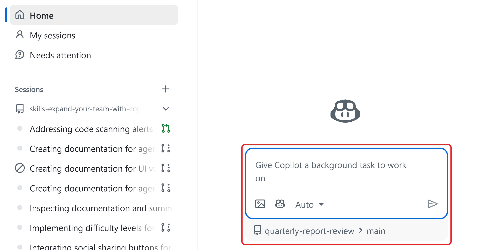
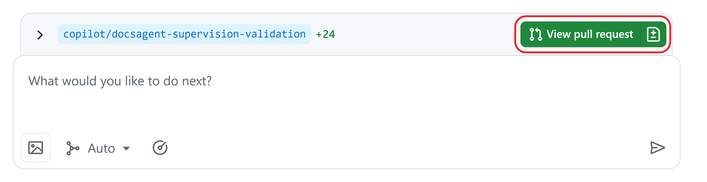

# Unit 4: Steer a Running Workflow

For example, while an agent updates a report, a colleague might ask you to add leadership slides. You can redirect the work while keeping the agreed task in scope.

**Steering** means redirecting a task that's already in progress. You might point to the right source, explain a requirement, or request an approved change. First check that the request stays within the agreed scope.

## Start or restart an approved task

Starting or restarting a task requires repository write access. Use the agreed task requirements. Before a restart:

- **The task owner confirms what failed and which fix the team permits.**

- Save the links from the earlier attempt and check its changes before choosing the base branch for the new attempt.

Summarize what failed, the evidence, and the permitted fix in the new prompt. **Don't** paste the whole earlier session: it can bury the correction.

1. Go to **github.com/copilot/agents**.

2. **Below the prompt box, select the repository button and choose the approved repository. Next to it, select the branch button and choose the approved base branch. The base branch decides which version of the files the agent starts from.**

3. In the prompt box ("Give Copilot a background task to work on"), check that the agent button shows **Agent: Copilot** when you point to it.

4. Enter the approved task. Include the correction, the files that may change, the limits to keep, the checks to run, and when to stop or escalate to an owner. Press **Enter** to submit.

**The Agents page. The repository and branch below the prompt decide where the agent works.**

1. Open the new task under **Sessions** in the left sidebar, or under **My sessions**. Check its repository and activity. For changes, Copilot works on a new branch based on the branch you selected.

2. When the session finishes, select the arrow next to the branch name below the session log to view the changed files. If the session already has a pull request, select **View pull request**. If it doesn't and the result is ready for review, select **Create pull request**.

**The end of a finished session. The arrow shows the changed files, and the prompt box sends a follow-up to the agent.**

Review the pull request before anyone accepts the result.

## Redirect a Copilot session

Steering requires repository write access and a session you started. It keeps the session and the work done so far; a restart opens a new session. Both steering and restarting use AI credits.

1. Go to **github.com/copilot/agents** and select your task in the left sidebar.

2. Read its latest activity. While the agent works, the prompt box below the log shows **Steer active session while agent is working**. Enter the correction and the limits that still apply.

3. Press **Enter**, or select the **Send now** arrow beside the prompt. Check that your message appears in the session.

4. **Read the next activity and the resulting changes to see whether the correction took effect.**

The agent reads your message after it finishes its current action. If continuing is unsafe, stop the session instead of waiting.

## Keep the boundary while changing direction

### Clarify the task or request a scope change

- **Clarification:** explains how to meet the current requirement. **Example:** "Show amounts in millions with one decimal."

- **Scope change:** adds work and needs an owner's decision, in its own issue. **Example:** "Also draft the leadership slides from the summary."

### Keep the limits visible

Limits that apply to every task belong in the repository's custom instructions file, .github/copilot-instructions.md, which Copilot reads on every request. Limits for one task belong in the task's issue.

**Example:** Add a short instruction like this to .github/copilot-instructions.md:

Use the approved figures in the data folder. Don't change those files. If figures don't match, report the difference instead of guessing.

### Send a focused steering message

For example, when correcting a report, a useful steering message is:

Use only the figures in data/q3-figures.csv. Leave the outlook sentence as it is until the report owner decides. Keep changes within report/summary.md. Don't change anything in data/. Report any figure that doesn't match before you continue.

After you send the message, check the changed files to see whether the agent followed it.

### Check unexpected tool use

For example, during an approved report update, the agent proposes using an unfamiliar tool to retrieve additional information. Before authorizing it, check what the tool does, what information it could access, and whether the proposed action stays within the agreed scope. An unfamiliar tool alone isn't a reason to stop.

If the action is outside scope, withhold authorization where possible and steer the agent back to the approved source and files. Escalate any request for broader access to the relevant owner. If continuing could expose sensitive information or cause other harm, stop the session and escalate rather than waiting for the steering message to take effect.

### Pause if the source changes

Inputs can change mid-task too. **Example:** The data owner revises West's figures while the agent is updating the summary.

A changed source changes what "correct" means. The session operator stops the session, and the task owner decides which version of the figures applies.

