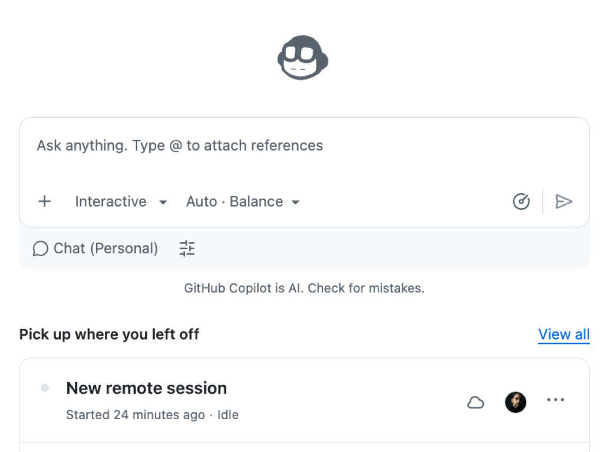
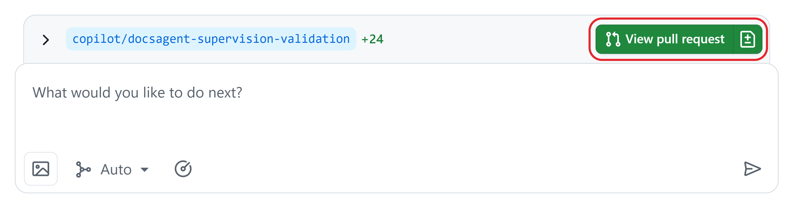
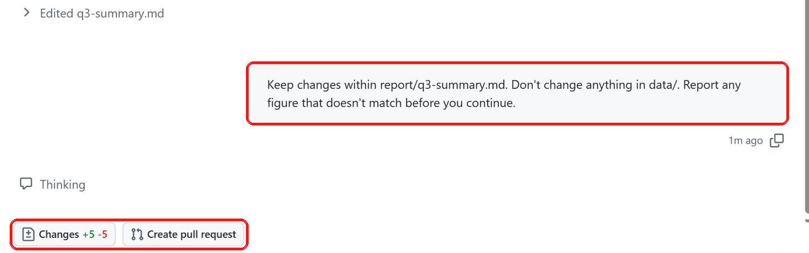

# Unit 4: Steer a Running Workflow

While an agent updates a report, a colleague might ask you to add leadership slides. You can redirect the work while keeping the agreed task in scope.

## Start or restart an approved task

**Steering** means redirecting a task that's already in progress. You might point to the right source, explain a requirement, or request an approved change. First check that the request stays within the agreed scope.

Starting or restarting a task requires repository write access. Use the agreed task requirements. Before a restart:

- The task owner confirms what failed and which fix the team permits.

- Save the links from the earlier attempt and check its changes before choosing the base branch for the new attempt.

Summarize what failed, the evidence, and the permitted fix in the new prompt. **Don't** paste the whole earlier session: it can bury the correction.

1. Go to the Copilot home page.

2. Below the prompt box, select the repository button and choose the approved repository. Next to it, select the branch button and choose the approved base branch. The base branch decides which version of the files the agent starts from.

3. In the prompt box ("Give Copilot a background task to work on"), hover over the agent button or move keyboard focus to it. Check that its tooltip reads **Agent: Copilot**.

4. Enter the approved task. Include the correction, the files that may change, the limits to keep, the checks to run, and when to stop or escalate to an owner. Press **Enter** to submit.

5. On the Copilot home page, open the new task under **Pick up where you left off**, below the chat box. Check its repository and activity. For changes, Copilot works on a new branch based on the branch you selected.

   

6. When the session finishes, select the arrow next to the branch name below the session log to view the changed files. If the session already has a pull request, select **View pull request**. If it doesn't and the result is ready for review, select **Create pull request**.

**The end of a finished session. The arrow shows the changed files, and the prompt box sends a follow-up to the agent.**

Review the pull request before anyone accepts the result.

## Redirect a Copilot session

Steering requires repository write access and a session you started. It keeps the session and the work done so far. A restart opens a new session. Both steering and restarting use AI credits.

Each session runs in the environment chosen when it starts. A **cloud session** runs in a **cloud sandbox**, an isolated environment that GitHub hosts. An **Actions session** runs in a GitHub Actions job.

1. Go to your Copilot home page at `github.com/copilot`. Under **Pick up where you left off**, select your task. If it isn't listed, select **View all**.

2. Read its latest activity. While the session's status reads **Working**, enter the correction and the limits that still apply in the prompt box.

3. Press **Enter**, or select the arrow beside the prompt. While the agent is working, the arrow's tooltip reads **Steer active turn**. Check that your message appears in the session.

4. Read the next activity and the resulting changes to see whether the correction took effect. In a cloud session, select **Changes** above the prompt to inspect the edits. The control shows how many lines the agent added and removed.

The agent reads your message after it finishes its current action. If continuing is unsafe, stop the session instead of waiting.

## Keep the boundary while changing direction

### Clarify the task or request a scope change

- **Clarification:** explains how to meet the current requirement. **Example:** "Show amounts in millions with one decimal place."

- **Scope change:** adds work and needs the task owner's decision, in its own issue. **Example:** "Also draft the leadership slides from the summary."

Work that expands without that decision is **scope creep**: the task grows one small request at a time, and nobody decided to expand it.

### Keep the limits visible

Limits that apply to every task belong in the repository custom instructions file (`.github/copilot-instructions.md`), which Copilot reads on every request. Limits for one task belong in the task's issue.

### Send a focused steering message

For example, when correcting a report, a useful steering message is:

- Use only the figures in `data/q3-figures.csv`, and don't edit that file.
- Change only `report/q3-summary.md`.
- Leave the outlook sentence as it is until the report owner decides.
- Before you continue, report any figure that doesn't match.

After you send the message, check the changed files to see whether the agent followed it.

### Check unexpected tool use

For example, during an approved report update, the agent proposes using an unfamiliar tool to retrieve additional information. Before authorizing it, check what the tool does, what information it could access, and whether the proposed action stays within the agreed scope. An unfamiliar tool alone isn't a reason to stop.

If the action is outside scope, withhold authorization where possible and steer the agent back to the approved source and files. Escalate any request for broader access to the relevant owner.

### Pause if the source changes

Inputs can change mid-task too. **Example:** The data owner revises West's figures while the agent is updating the summary.

A changed source changes what "correct" means. The session operator stops the session, and the task owner decides which version of the figures applies.
