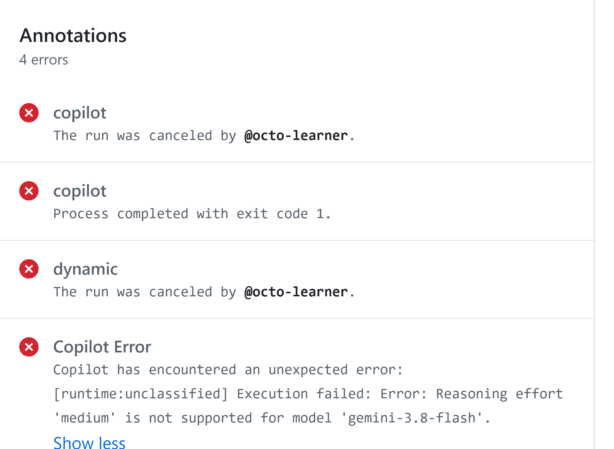

# Unit 5: Recover from Failure

A run can end without meeting the task requirements, or stop because the agent lacks permission. With this unit, you can read a failed run, find the real cause, and fix it once, instead of retrying and paying for each attempt.

An agent can finish its run without meeting the requirement. It can also stop for a valid reason, such as a denied permission. Before you retry, find what failed and decide how you'll check that a fix worked.

## Identify the failure before choosing the fix

Start with the requirement, the changed files, and the session or workflow log. Compare the expected result with the actual result. Find the first specific error or wrong result, because the agent's final summary may not explain the cause.

The following failure types help your team investigate. They aren't GitHub error codes.

| **Failure** | **What to look for** | **Corrective action** |
| --- | --- | --- |
| Context | A missing file, an outdated requirement, or the wrong source, such as the earlier draft instead of the figures file. | Point to the right source and say which version applies. |
| Permission | A denied action, an unavailable repository, or a blocked network request. | Check that the task needs the action and that the agreement permits it. The access owner grants access that's really needed in the repository's settings. |
| Tool or environment | A failed command, a missing component, or an unsupported setting. | The setup fix needs administrator or technical reviewer access. Then repeat the check. |
| Instruction | The agent missed an agreed limit, or two instructions conflict. | Name the conflict, restate the limit, and request a specific correction. |
| Model or output | A wrong figure, a statement the source doesn't support, or a claim of success without evidence. | Check the output against the source and request a specific revision. |
| Business requirement | The result matches the figures but doesn't serve the intended reader, such as a summary leadership can't use. | Clarify the acceptance criteria with the task owner. |

Fix the cause and keep the controls that showed the problem. Granting every permission to get past a denial, or loosening a check so the result passes, hides the problem instead of fixing it.

## Find the error in the run

Copilot work runs on GitHub Actions, and the run records errors as **annotations**. To find them:

1. In the repository, select the **Actions** tab.

2. In the left sidebar, select **Copilot**, and then open the run.

3. On the run's **Summary** page, read the **Annotations** list. Select **Show more** to read a long error in full.

Here's a real example. The run stopped with this error: "Reasoning effort 'medium' is not supported for model 'gemini-3.8-flash'." This is a tool or environment failure. Reasoning effort is how much the model analyzes before it answers, and the selected model doesn't support that setting.

Retrying with the same settings would fail again, so the fix is a restart with a supported model or setting, using the session operator's access.

**The Annotations list on a run's Summary page. The last error names the real cause.**

A **firewall** restricts network connections. Copilot's firewall can block a request, and the warning shows the address it tried to reach. Give that evidence to the right owner.

If the task really needs that address, the fix is allowing only that address in the agent's internet access settings, which needs the administrator role. Keep the firewall on. For session logs, access checks, and firewall warnings, **troubleshoot Copilot**.

## Work through a failed requirement

1. **Check the result against the source.** For example, an agent corrects a report's revenue to $16.8 million. Its pull request description **says** "All figures now match the source." But the report still says North had the highest operating margin, at 16.8%, and East's margin is higher, at 17.3%.

2. **Identify what the check missed.** The agent checked each number it changed, but not the statements that compare regions.

3. **Request a targeted correction.** For example: "East has the highest operating margin, 17.3% (900 of 5,210). Correct the North sentence and add East as the highest. Check every comparison against the figures."

4. **Read the whole summary again.** Include the lines the agent didn't touch, because a fix in one place can leave another statement wrong.

5. **Resolve unclear requirements before accepting the result.** The rules **don't** say how to round South's revenue of 3,950 thousand, which reads as $4.0 million. The report owner decides.

## Decide whether to retry or escalate

Retry when you understand the cause, the fix stays within the approved scope, and you can check it. To **escalate** means to hand the decision to an authorized owner. Escalate when requirements conflict, when access needs an owner's decision, or when repeated attempts show nothing new.

Post the escalation as a comment on the issue or the pull request and **mention the owner**. Include the requirement, the failure, the evidence, and the decision you need. A practical trigger: when the same check fails twice with the same error, stop the attempts and escalate with that short report.

To mention someone, type @ followed by their GitHub username. For example, replace @report-owner in this message with the actual owner's username:

@report-owner The summary must use the team's agreed rounding rule, but the issue doesn't specify one. The source lists South's revenue as 3,950 thousand; the summary shows $4.0 million. Should we keep that rounding or show two decimal places? Please confirm before we accept the result.

For the mention to notify the owner, they need read access to the repository and, for an organization-owned repository, membership in that organization.
