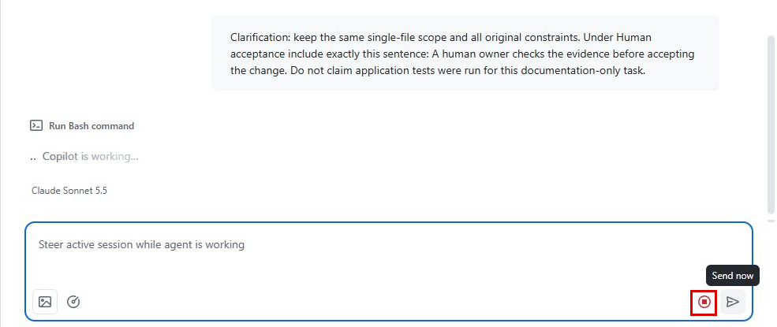

# Unit 6: Stop and Contain

If the agent changes the approved figures or works outside the agreed files, stop it before it can continue. With this unit, you can stop an agent in one step and know what's left to clean up. If something goes wrong, you can stop it before it reaches leadership, a client, or another system.

Stop when continuing could increase harm or slow down recovery. Examples include changes to the approved figures, changes outside the agreed files, requests for access the task doesn't need, another client's data in the output, or repeated runs without useful progress.

Stopping prevents further work in that session, but it doesn't undo changes already made or necessarily stop separate processes. **Containment** means preserving evidence, reviewing existing changes, and checking other activity the agent may have started.

## Stop a Copilot session on GitHub

Stopping requires repository write access and a session you started. If you can't stop it yourself, follow the steps under “If you can't stop the session.”

1. Go to **github.com/copilot/agents** and select the active task.

2. **Check the session log to confirm that it's the right task. Copy the session URL and any pull request link. You'll need them for the evidence record and the recovery decision.**

3. Below the session log, select **Stop session**, the square stop icon beside the send arrow.

**The Stop session icon appears next to the send arrow while the agent works.**

1. Confirm that the session shows **Copilot's work was cancelled**. Select **View run** and check that the Actions run and its job show **Cancelled**.

2. **Check the changes that remain before deciding what to do next.**

Stopping a session ends its Actions run and keeps the commits it already pushed. Those commits still need review, because stopping doesn't undo them.

## If you can't stop the session

If you can't stop the session, the person who started it stops it. Use the contact method listed in the task's issue.

1. **Record what happened.** Save the session link, what went wrong, and when you saw it. Include any pull request and run links. Keep sensitive details in the team's approved private location, and share only a link with people allowed to see them.

2. **Request to stop.** Contact the person who started it and the task owner. Explain what went wrong and ask them to check any other work the agent started. If nobody responds, contact the backup person or the team's emergency contact. **Don't** wait for a routine **review** if data could be exposed or harm could occur.

3. **Don't approve the affected work.** Don't accept the result or approve further actions while the problem is unresolved. Don't grant the agent more access.

4. **Confirm what stopped.** Ask the person who stopped the session to confirm whether its Actions run also stopped, what files changed, and whether anything else is still running. Contact the security team if data may have been exposed, and the owner of any other affected system. Until someone confirms the stop, keep following up and record that it hasn't been confirmed.

Record who is handling the problem, what stopped, and what still needs attention. The task owner decides when work can resume.

## Check what else is still running

Another Actions workflow or an outside process needs separate attention. Cancelling an Actions run also requires repository write access:

1. In the repository, select the **Actions** tab.

2. **In the left sidebar, select the workflow, and then open the queued or running run.**

3. In the upper-right corner, select **Cancel workflow**.

4. **Check the resulting run and job states.**

Cancellation isn't always immediate. A workflow can set some jobs to keep running even after a cancel. If the run keeps going, involve the workflow owner.

## Keep evidence and agree on recovery

Keep the relevant session, pull request, commit, and run links, together with the error you saw and the time. Record what stopped, what's still active, and what may already have reached another person or system, such as a summary someone already forwarded.

Keep sensitive evidence in the team's approved restricted location, and keep passwords and keys out of issues and prompts.

Before resuming, contact the relevant repository, application, or security owner to review the effects and authorize corrective work. Anything already shared outside the team needs its own recovery decision. Resume only when you know the cause, the permitted scope, what activity remains, and the checks that will confirm the fix.
