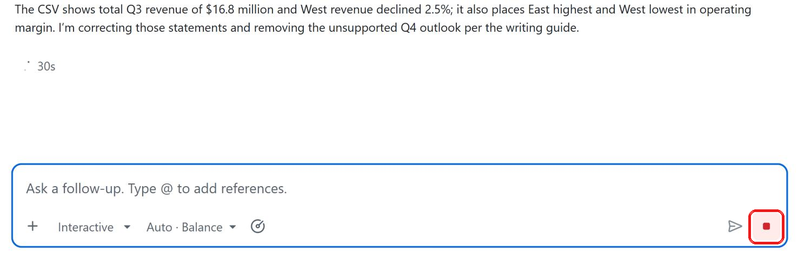

# Unit 6: Stop and Contain

If the agent changes the approved figures or works outside the agreed files, stop it before it can continue. With this unit, you can stop an agent in one step and know what's left to clean up. If something goes wrong, you can stop it before it reaches leadership, a client, or another system.

Stop when continuing could increase harm or slow down recovery.

Examples include:

- Changes to the approved figures
- Changes outside the agreed files
- Requests for access the task doesn't need
- Another client's data in the output
- Repeated runs without useful progress

Stopping prevents further work in the current turn, but it doesn't undo changes already made or necessarily stop separate processes. **Containment** means preserving evidence, reviewing existing changes, and checking other activity the agent may have started.

## Stop a Copilot session on GitHub

Stopping requires repository write access and a session you started. Before you act, confirm that you have the right account, repository, and task.

1. Go to your Copilot home page at `github.com/copilot`. Under **Pick up where you left off**, select the active task. If it isn't listed, select **View all**.

2. **Check the session log to confirm that it's the right task. Copy the session URL and any pull request link. You'll need them for the evidence record and the recovery decision.**

3. In a cloud session, select **Stop generating**, the square stop icon in the prompt box.

    

4. Confirm that the status changes from **Working** to **Idle**. Select the session title to see **Session status** and **Environment**.

5. Select **Changes** to inspect the work that remains. In a cloud session, edits stay in the session's sandbox until someone selects **Create pull request**. When the sandbox shuts down, it saves a snapshot so you can resume the session.

Also check the repository's pull requests and branches for changes that already left the sandbox. Stopping doesn't undo commits the agent already pushed.

Stopping ends the current turn, not the session. The session stays in your **Sessions** list as **Idle**, and it can accept a follow-up message. Record in the task's issue that nobody resumes it before the task owner makes the recovery decision.

For an Actions session, use **View run** to inspect its run status. The status labels described earlier apply to cloud sessions, so an Actions session might show different labels.

## If you can't stop the session

If you see a risk but can't stop the session because you lack access, didn't start the session, or can't find the stop control, escalate the risk so that the person who started the session stops it. Use the contact method listed in the task's issue.

1. **Record what happened.** Save the session link, what went wrong, and when you saw it. Include any pull request and run links. Keep sensitive details in the team's approved private location, and share only a link with people allowed to see them.

2. **Request a stop.** Contact the person who started the session and the task owner. Explain what went wrong and ask them to check any other work the agent started. If nobody responds, contact the backup person or the team's emergency contact. **Don't** wait for a routine **review** if data could be exposed or harm could occur.

3. **Don't approve the affected work.** Don't accept the result or approve further actions while the problem is unresolved. Don't grant the agent more access.

4. **Confirm what stopped.** The person who stopped the session confirms whether its Actions run also stopped, what files changed, and whether anything else is still running. Contact the security team if data may have been exposed. Also contact the owner of any other affected system. Until someone confirms the stop, keep following up and record that it hasn't been confirmed.

Record who is handling the problem, what stopped, and what still needs attention. The task owner decides when work can resume.

## Check what else is still running

Another GitHub Actions workflow or an external process needs separate attention. Canceling an Actions run also requires repository write access:

1. In the repository, select the **Actions** tab.

2. In the list of workflows, select the one you need, for example **Copilot cloud agent**, and then open the queued or running run.

3. On the run's page, select **Cancel workflow**.

4. **Check the resulting run and job states.**

Cancellation isn't always immediate. A workflow can set some jobs to keep running even after someone cancels the run. If the run keeps going, involve the workflow owner.

## Stop an automation from starting more sessions

To disable the automation that started a session, open the repository's **Agents** tab, and then in the sidebar, select **Automations**. Anyone with write access can disable a shared automation. Only its creator can see or disable a personal automation.

Disabling future triggers doesn't replace stopping an active session. Check for other automations it triggered, and contact the creator if a personal automation isn't visible to you.

## Keep evidence and agree on recovery

Record what stopped, what's still active, and what may already have reached another person or system, such as a summary someone forwarded.

Keep sensitive evidence in the team's approved restricted location, and keep passwords and keys out of issues and prompts.

Before resuming, contact the relevant repository, application, or security owner to review the effects and authorize corrective work. Anything already shared outside the team needs its own recovery decision. Resume only when you know the cause, the permitted scope, what activity remains, and the checks that will confirm the fix.
