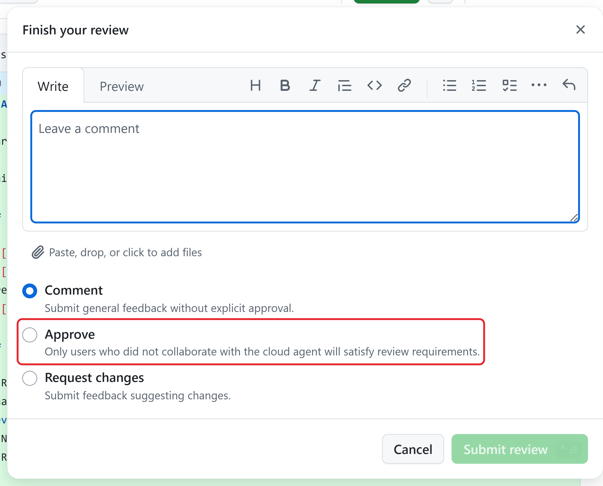
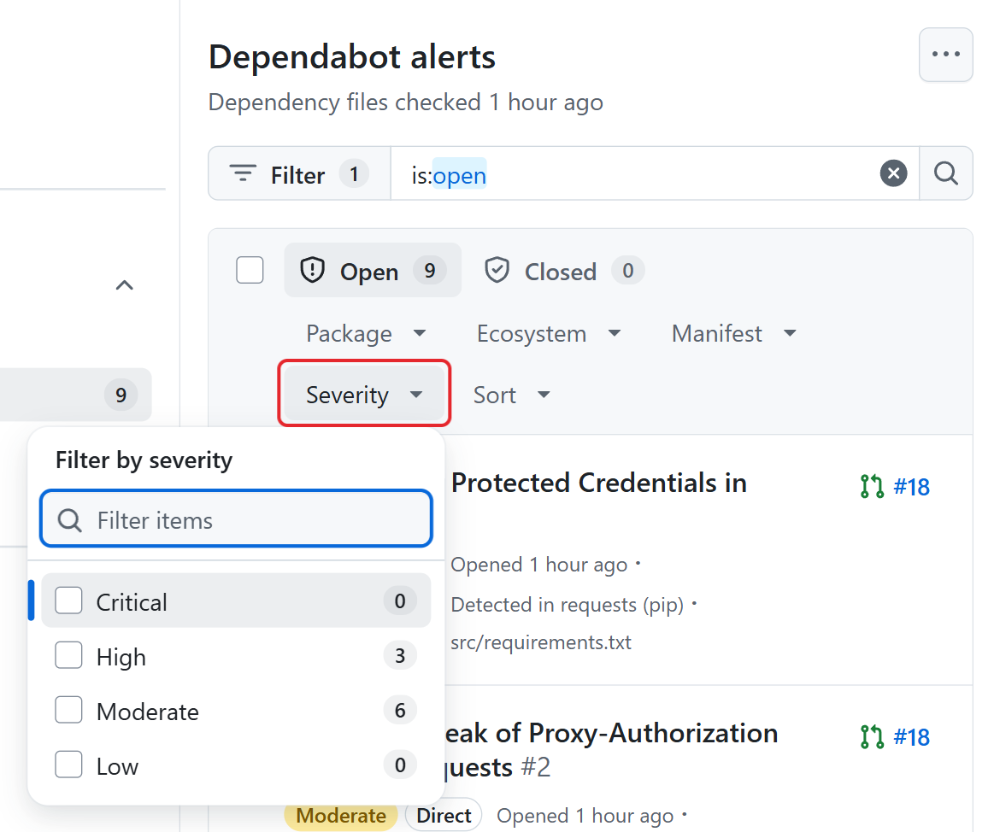

# Unit 7: Validate Output

An agent may say every figure in a report matches even when a claim conflicts with the approved source. With this unit, you can tell a result that's right from one that only sounds right, so nothing leaves your hands until each figure and claim matches its source.

A completed session tells you that the run ended. Before you accept the result, a person must check: does it meet the requirements, keep the agreed limits, and have enough supporting evidence?

## Connect each requirement to evidence

Use a small acceptance record, and paste it into the pull request description or a comment. It shows the next reviewer what you checked, so acceptance doesn't rest on memory or on the agent's summary. For example, a report review record might look like this:

| **Requirement or limit** | **Evidence to check** | **Acceptance decision** |
| --- | --- | --- |
| Every figure matches the figures file. | Each figure in the summary next to its row in data/13-figures.csv. | Accept only when every figure matches. |
| Growth and margin statements are right in direction and size. | Each comparison checked against the figures, such as which region has the highest margin. | Request a revision for any wrong direction or comparison. |
| The summary makes no claim the figures don't support. | Each sentence without a source, such as an outlook for the next period. | Get the report owner's decision, or remove the claim. |
| Only report/summary.md changed. | The complete list of changed files. | Reject changes to data/ or other files, or get a new scope decision. |
| The summary works for leadership. | The report owner's read of the final version. | Record the owner's acceptance or the open question. |

"All figures match" in the agent's description doesn't tell you whether the agent checked every figure, against which version, or whether the statements around the figures are right.

Also check that the summary is clear, follows the team's format, and is clear enough for the next person to update. Use more thorough checks when a mistake could cause more harm, such as anything that goes to a client.

## Tell supported output from plausible output

An agent's output can look right without being right. **Plausible** output reads well and sounds confident. **Supported** output has evidence behind each claim: a changed file you checked, a source row, or a check result for the version you reviewed.

For example, "Revenue reached $16.9 million, up 4.2% from the prior period" reads well, and the growth rate might be right. But if the approved Total row is 16,760 thousand, revenue should read $16.8 million. Plausible wording doesn't establish accuracy.

Check the version too. A review against the earlier draft or an older copy of the figures can pass every check and still be wrong, so note which commit you reviewed in your acceptance comment.

Before a summary reaches a client, match each figure to its source row and each claim to its source document, and mark anything you can't trace as unverified.

People often skip this check: in a 2025 global study, 66% of employees who use AI at work said they rely on its output without evaluating its accuracy.

## Review a pull request

Use a browser signed in to GitHub.com with access to the repository and permission to review its pull requests. Have the requirement, the permitted scope, and the source ready. A reviewer whose approval counts must be eligible under the repository's rules.

1. In the repository, open **Pull requests** and select the proposed change.

**Open the proposed change, then select Files changed.**

2. Read the linked issue and pull request description. In **Files changed**, confirm every file is in scope. Lines starting with + are additions; lines starting with - are removals. After a revision, check that the description still matches the changes.

3. Open **Checks** and note failed, skipped, or missing checks. An empty tab **doesn't** show that checks passed. **Treat changes to data/ as out of scope.** For code, the technical reviewer confirms that the checks cover the required behavior. For dependency files, the technical reviewer checks whether dependencies were added, updated, or removed.

4. In **Files changed**, select **Review changes**.

**Select Review changes to open the review form.**

5. Summarize what you checked and any open questions.

6. **Choose the type of review:**  
  
Select **Submit review** to publish your review.

- **Comment** leaves general feedback without approving or requesting changes.

- **Request changes** flags a problem that must be fixed before the pull request can be merged.

- **Approve** approves the proposed changes for merging.

**The review dialog. The note under Approve explains who can satisfy review requirements for a Copilot change.**

Whether Request changes blocks merging depends on the repository's rules and the reviewer's permissions. For the full steps, **submit your review**.

Use an eligible, independent reviewer for a Copilot change. If you asked for the change, your approval doesn't count toward required approvals.

A **code owner** is a person or team that a repository names to review specified files.

If the pull request shows **Approve and run workflows**, check the proposed changes, especially changes to the repository's automation files, before you allow them to run. The button appears when the repository requires human approval for workflow runs. This approval only lets the workflows run.

## Use automated review as supporting evidence

Copilot code review can suggest issues and fixes, but it can miss problems or be wrong. If **GitHub Code Quality** is licensed and turned on for the repository, it can also post comments about code quality problems it finds.

Treat both as supporting evidence: validate their suggestions and keep a human review. By default, Copilot's reviews don't count toward required approvals, and the acceptance decision belongs to a person.

One GitHub setting needs to stay this way, and it need the administrator role:

- **Allow Copilot to approve pull requests** stays off, so only people can approve.

Accept the work only when the evidence supports the requirements and the agreed limits. Record any remaining limitations and who accepted them in a comment on the pull request.

## Optional: Check security alerts for code or dependency tasks

*This section applies only when a task changes code or dependency files. If your task only updates a document, such as the quarterly summary, skip it.*

You don't need to judge security findings yourself. Our job is to notice when a change needs technical review and to route it to a **technical reviewer** before you accept the work. A technical reviewer, such as a developer, the repository administrator, or a code owner, reviews the change when:

- The changed files include code, scripts, or automation files, not just documents.

- A dependency file changed, so a library was added, updated, or removed.

- The change touches passwords, keys, permissions, or network access.

- The pull request shows a failed check, a security warning, or a comment from Copilot code review or a scanning tool that you can't interpret.

- The agent says it fixed a security problem.

The technical reviewer posts their findings as a comment on the pull request. Accept the work only after they confirm it's safe to continue, and record their name with your acceptance decision.

The following walkthrough is for technical reviewers, or for supervisors who want to see where the alerts are. Security alerts report problems in the code and dependencies the tools scan, including problems found after a merge. They don't catch every security issue.

Sign in to GitHub.com with permission to view security alerts. Code scanning alerts need write access; Dependabot alerts need write access or permission granted specifically to view them. If you don't see the option, the repository administrator checks your permissions and whether the alerts are enabled. Read access alone may not be enough.

1. In the repository, select **Security and quality**. The **Overview** lists each feature and whether it's enabled.

2. Under **Findings**, select **Dependabot**, then select **Vulnerabilities** to see alerts about dependencies. Select **Code scanning** to see alerts about the code itself.

3. Select **Severity**, and then select **Critical** or **High** to see the most urgent alerts first.

1. **Select an alert. It shows what's wrong, where, and how severe it is. For a dependency, it also shows the version that fixes the problem, when one exists.**

An empty list means no alerts match the current filters. It doesn't prove the files are safe. Check which branch and filters you're viewing. Alerts can also appear fast: adding one outdated library version to a dependency file can produce several alerts within minutes.

A fix for an alert arrives as a pull request, from Dependabot or from Copilot, and it gets the same review as any other change.
