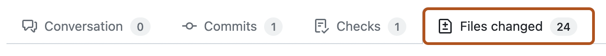
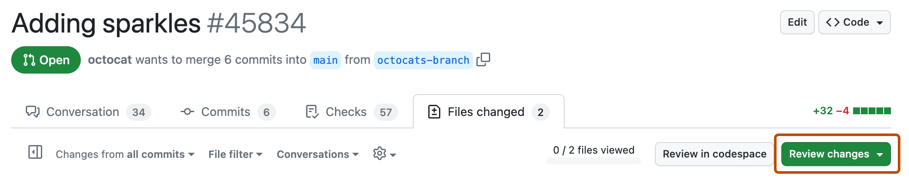
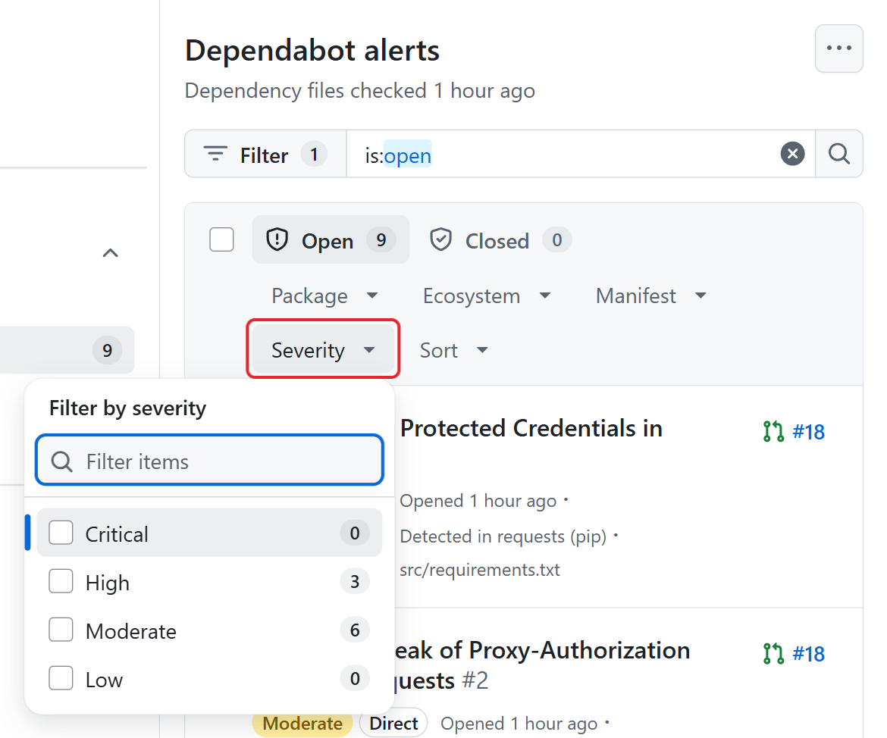

# Unit 7: Validate Output

In this unit, you'll learn how to validate the output of an agent by connecting each requirement to evidence, distinguishing supported output from plausible output, and reviewing pull requests effectively.

A completed session tells you that the run ended. Before you accept the result, a person must check whether it meets the requirements, stays within the agreed limits, and has enough supporting evidence.

## Connect each requirement to evidence

Write a short acceptance record, and paste it into the pull request description or a comment. It shows the next reviewer what you checked and the decision you made, so acceptance doesn't rely on memory or the agent's summary. For the example report, it might look like this:

| **Requirement or limit** | **Evidence to check** | **Acceptance decision** |
| --- | --- | --- |
| Every figure matches the figures file. | Each figure in the summary next to its row in data/q3-figures.csv. | Accept only when every figure matches. |
| Growth and margin statements are correct in direction and magnitude. | Each comparison checked against the figures, such as which region has the highest margin. | Request a revision for any wrong direction or comparison. |
| The summary makes no claim the figures don't support. | Each sentence without a source, such as an outlook for the next period. | Get the report owner's decision, or remove the claim. |
| Only report/summary.md changed. | The complete list of changed files. | Reject changes to data/ or other files, or get a new scope decision. |
| The summary works for leadership. | The report owner's read of the final version. | Record the owner's acceptance or the open question. |

"All figures match" in the agent's description doesn't tell you whether the agent checked every figure, against which version, or whether the statements around the figures are right.

Also check that the summary follows the team's format and is clear enough for the next person to update. Use more thorough checks when a mistake could cause more harm, such as anything that goes to a client.

## Tell supported output from plausible output

An agent's output can look right without being right. **Plausible** output reads well and sounds confident. **Supported** output has evidence behind each claim: a changed file you checked, a source row, or a check result for the version you reviewed.

For example, "Revenue reached $16.9 million, up 4.2% from the prior period" reads well, and the growth rate might be right. But if the approved Total row is 16,760 thousand, revenue should read $16.8 million. Plausible wording doesn't establish accuracy.

Check the version too. A review against the earlier draft or an older copy of the figures can pass every check and still be wrong, so note which commit you reviewed in your acceptance comment.

## Review a pull request

Use a browser signed in to GitHub.com with access to the repository and permission to review its pull requests. Have the requirement, the permitted scope, and the source ready.

1. In the repository, open **Pull requests** and select the proposed change.

    

    **Open the proposed change, then select Files changed.**

2. Read the linked issue and pull request description. In **Files changed**, confirm every file is in scope. Lines starting with + are additions; lines starting with - are removals. After a revision, check that the description still matches the changes.

3. Select the **Checks** tab and note failed, skipped, or missing checks. An empty tab **doesn't** show that checks passed. **Treat changes to data/ as out of scope.** For code or dependency files, see the optional section at the end of this unit.

4. In **Files changed**, select **Review changes**. In the comment field, summarize what you checked and any open questions.

    

5. Choose **Comment** for a question or nonblocking feedback, **Request changes** for a problem the agent must fix, or **Approve** if the changes are acceptable. Select **Submit review** to publish your choice.

    

    The review dialog. The note under Approve explains who can satisfy review requirements for a Copilot change.

Whether **Request changes** blocks merging depends on the repository's rules and the reviewer's permissions.

Use an eligible, independent reviewer for a Copilot change. If you asked for the change, your approval doesn't count toward required approvals.

A **code owner** is a person or team that a repository names to review specified files.

If the pull request shows **Approve and run workflows**, check the proposed changes, especially changes to the repository's automation files, before you allow them to run. The button appears when the repository requires human approval for workflow runs. This approval only lets the workflows run.

## Use automated review as supporting evidence

Copilot code review can suggest issues and fixes, but it can miss problems or be wrong. If **GitHub Code Quality** is licensed and enabled for the repository, it can also post comments about code quality problems it finds.

Treat both as supporting evidence: validate their suggestions and keep a human review. By default, Copilot's reviews don't count toward required approvals, and the acceptance decision belongs to a person.

In a comment on the pull request, record any remaining limitations and who accepted them.

## Optional: Check security alerts for code or dependency tasks

The agent's checks cover its own change. When a repository also contains code, its security alerts cover all the code and its dependencies, including issues found after a merge. Read them before you accept work that adds a dependency or involves passwords and keys.

Use a browser signed in to GitHub.com with access to the repository. Code scanning alerts need write access. The repository administrator enables these alerts.

1. In the repository, select **Security and quality**. The **Overview** lists each feature and whether it's enabled.

2. Under **Findings**, select **Dependabot**, then select **Vulnerabilities** to see alerts about dependencies. Select **Code scanning** to see alerts about the code itself.

3. Select **Severity**, and then select **Critical** or **High** to see the most urgent alerts first.

1. **Select an alert. It shows what's wrong, where, and how severe it is. For a dependency, it also shows the version that fixes the problem, when one exists.**

An empty list means no alerts match the current filters. It doesn't prove the files are safe. Check which branch and filters you're viewing. Alerts can also appear fast: adding one outdated library version to a dependency file can produce several alerts within minutes.

A fix for an alert arrives as a pull request, from Dependabot or from Copilot, and it gets the same review as any other change.
