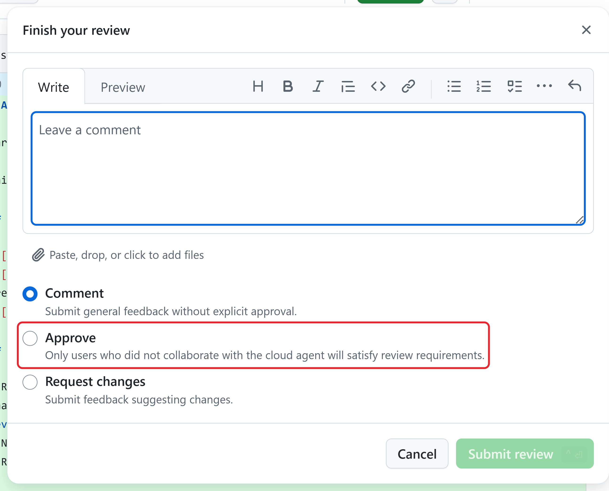

# Unit 7: Validate Output

In this unit, you'll learn how to validate the output of an agent by connecting each requirement to evidence, distinguishing supported output from plausible output, and reviewing pull requests effectively.

A completed session tells you that the run ended. Before you accept the result, a person must check whether it meets the requirements, stays within the agreed limits, and has enough supporting evidence.

## Connect each requirement to evidence

Write a short acceptance record, and paste it into the pull request description or a comment. It shows the next reviewer what you checked and the decision you made, so acceptance doesn't rely on memory or the agent's summary. For the example report, it might look like this:

| **Requirement or limit** | **Evidence to check** | **Acceptance decision** |
| --- | --- | --- |
| Every figure matches the figures file. | Each figure in the summary, compared with its matching value in `data/q3-figures.csv`. | Accept only when every figure matches. |
| Growth and margin statements are correct in direction and magnitude. | Each comparison checked against the figures, such as which region has the highest margin. | Request a revision for any wrong direction or comparison. |
| The summary makes no claim the figures don't support. | Each sentence without a source, such as an outlook for the next period. | Get the report owner's decision, or remove the claim. |
| Only report/q3-summary.md changed. | The complete list of changed files. | Reject changes to data/ or other files, or get a new scope decision. |
| The summary works for leadership. | The report owner's read of the final version. | Record the owner's acceptance or the open question. |

"All figures match" in the agent's description doesn't tell you whether the agent checked every figure, against which version, or whether the statements around the figures are right.

Also check that the summary follows the team's format and is clear enough for the next person to update. Use more thorough checks when a mistake could cause more harm, such as anything that goes to a client.

## Tell supported output from plausible output

An agent's output can look right without being right. **Plausible** output reads well and sounds confident. **Supported** output has evidence behind each claim: a changed file you checked, a source row, or a check result for the version you reviewed.

For example, "Revenue reached $16.9 million USD, up 4.2% from the prior period" reads well, and the growth rate might be right. But if the approved Total row is 16,760 thousand, revenue should read $16.8 million USD. Plausible wording doesn't establish accuracy.

Check the version too. A review against the earlier draft or an older copy of the figures can pass every check and still be wrong, so note which commit you reviewed in your acceptance comment.

## Review a pull request

Have the requirement, the permitted scope, and the source ready.

1. In the repository, open **Pull requests** and select the proposed change.

    

    **Open the proposed change, then select Files changed.**

2. Read the linked issue and pull request description. In **Files changed**, confirm every file is in scope. Lines starting with + are additions; lines starting with - are removals. After a revision, check that the description still matches the changes.

3. Select the **Checks** tab and note failed, skipped, or missing checks. An empty tab **doesn't** show that checks passed, so confirm that each required check is listed and passed. **Treat changes to data/ as out of scope.**

4. In **Files changed**, select **Review changes**. In the comment field, summarize what you checked and any open questions.

    

5. Choose **Comment** for a question or nonblocking feedback, **Request changes** for a problem the agent must fix, or **Approve** if the changes are acceptable. Select **Submit review** to publish your choice.

    

    The review dialog. The note under Approve explains who can satisfy review requirements for a Copilot change.

Whether **Request changes** blocks merging depends on the repository's rules and the reviewer's permissions.

Use an eligible, independent reviewer for a Copilot change. If you asked for the change, your approval doesn't count toward required approvals.

A **code owner** is a person or team that a repository names to review specified files.

If the pull request shows **Approve and run workflows**, check the proposed changes, especially changes to the repository's automation files, before you allow them to run. The button appears when the repository requires human approval for workflow runs. This approval only lets the workflows run.

## Use automated review as supporting evidence

Copilot code review can point out problems and suggest fixes, but it can miss problems or be wrong. If **GitHub Code Quality** is licensed and enabled for the repository, it can also post comments about code quality problems it finds.

Treat both as supporting evidence: validate their suggestions and keep a human review. By default, Copilot leaves a Comment review that doesn't count toward required approvals. An administrator can enable Copilot approvals at the enterprise, organization, or repository level. When enabled, a Copilot approval counts toward required approvals. The acceptance decision belongs to the named owner.

In a comment on the pull request, record any remaining limitations and who accepted them.
