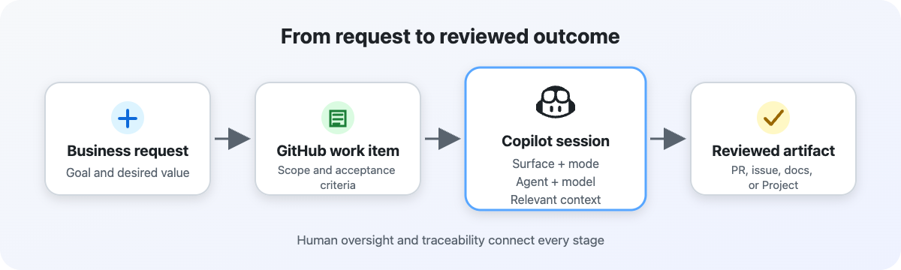
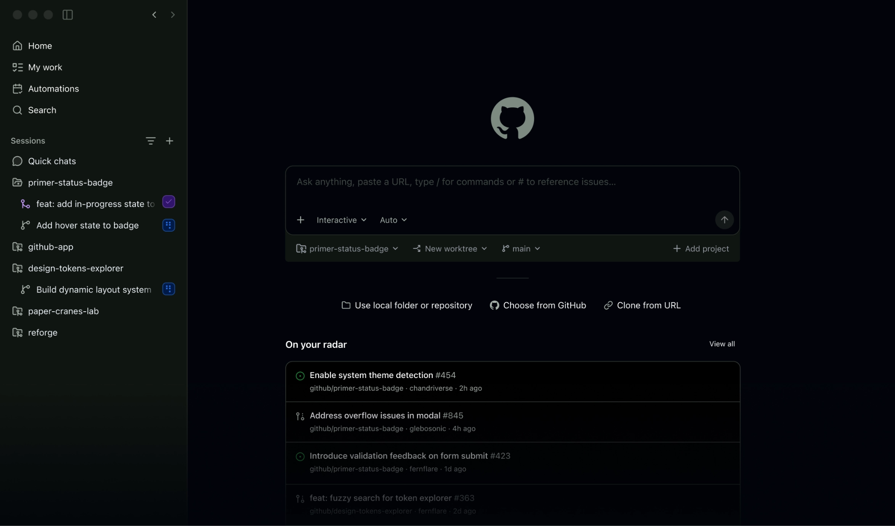
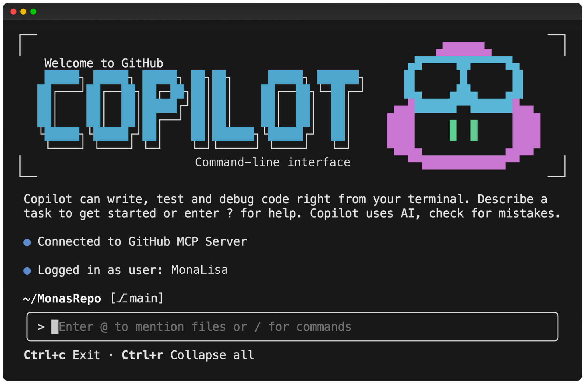

# **2. Choose the Working Surface**

GitHub Copilot can support your work from several different surfaces, including GitHub.com, the GitHub Copilot app, and Copilot CLI. Each surface provides a different way to interact with Copilot and work with your repository, files, issues, and other context.

Choosing a working surface isn't simply a matter of choosing your preferred interface. The right choice depends on the type of work you need to accomplish, where the relevant context exists, how the work needs to persist, and how much direct intervention or automation is required.

For example, a task that starts with a GitHub issue and needs to result in a pull request might be well suited to a cloud-based agent experience. A task that requires direct interaction with a local development environment might be better suited to Copilot CLI. When you need to manage and monitor agent sessions as part of a broader workflow, the GitHub Copilot app provides another option.

Understanding these differences helps you route work to the surface that best supports the outcome you need.

## **GitHub.com**

GitHub.com provides a central place to work with your repositories, issues, pull requests, Projects, and other GitHub resources. Copilot experiences available through GitHub.com can use this GitHub context to help you move work from a request toward an actionable result.

This can be particularly useful when the work is already organized in GitHub and needs to remain connected to existing issues, repositories, or project workflows.

Consider GitHub.com when:

- The work is closely connected to GitHub issues, pull requests, or Projects.

- The required context is already available in GitHub.

- You want work to remain connected to your GitHub workflow.

- The resulting changes or artifacts need to be shared with other contributors.

## **GitHub Copilot app**

The GitHub Copilot app provides a dedicated environment for working with Copilot agent sessions. It allows you to start and manage sessions for tasks that may require Copilot to work through multiple steps.

Agent sessions can provide a persistent place to give Copilot a task, provide context, monitor its progress, and review the resulting work. This makes the app useful when the work needs more than a single question or code suggestion and requires an agent to work toward a defined outcome.

Consider the Copilot app when:

- You need to start or manage an agent session.

- The task requires multiple steps or iterations.

- You want to provide context such as repositories, issues, or files.

- You need to monitor the agent's progress and review its output.

## **Copilot CLI**

Copilot CLI brings GitHub Copilot into the command-line environment. It can work alongside your existing terminal-based development workflow and is useful when the task requires direct interaction with files, commands, development tools, or the local environment.

Consider Copilot CLI when:

- You work primarily from the command line.

- The task requires interaction with a local development environment.

- You need to work with terminal commands or local files.

- You want Copilot to fit directly into an existing CLI-based workflow.

## **How to choose a working surface**

When deciding where to start a Copilot task, consider four questions:

1. **Where does the relevant context live?** If the work is centered on GitHub issues, Projects, repositories, or pull requests, a GitHub-based surface may be the natural starting point. If the work depends heavily on the local environment, a CLI-based workflow may be more appropriate.

1. **Where does the work need to persist?** Consider whether the task needs a persistent agent session, collaboration with other contributors, or durable GitHub artifacts such as issues and pull requests.

1. **What output does the task require?** A task that needs code changes, a pull request, documentation, or another GitHub artifact may benefit from a surface that keeps the work connected to GitHub.

1. **How much intervention is required?** Some tasks benefit from frequent interaction and monitoring, while others can be delegated to an agent to work through multiple steps with less intervention.

The goal isn't to memorize which surface to use for every scenario. Instead, evaluate the **context, persistence, output, and level of intervention** required by the work, then choose the surface that best supports those requirements.

## **From surface to session**

Selecting the working surface is only the first decision. Once you choose where the work should happen, you can determine how the Copilot session should operate.

For example, a complex task might begin with an agent session in the Copilot app, while a task requiring direct interaction with a local environment might begin with Copilot CLI. Within those surfaces, the level of autonomy and human control can also vary.

In the next unit, you learn how to choose the appropriate session mode based on the task's complexity, risk, and the level of control you need.

