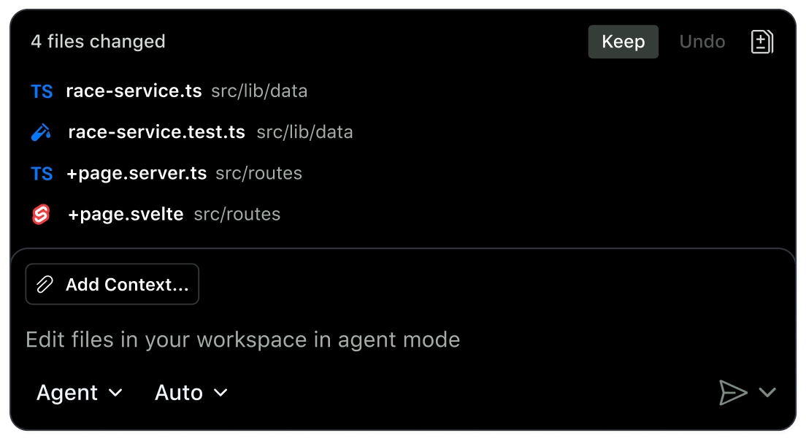

# **3. Choose the Right Session Mode**

Choosing a Copilot working surface determines where the work happens. The next decision is how Copilot should work with you.

GitHub Copilot agent sessions can support different levels of human involvement. Depending on the task and the experience you are using, you can work interactively with Copilot, ask it to develop a plan before implementation, or allow it to operate with greater autonomy.

The right level of autonomy depends on more than the size of the task. Consider how clearly the work is defined, how much risk is involved, how reversible the changes are, what permissions are required, and what would happen if the agent made an incorrect decision.

The goal isn't to give Copilot as much autonomy as possible. The goal is to give it **the appropriate level of autonomy for the work**.

## **Interactive mode**

Interactive work keeps you closely involved throughout the session. You can provide additional instructions, answer questions, review proposed actions, and guide Copilot as the task progresses.

This approach is useful when:

- The task is ambiguous or requirements may change.

- You need to make decisions during the implementation.

- The work involves unfamiliar or sensitive parts of a codebase.

- Changes could have significant consequences.

- You want frequent opportunities to review and redirect the agent.

For example, suppose you need to modify authentication in an application but the requirements are not completely defined. An interactive session allows you to clarify the desired behavior as Copilot explores the code and proposes changes.

Interactive sessions provide greater human control, which can be valuable when the cost of an incorrect decision is high.

## **Plan mode**

Planning is useful when a task is complex enough that you want to understand the proposed approach before implementation begins.

Instead of immediately asking Copilot to make changes, you can use a planning workflow to explore the task, identify relevant parts of the codebase, and develop an implementation approach.

A plan can help you:

- Break a complex request into smaller steps.

- Identify relevant files and dependencies.

- Surface assumptions or missing requirements.

- Evaluate the proposed approach before changes are made.

- Create a shared understanding of the work before implementation.

For example, imagine that you need to migrate an application from one authentication library to another. The task may involve configuration, dependencies, application code, and tests. Reviewing a plan first can help you identify the scope of the work and decide whether the proposed approach is appropriate.

Planning is especially useful when the work is complex but sufficiently defined for Copilot to develop a structured approach.

## **Autopilot**

Autopilot allows Copilot to work through a task with a higher level of autonomy. Instead of requiring you to approve every step, Copilot can continue working through the task while using the available tools and instructions.

This can be useful for well-defined, repeatable, and relatively low-risk tasks where the desired outcome is clear and the changes are reasonably easy to review or reverse.

For example, you might use a more autonomous workflow to make a series of straightforward code changes, update tests, or perform a well-defined refactoring where the acceptance criteria are clear.

Greater autonomy can save time, but it also means you need to think carefully about the task before delegating it.

## **How to choose the right level of autonomy**

Before starting a session, consider the following questions:

1. **How clear is the task?**  
If the requirements are ambiguous, keep more human involvement. If the desired outcome is clearly defined, greater autonomy may be appropriate.

1. **How complex is the work?**  
Complex tasks may benefit from planning before implementation. Straightforward tasks may not require the same level of preparation.

1. **What is the risk of failure?**  
The higher the potential impact of an incorrect change, the more important human oversight becomes.

1. **How reversible are the changes?**  
Changes that are easy to review, test, or revert generally provide more room for autonomy. Irreversible or difficult-to-recover actions require greater caution.

1. **What permissions does the task require?**  
Consider what resources Copilot can access and what actions it can take. Greater autonomy should not mean granting unnecessary access.

1. **What is the cost of an incorrect decision?**  
A minor formatting error has a very different impact from an incorrect production configuration or a security-sensitive change.

A useful way to think about these choices is:

| **Task characteristics** | **Appropriate approach** |
| --- | --- |
| Ambiguous, sensitive, or high-risk | **Interactive** |
| Complex and requires a clear implementation approach | **Plan** |
| Well-defined, repeatable, and lower-risk | **Autopilot** |

These are guidelines rather than rigid rules. A single task can move between modes as your understanding changes. You might begin by planning a complex task, switch to interactive work when an important decision arises, and use a more autonomous workflow for well-defined implementation steps.

## **Autonomy requires oversight**

Higher autonomy does not remove the need for human responsibility. Copilot can make incorrect assumptions, misunderstand requirements, introduce bugs, or make changes that do not fully satisfy the intended outcome.

Before delegating work, make sure the task has clear requirements and appropriate boundaries. After the agent completes its work, review the results against the original acceptance criteria and verify that the changes behave as expected.

The purpose of choosing a session mode is therefore not simply to make Copilot work faster. It is to find the right balance between **automation and human control** for the task at hand.

## **Next unit: Choose the right agent and model**
