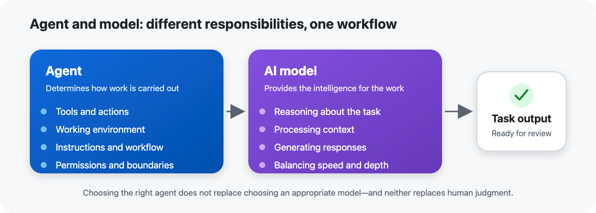

# **4. Choose the Agent and Model**

Once you have selected a working surface and determined the appropriate level of autonomy, there is another important decision: which agent and model should perform the work?

GitHub Copilot can use different agents and AI models, each with different capabilities and characteristics. Understanding the difference between an **agent** and a **model** helps you make better choices without relying on memorizing a particular list of model names.

An agent determines how Copilot approaches a task. It can define the tools available to Copilot, the environment in which it operates, the instructions it follows, and the actions it can take. A model provides the underlying AI capabilities used to reason about the task, interpret context, and generate responses.

Think of the distinction this way: the **agent determines how the work is carried out**, while the **model provides the intelligence used to carry out that work**.

## **Agents and models**

An agent is designed around a particular way of completing work. Depending on the agent, Copilot might have access to different tools, instructions, environments, and permissions.

For example, an agent working on a software development task might be able to inspect a repository, modify files, run commands, and work through a set of implementation steps. A specialized or custom agent can be configured to focus on a particular type of task or workflow.

The model is the AI system that processes the information provided to it and generates the reasoning and responses used during the task.

This distinction matters because choosing a more capable model does not automatically give an agent additional tools or permissions. Likewise, choosing an agent with the right tools does not necessarily mean that every model will be equally effective for every task.

## **What to consider when choosing an agent**

When selecting an agent, consider what the task requires the agent to be able to do.

Ask:

- **What tools does the task require?**

- **What environment does the work need to run in?**

- **What files, repositories, or other resources must the agent access?**

- **What instructions should guide its behavior?**

- **What permissions does it need?**

- **What type of output should it produce?**

For example, an agent working on a code change may need access to the repository and development tools. A task involving a specific organizational workflow may benefit from a custom agent configured with specialized instructions and capabilities.

The principle is simple: **choose an agent based on the work it needs to perform, not simply on the name of the agent.**

## **What to consider when choosing a model**

Models can differ in areas such as reasoning capability, response speed, context handling, quality, and cost or usage considerations.

When choosing a model, consider:

- **Task complexity:** Does the task require straightforward generation or deeper reasoning?

- **Quality requirements:** How important is accuracy and depth?

- **Speed:** Does the task benefit from a faster response?

- **Context:** How much information does the model need to process?

- **Usage considerations:** Does the choice have implications for availability, limits, or cost?

A simple task such as generating a small piece of boilerplate code may not require the same model capabilities as a complex architectural change that involves multiple components and difficult reasoning.

The objective is not to select the most powerful model for every task. Instead, match the model's capabilities to the complexity and requirements of the work.

## **Automatic versus explicit model selection**

Depending on the Copilot experience, you may be able to allow Copilot to select a model automatically or select one explicitly.

Automatic selection can be useful when you want Copilot to choose an appropriate model without managing model selection for every task. Explicit selection can be useful when you have a specific reason to prefer a particular model based on the requirements of the task.

For example, if you are working on a straightforward task and do not have a strong reason to control the model selection, automatic selection can reduce unnecessary decision-making. For a task with specific reasoning or performance requirements, explicitly selecting an appropriate model may provide more control.

Model availability can change over time. For this reason, focus on **how to evaluate a model** rather than memorizing model names.

## **Match the agent and model to the task**

Choosing an agent and model works best when you consider them together.

Suppose you need to implement a small documentation change. The task may require relatively simple reasoning and limited tools.

Now consider a task that requires Copilot to understand an unfamiliar codebase, modify multiple components, run tests, diagnose failures, and implement a complex feature. This task requires a different level of capability and may benefit from an agent with the appropriate development tools and a model suited to deeper reasoning.

The decision can be summarized as:

| **Question** | **Decision** |
| --- | --- |
| What does Copilot need to do? | **Choose the agent** |
| What tools and permissions are required? | **Choose the agent** |
| How complex is the reasoning? | **Choose the model** |
| How much speed or depth is required? | **Choose the model** |
| Does the task need specialized instructions or behavior? | **Consider a custom agent** |

## **Avoid choosing by name alone**

AI models and Copilot capabilities evolve quickly. A model that is appropriate for a particular task today may be replaced, renamed, or joined by a better option in the future.

Instead of memorizing model names, develop a repeatable selection process:

1. Understand the task and its requirements.

1. Determine what capabilities, tools, environment, and permissions the agent needs.

1. Assess the complexity and reasoning requirements.

1. Select a model that provides an appropriate balance of quality, speed, context, and usage considerations.

1. Review the results and adjust your choice when the task requires it.

This approach allows you to adapt as new agents and models become available without changing the underlying decision process.

## **Agents, models, and human judgment**

Selecting an agent and model does not replace human judgment. The combination you choose affects how Copilot approaches the work, but you remain responsible for determining whether the approach is appropriate and whether the resulting work meets the requirements.

The strongest Copilot workflows therefore combine three decisions: **where the work happens, how much autonomy Copilot has, and which agent and model are best suited to the task.**

In the next unit, you learn how to provide and manage the context Copilot needs so that the selected agent and model can work effectively.

