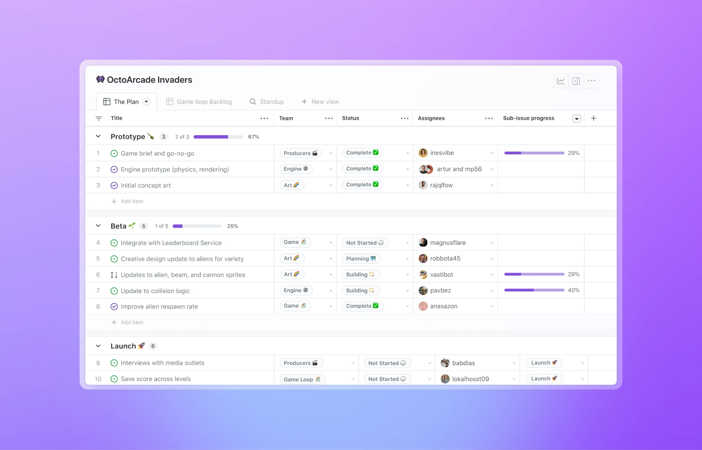

# **6. Close the Loop in GitHub**

Using GitHub Copilot to complete a task is only part of the workflow. Once Copilot produces a plan, code change, document, or recommendation, the result needs to become part of the team's work.

GitHub provides several ways to turn Copilot output into durable artifacts, including issues, pull requests, documentation, and Projects. These artifacts make the work visible to other people, create a record of what changed, and provide opportunities for review.

The goal is to move from **AI-generated output to validated, traceable work**.

## **Turn Copilot output into a GitHub artifact**

The right artifact depends on the outcome you're trying to achieve.

For example:

- A new requirement or follow-up task can become a **GitHub issue**.

- A code change can become a **pull request**.

- A project decision or technical explanation can become **documentation**.

- A change in project status can be reflected in a **GitHub Project**.

- An unresolved question can become a new issue for further investigation.

This creates a durable record instead of leaving the result inside a Copilot session.

A useful question to ask after a session is:

**What should exist in GitHub after this work is complete?**

## **Connect the result to the original request**

Traceability helps teams understand why a change was made and how it relates to the original requirement.

A well-orchestrated workflow might look like this:

**Business request → Issue → Copilot session → Changes → Pull request → Review → Merged result**

Each stage adds information that helps people understand the work.

The issue describes the problem and expected outcome. The Copilot session helps develop the solution. The pull request captures the implementation and provides a place for review. The final result becomes part of the repository and project history.

This connection is especially useful when multiple people or agents contribute to the same work.

## **Validate against acceptance criteria**

Copilot can help implement a solution, but the output still needs to be evaluated against the original requirements.

Return to the acceptance criteria and ask:

- Does the implementation solve the original problem?

- Does it satisfy each required behavior?

- Were unrelated parts of the system changed?

- Were tests added or updated where appropriate?

- Are there assumptions that need to be confirmed?

- Is anything still unresolved?

Acceptance criteria provide an objective way to evaluate the result instead of relying only on whether the generated code looks reasonable.

## **Use pull requests for human review**

When Copilot produces code changes, a pull request provides a natural point for human review.

Reviewers can examine the proposed changes, understand their purpose, run or inspect tests, and provide feedback before the changes are merged.

The fact that Copilot generated a change does not remove the need for review. Human reviewers remain responsible for determining whether the change is appropriate for the project.

During review, consider both the implementation and the reasoning behind it:

- Does the change match the intended outcome?

- Does it follow repository conventions?

- Could it introduce security, performance, or reliability issues?

- Does the test coverage provide enough confidence?

- Are there unintended changes?

- Does the implementation introduce technical debt?

Copilot can assist with this process, but approval should remain an intentional human decision.

## **Capture assumptions and unresolved work**

Not every Copilot session finishes every part of a task.

Copilot may identify an assumption, encounter an unsupported scenario, or leave a question that requires input from a stakeholder. Don't allow these details to disappear when the session ends.

Capture important follow-up work in GitHub.

For example:

- Create an issue for a known limitation.

- Add a comment explaining an implementation decision.

- Update documentation when behavior changes.

- Add a follow-up task to a Project.

- Record an unresolved decision for the appropriate team.

This turns incomplete work into visible work that can be tracked and resolved.

## **Keep Projects aligned with the work**

GitHub Projects can provide a broader view of work across issues and pull requests.

When work progresses through the development workflow, keeping the corresponding Project information current helps the team understand:

- What is being worked on

- What has been completed

- What requires review

- What is blocked

- What needs to happen next

This is another reason to create durable GitHub artifacts instead of keeping the outcome only inside an AI session.

## **Maintain traceability**

A strong Copilot workflow should make it possible to answer a few simple questions:

**Why was this work done?**

Look at the original issue or business request.

**What did Copilot help produce?**

Look at the session output and resulting artifacts.

**What changed?**

Review the pull request and associated commits.

**Who reviewed it?**

Check the pull request review history and approvals.

**What remains to be done?**

Check linked issues, Project status, and follow-up tasks.

This creates a chain of evidence around the work and makes the AI-assisted workflow easier to understand and manage.

## **Benefits of closing the loop**

Turning Copilot output into durable GitHub artifacts helps teams:

- Preserve the connection between requirements and implementation.

- Make AI-assisted work visible to collaborators.

- Create clear points for human review and approval.

- Track assumptions, decisions, and unresolved issues.

- Maintain project and repository history.

- Make follow-up work easier to identify.

- Improve accountability and traceability.

The objective isn't simply to get Copilot to complete a task. The objective is to integrate Copilot into a workflow where **the work can be reviewed, understood, tracked, and maintained after the session ends**.

## **From request to outcome**

You can now apply the complete orchestration workflow:

1. **Define the work** by turning the business request into a clear issue with an expected outcome and acceptance criteria.

1. **Choose the working surface** based on where the task, context, and output belong.

1. **Choose the session mode** based on complexity, risk, and the level of human control required.

1. **Choose the agent and model** based on the capabilities and reasoning required.

1. **Manage the context** by providing relevant information and controlling unnecessary or conflicting context.

1. **Close the loop** by turning the result into a durable GitHub artifact and applying human review.

#### **Worked example: Turn an operations request into an actionable issue**

Suppose you're an events coordinator working with an operations manager. Neither role requires software development. Your team already uses GitHub Issues and Projects to track event preparation and keeps approved planning documents in a private repository. The operations manager asks:

> "We have six regional workshops next month. Pull together where we stand, flag anything that could prevent them from going ahead, and get the follow-up work organized before Friday's readiness meeting."

This isn't just a request to write a report. It requires reconciling information from different sources, identifying blockers, routing follow-up work, and supporting a human decision. Before delegating any of it to Copilot, you need to define what "ready" means, which information it can use, and what it may do without approval.

**1. Clarify the request before defining the work.**

Ask the requester questions that turn the broad goal into a bounded deliverable. In this example, the manager confirms the following answers:

| Clarifying question | Confirmed answer |
| --- | --- |
| Who needs the result, and what should they be able to do? | The operations manager needs to see which workshops have unresolved requirements and decide what action to take. |
| What does readiness mean? | Each workshop needs a confirmed venue, an assigned facilitator, and approved materials. All three must be confirmed to mark it ready. |
| Which information should be used? | The approved event schedule, venue confirmation log, facilitator roster, materials approval tracker, and existing preparation issues, as of Thursday at noon. |
| How should missing or conflicting information be handled? | Mark the affected requirement as needing confirmation, cite the evidence, and ask the events coordinator to resolve it. Don't infer readiness from silence or choose between conflicting records. |
| What should this work produce? | A readiness brief covering all six workshops and proposed follow-up issues for unresolved requirements, without duplicating existing issues. |
| What decisions stay with people? | The manager approves follow-up ownership and deadlines and decides whether to proceed, postpone, or authorize spending. Copilot must not contact suppliers or make bookings. |
| Who owns the work, and when is it due? | The events coordinator prepares the brief for the operations manager's review before Friday's meeting. |

These are illustrative answers, not rules Copilot should invent. Confirm the actual cutoff, meeting date, readiness rules, and source access with the requester. Provide only approved planning information; attendee details and confidential supplier terms aren't needed.

**2. Write the issue around the outcome, not just the activity.**

Use the confirmed answers to draft a GitHub issue. Separate the business outcome from the deliverables: the outcome is that the manager can make informed readiness decisions; the brief and follow-up issues provide the evidence and actions needed for those decisions.

The following issue body is an illustrative example. Replace the source descriptions with links to the team's actual approved documents before assigning the work.

*Title: Prepare the readiness review for next month's six regional workshops*

*## Problem and expected outcome*

*Workshop preparation is tracked across several documents and issues.*

*The operations manager needs a reconciled view of outstanding requirements*

*and proposed follow-up work before Friday's readiness meeting.*

*## Deliverable and scope*

*Prepare a readiness brief for all six workshops using the Thursday-noon*

*information cutoff. For each workshop, check venue confirmation, facilitator*

*assignment, and materials approval. Propose follow-up work for unresolved*

*requirements; link existing issues rather than duplicating them.*

*## Source context*

*- Event schedule and readiness rules: [links to approved versions]*

*- Venue confirmation log: [link to approved snapshot]*

*- Facilitator roster: [link to approved snapshot]*

*- Materials approval tracker: [link to approved snapshot]*

*- Existing preparation issues: [link to the relevant issue list]*

*## Acceptance criteria*

*- [ ] The brief covers each of the six workshops exactly once.*

*- [ ] Each workshop shows all three readiness requirements with source links*

*      and the information cutoff. Only three confirmed requirements means ready.*

*- [ ] Missing or conflicting evidence is marked "Needs confirmation," with*

*      a question for the events coordinator; it is never counted as confirmed.*

*- [ ] Every unresolved requirement links to an existing follow-up issue or a*

*      proposed issue containing the action, suggested owner, and needed-by date.*

*      Unconfirmed owners and dates are explicitly marked for manager approval.*

*- [ ] The events coordinator checks all 18 requirement assessments against*

*      the sources and records corrections and unresolved questions.*

*- [ ] The operations manager approves the brief and follow-up work before*

*      proposed issues are created or existing assignments and dates are changed.*

*## Constraints and escalation*

*Do not book venues, contact suppliers, authorize spending, or decide whether*

*an event proceeds. Do not include attendee details or confidential supplier terms.*

*If an approved source is inaccessible, report the gap and pause the affected*

*assessment rather than presenting a complete-looking readiness result.*

*## Ownership and timing*

*Work owner: Events coordinator*

*Decision owner and reviewer: Operations manager*

*Due: Before Friday's readiness meeting; enter the agreed date and time.*

These criteria make "done" observable. "Prepare a useful update" leaves reviewers to guess. Six workshops, three requirements each, source-linked assessments, and explicit approval boundaries give them concrete checks. Completing the brief doesn't mean all workshops are ready: an accurate account of unresolved blockers is a valid result.

**3. Review and create the work item.**

You can ask Copilot to help structure the issue before creating it:

> "Using the confirmed answers, draft a GitHub issue for the workshop readiness review. Include the business outcome, deliverables, source context, acceptance criteria, constraints, owner, and reviewer. Flag missing information as questions. Don't invent readiness rules, assign follow-up work, or create issues yet."

Review the draft with the operations manager. Replace placeholders with actual source links, confirm the dates and ownership, and resolve questions about the scope and rules. Then create the issue in the team's private planning repository, assign the events coordinator, and add it to the team's GitHub Project. This parent issue defines the agreed work; any approved follow-up issues will link back to it.

**4. Use the issue to orchestrate the work.**

With the request defined, sequence the work so that later actions depend on reviewed results rather than assumptions:

1. Ask Copilot to inventory the approved sources and existing issues, then propose a reconciliation plan. Review the plan before analysis begins.

1. Have it compare the records by workshop and draft the requirement assessments. For example, if the venue log says "confirmed" but the event schedule says "pending," it should show both records and ask for clarification, not choose the more convenient status.

1. Resolve source questions with the responsible people. Then have Copilot update the brief and propose follow-up work only for the remaining gaps.

1. Review the brief and proposed actions before authorizing changes to GitHub work items.

The orchestration choices support these dependencies:

| Orchestration decision | Choice for this example and why |
| --- | --- |
| Working surface | Use GitHub.com for the issue and review record. Use a Copilot session that can access the approved repository documents and issues; verify access before delegating the comparison. No local development environment is needed. |
| Session mode | Start with planning, use interactive work for conflicting evidence, and delegate the bounded comparison once the rules are agreed. Don't allow autonomous changes to assignments or deadlines. |
| Agent and model | Choose an agent with the repository and issue-reading tools needed for reconciliation. Where model selection is available, favor one suited to comparing several sources and reasoning about dependencies, not just summarizing prose. Writing permissions aren't needed for the analysis stage. |
| Context | Supply the parent issue, approved source snapshots, existing preparation issues, and readiness rules. Preserve the cutoff and any human clarifications as the work progresses. |
| Human boundaries | The coordinator resolves evidence gaps and verifies assessments. The operations manager approves follow-up work and makes event decisions. Copilot analyzes and proposes; it doesn't make external commitments. |

For the analysis stage, a bounded instruction might be:

> "Use the linked readiness issue and approved source snapshots to assess all six workshops against the three agreed requirements. Cite the evidence for every assessment. Mark missing or conflicting information as needing confirmation and list the questions separately. Match unresolved requirements to existing issues before proposing new ones. Draft the brief and proposed follow-up work for review; don't create issues, change assignments or deadlines, or contact anyone."

**5. Close the loop with evidence.**

Save the brief and proposed follow-up work in the parent issue or a linked repository document, rather than leaving them only in the session. The events coordinator checks the 18 assessments against their sources and records unresolved questions. If an assessment is wrong, correct it and recheck the workshop's overall status and any dependent follow-up proposal.

The operations manager reviews the brief and approves or changes the proposed actions, owners, and dates. The coordinator then creates the approved follow-up issues, or uses an authorized Copilot workflow to do so, and links them to the parent issue. Update the Project to show which actions are approved and which remain blocked. If the team reviews repository documents through pull requests, link the document's pull request to the parent issue as well.

Close the readiness-review issue when its acceptance criteria are satisfied; keep unresolved preparation actions open in their own issues. The result is a traceable chain from a business request to an agreed work item, source-based analysis, human decisions, and owned follow-up work. The orchestration lies in managing those dependencies and approval points, not in writing code or using several agents.

Copilot is most effective when it is treated as part of the work orchestration process rather than as a standalone AI tool. The value comes from connecting the right request, context, agent, model, level of autonomy, and GitHub workflow to produce an outcome that people can review and trust.
